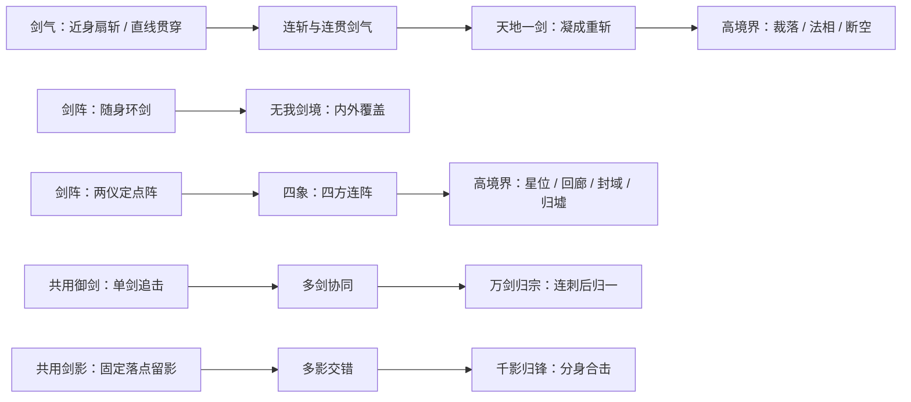

# 剑修技能全面评审：名称、招式、范围与进阶表现

2026-10-30 · 设计评审稿

**结论：保留“剑气、剑阵”双主流，并把共用御剑的身份讲清楚；优先补齐招式与判定的一致性，再制作各阶动画。** 目前最明显的问题不是特效不够亮，而是许多不同技能最终都表现为相似圆圈，升级和进化又很少改变玩家看到的动作。

本次覆盖 **35 项：17 项现行技能、9 项界面预览技能、9 项仅存在于远期文档的技能**。现状以锁妖塔运行代码为准，旧修仙生存模式另行核对，不把旧版能力算作当前已经实现。

下文“建议”全部是本次新方案，尚未写入游戏。讨论打击段数、攻击物数量、范围形状与控制方式；不调整伤害、暴击数值、冷却、消耗、学习成本或境界门槛。增加段数并不代表未来把整招伤害机械倍增。

## 一、应先修正的问题

| 优先级 | 问题与证据 | 对玩家的影响 | 建议 |
|---|---|---|---|
| 高 | 万剑诀写着4→8把环绕剑，但现行逻辑按整个圆盘判定，画面也没有对应的环绕剑。[行为审计](/Users/zhangnu/WeChatProjects/rainy-mushroom/design/xianxia-skill-review-2026-10-30/combat-audit.md) | 买到“更多剑”却看不见；不能根据剑的位置判断安全距离 | 改名环剑诀，做出真实巡游剑与环带；明确近身空隙 |
| 高 | 四象剑阵只设置`eyes=4`，判定和渲染都未使用阵眼数 | 进化后仍是同一个圆，四象名不副实 | 从两眼圆阵变为四眼菱形阵，整块内部随共同节拍亮起 |
| 高 | 天地一剑仍继承一线天的长度、宽度、目标上限 | 名字像绝技，实际仍是细线 | 增加清楚的蓄势、宽长锋面与沿轴裂空；保留“一击”的重量 |
| 高 | 新剑气斩素材中段闭合成圆，而实际是前方90°扇区 | 玩家会误判侧后方也被击中 | 保留青蓝材质，重制不闭环的扇形月刃；不能迁就视频把判定偷偷改圆 |
| 高 | 剑影分光实际只有一个固定剑印、一次爆发 | “分光”承诺的多影不存在 | 保留名称，落实单影→双影→多影的固定落点连斩 |
| 高 | 技能详情过滤掉范围、目标上限等字段，缺少下级效果对比。[目录审计](/Users/zhangnu/WeChatProjects/rainy-mushroom/design/xianxia-skill-review-2026-10-30/catalog-audit.md) | 无法判断升级改变了几道剑、几次攻击 | 固定显示“当前形态、升级变化、同敌次数、范围示意” |
| 中 | 万剑诀并不进化成万剑归宗；剑开天门只是击杀爆发被动 | 名称暗示错误的成长关系和招式规模 | 万剑诀→环剑诀；剑开天门→剑意余震 |
| 中 | 多种被动在脚下叠相似圆环；角色出手动画只响应御剑术 | 场面混杂，主招缺少动作支撑 | 被动改为触发反馈；补横挥、直刺、立剑、结印四类出手动作 |
| 中 | 未来多代重斩、剑雨、领域存在重复 | 境界提高后只能继续放大同一个特效 | 提前区分“线、扇、定点阵、移动阵、空间通道、收缩领域” |

**已有素材状态：** 剑气斩的接入技术验证通过，但上述范围语义仍不通过；一线天目前是独立动画样片，尚未接入，也未作为新方案的最终素材验收。技术报告见[剑气斩验证记录](/Users/zhangnu/WeChatProjects/rainy-mushroom/design/xianxia-sword-arc-2026-10-30/review/verification.md)。

## 二、参考作品：借鉴招式组织，不照搬演出

本次直接查阅了 DNF 国际服官方剑魂觉醒说明与《暖雪》官方商店介绍，来源地址见文末。

| 参考 | 官方资料能够支持的事实 | 对本项目的设计启发 |
|---|---|---|
| DNF 剑魂95级被动、95级主动 | 不同武器使技能出现剑气斩、多段斩、冲击波等不同形态；95级主动包含区域多斩与收尾爆发。[R1] | 成长要改变攻击方式；“多段”和“范围”需要各自清楚的动作 |
| DNF 剑魂100级 Pentastrike | 多种武器动作后，汇聚能量形成巨型光剑终结。[R1] | 可以由多归一：低中阶增加连段，高阶把力量压成一记重斩 |
| 同一官方更新的修复记录 | 专门修正了幻影剑舞实际斩击次数与描述不一致的问题。[R1] | 画面、文案和真实受击次数必须一起验收 |
| 《暖雪》 | 官方强调宗派核心玩法、神兵与圣物联动，以及飞剑与近战攻击的配合。[R2] | 流派应改变战斗习惯；飞剑、剑气、剑阵要有不同的空间职责 |

本项目的推导是：**剑气靠站位拉线与出手节奏，剑阵靠引敌入阵与区域驻留，御剑负责有实体的追击和合围。** 这是本次设计判断，不是上述作品官方给出的本项目结论。

DNF 的长觉醒表演不直接移植到横屏自动战斗。这里的气势主要来自收势与爆发的反差、明确的主锋面、命中反馈及快速退场；玩家仍能看清敌方预警和移动位置。

## 三、流派与九境成长

保留现有双主流和自由混搭。下图表示**视觉与打法的承接关系**，不增加学习前置、不要求逐项买齐，也不把御剑变成第三个互斥职业。

| 身份 | 玩家主要行为 | 核心轮廓 | 应避免 |
|---|---|---|---|
| 剑气 | 通过移动把敌人排进前方扇区、窄线，给重斩创造位置 | 弧、线、锋面，明确的发射方向 | 普通技能也变成全屏圆爆；每种剑气都同样多段 |
| 剑阵 | 控制与怪群的距离，引敌停留在有效区域 | 环带、阵眼、连线、区域边界 | 只有装饰阵眼，实际形状永远是圆；用阵眼数乘受击数 |
| 共用御剑 | 飞剑追敌、补侧面覆盖，形成集中打击 | 可辨认的剑体与飞行轨迹 | 把实体剑变成另一条无形光炮；宣称已经平衡为“补伤” |
| 共用心法 / 身法 | 强化出手、生存与移动 | 身上、剑上或敌人状态的短促提示 | 七个被动叠七个常驻地面圆环 |

境界的视觉尺度建议：

| 境界 | 视觉主题与能力上限 |
|---|---|
| 炼气 | 人与剑为主体：单剑、小月刃、少量护身剑，动作利落 |
| 筑基 | 招式成形：连贯剑气、分光、两仪阵，开始出现有方向的组合 |
| 金丹 | 凝聚与成境：万剑归一、重剑、四象、随身剑境；已有气势，但不耗尽开天意象 |
| 元婴 | 操纵局部空间：剑域折射、星位落剑，范围有组织 |
| 化神 | 剑意具象：裁剑从空中落下，分身形成合击 |
| 炼虚 | 空间关系变化：剑门、异地夹击、回廊，而非继续加亮 |
| 合体 | 人与法相协同，六方封域 |
| 大乘 | 流动剑河与真正的一剑开天；大场面仍保留可读边界 |
| 渡劫 | 雷剑分段、领域最终收束；达到演出顶点 |

## 四、先统一“次数”和“范围”的口径

每个技能同时记录以下五项：

1. **可见攻击物数量：** 几把实体剑、几道锋面、几个阵眼。
2. **打击节拍：** 同时齐射，还是先后连击；持续阵一次释放有几个脉冲。
3. **同敌最多受击：** 假设该敌人始终处于各次有效判定中，并且没有被遮挡或提前死亡。
4. **空间形状：** 发射点、方向、长度/半径、边界、是否随角色移动。
5. **锁定方式：** 每剑追踪、整轮锁向、固定落点；连段期间是否重新寻敌。

例如，“四眼、七脉冲”不等于28击；“一道贯穿六个敌人”不等于单体六连击；“八把巡游剑”不等于每圈对同一敌人八击。

**范围建议：** 有清楚实体锋面的扇斩、贯穿和阵内脉冲，应按有效几何覆盖命中，避免锋面扫过整排敌人却因隐藏名额漏掉后半排。当前存在的目标上限要在后续实现中明确处理；若保留，必须让文案和锋面终止位置表达出来。飞剑仍按各自追踪与首碰规则，不自动穿墙。本文不把这个建议当成已经修改了目标上限。

**锁定建议：**

- 御剑术每剑追踪，命中或消散后结束，不无限换目标。
- 剑气斩整轮锁向，每一挥从角色当时位置出刃，已生成的锋面不再跟随角色。
- 一线天在首道释放时锁定整条射线，随后沿同一射线连发；角色可以移动，发射源用短暂剑印说明。
- 剑影、定点剑阵固定落点；目标走开会落空，不偷偷把阵传送到目标脚下。
- 天地一剑先随出手准备对准，锋线显现时同时锁定方向与起点；之后人物移动不再改变这条攻击轴线，起点保留短暂剑印，后续余光没有额外伤害。

以上是建议的瞄准规则，和当前多种技能在起手时就锁定位置的行为有所不同。

## 五、17项现行技能的建议规格

### 5.1 六个基础主动：名称、文案与范围

下列文案是建议的形态通用短描述；游戏内还应显示当前等级的具体次数。

| 技能 / ID | 名称结论与建议短描述 | 建议范围及定位 | 现状需要改变的部分 |
|---|---|---|---|
| 御剑术 `sj_yujian` | **保留。**“御使飞剑追击敌人；敌人较少时，多把飞剑可合击同一目标。每剑命中后消散。” | 中远程实体追踪剑，单剑首碰；可分散也可集中 | 机制基本清楚，补齐数量分组、发射先后与集中目标反馈 |
| 剑气斩 `sj_arc` | **保留。**“向前挥出月牙剑气，连斩前方扇区内的敌人。”首级显示“一斩” | 近中距离前方扇区，侧向清群；不覆盖身后 | 增加实际连斩；月刃必须和扇区一致，不闭成圆环 |
| 万剑诀 `sj_wanjian` | **改为环剑诀。**“飞剑环绕周身巡游，斩击剑锋扫过的敌人；所有飞剑共享同一受击间隔。” | 随身移动的环带，环内靠身位置有空隙 | 从整个圆盘侵蚀改为真实剑体扫碰，这是机制改动，不只是换图 |
| 一线天 `sj_line` | **保留。**“沿锁定方向释放笔直剑气，贯穿同一直线上的敌人；高阶可连续贯出。” | 中远距离窄长通道，强调纵深；同轮不扇形散射 | 加入连贯剑气形态；保留窄线身份，别提前占用天地一剑的宽锋 |
| 剑影分光 `sj_shadow` | **保留并兑现分光。**“在敌人所在位置留下剑影，短暂凝聚后依次斩过该处；分光后从多个方向合击。” | 中距离选点，局部短剑痕交错；落点固定 | 单印圆爆改为可辨认的多影斩击；初级单影不能叫交叉斩 |
| 两仪剑阵 `sj_formation` | **保留。**“在目标位置布下阴阳双眼，交替催动阵内剑气；阵眼共同产生每次脉冲。” | 固定圆形阵域；两眼是发源点，整个内部按节拍生效 | 真实绘制两眼、阴阳轮换与逐跳反馈；高阶加入一次明确收阵 |

### 5.2 基础主动的等级节点

**L1 / L3 / L6 / L10是建议沿用的形态节点**，不是修改学习等级。节点之间可渐进改善范围、纹理完整度与出手收束，不必每级新增一种机制。

| 技能 | 当前首级→满级 | 建议 L1 → L3 → L6 → L10 | 同敌次数与说明 |
|---|---|---|---|
| 御剑术 | 1→4把；每剑一击 | **1 → 2 → 3 → 4把**；单剑、双剑错峰、三剑品字、四剑合围 | 一轮最多1/2/3/4击，取决于飞剑分配与实际碰撞；不是每个敌人都吃满 |
| 剑气斩 | 始终1击；固定90°，半径140→190 | **1 → 2 → 3 → 3斩**；单挥、正反双挥、三叠斩、末斩更完整且前伸 | 同敌最多1/2/3/3击；三斩逐次出锋，不画三条线只结算一次 |
| 环剑诀 | 表中4→8剑；实际圆盘共享受击间隔 | **4 → 5 → 6 → 8把**真实巡游剑；逐渐填补剑间空档 | 同一受击间隔最多1击；持续技能没有有限的“全程总击数” |
| 一线天 | 始终1击；长度360→510、宽28，目标上限3→6 | **1 → 1 → 2 → 3贯**；锐线、贯出更深、双贯、三贯 | 同敌最多1/1/2/3击；每道独立命中，始终沿同一通道 |
| 剑影分光 | 单印、1击；半径80→130 | **1 → 2 → 3 → 4击**；单影落斩、双影交叉、三影围斩、四影先后合击 | 同敌最多1/2/3/4击；每条短剑痕各一次，中心交汇才可能吃满 |
| 两仪剑阵 | 双眼元数据，固定6脉冲 | **6 → 6 → 6 → 7脉冲**；三轮阴阳交替，高阶最后加一次两仪归一 | 同敌最多6/6/6/7击；两眼不乘二。L3/L6主要提升阵域展开和范围表达 |

现状数字来自当前成长表，仅用于核对；新方案没有给出伤害和冷却方案。范围的具体新尺寸应在横屏实机场景中定标，不用动画视频画幅代替战斗坐标。

### 5.3 四项进化：要有真正的新形态

| 进化 / ID | 建议短描述、范围 | 当前行为 → 建议初阶 | 建议进化二阶 |
|---|---|---|---|
| 万剑归宗 `evo_wanjian`，替换御剑术 | “平时御剑追敌；发动归宗时，群剑依次刺向锁定点，最终凝出重剑贯击。”每把飞剑有轨迹，终剑沿确定方向贯出 | 当前额外6跳圆区剑雨。建议改为**6把先后刺击＋1次终剑＝7个打击节拍**；先刺后汇，不能把未命中的汇聚光丝算成6击 | **8把先后刺击＋1终剑＝9节拍**，剑群构图更完整，终剑纵深更明显。普通御剑轮另计 |
| 无我剑境 `evo_wuwo`，替换环剑诀 | “外圈飞剑巡游，内圈剑意护持，覆盖周身剑境；同一敌人在同一受击间隔只受一次攻击。” | 当前只有内外倍率差异。建议明确**外环真实巡剑＋内圆剑意脉冲**，补足基础环剑的近身空隙；初阶保留8把外剑 | 外剑形成**12把**有序回旋，外环覆盖向外展开；内圈与外环仍共享间隔，**次数仍为1**，不凭剑数翻倍 |
| 天地一剑 `evo_tiandi`，替换一线天 | “凝聚剑气，蓄势挥出一道宽长重斩，贯穿前方敌阵。” | 当前形状仍同一线天。建议把最多三贯**凝为1次**宽长重斩，白色主锋、青色侧焰，出手和收势明显 | **仍1击**；攻击纵深扩大，沿真实轴线形成短暂裂空纹。裂隙余光不是持续伤害 |
| 四象剑阵 `evo_sixiang`，替换两仪剑阵 | “四方阵眼结成菱形剑阵，轮转催动阵内剑气，最后合阵一击。” | 当前同圆、同6跳。建议四眼固定在上下左右，**整个菱形内部生效**；6次轮转脉冲＋1次合阵＝**7击** | **8次轮转＋1次合阵＝9击**，两轮四方完整轮转；四眼不乘四，边线和内部同时提示有效范围 |

万剑归宗的7/9是特殊招式的事件数，也是单敌在全部命中时的上限；不是每个敌人固定受到7/9击。特技期间暂停普通御剑出手，结束后恢复，不补发积压的普通剑轮。这个调度属于新机制建议。

进化继续替换母技能，不把母技能与进化当成两套独立自动发射器。万剑归宗保留的日常御剑是进化自身的常规状态。

### 5.4 七个被动与身法

被动不需要为了“升级感”假造额外斩击。它们的成长反馈应出现在实际触发位置，形态不变的等级要直说“本级招式形态不变”。

| 技能 / ID | 名称与建议短描述 | 范围、打击次数、升级表现 |
|---|---|---|
| 剑心通明 `sj_heart` | **保留。**“剑心澄明，使直接攻击更容易打出会心一击。” | 作用于符合条件的直接命中；**不增加独立打击**。会心时剑锋与敌人命中点短闪，升级提高纹理精细度，不增落剑 |
| 青萍剑意 `sj_mark` | **保留。**“直接命中后留下青色剑痕，剑意在短时间内持续侵蚀敌人。” | 仅在受影响敌人身上显示剑痕；属于持续效果，**不包装成几十或上百次连斩**。高阶痕迹更清楚，但不暗示代码里不存在的叠层 |
| 剑骨 `sj_bone` | **保留。**“淬炼剑骨，增强出手威力与行进能力。” | 自身强化，**0独立攻击**。学习/升级时骨纹一闪，平时以武器内光和疾行尾迹点到为止 |
| 剑开天门 `sj_gate` | **改为剑意余震。**“命中积蓄剑意，击杀时在敌人倒下之处释放余震，波及附近敌人。” | 击杀点局部爆发，每次触发同敌**1击**；当前最多4目标。低高阶都不追加连锁爆炸，不使用天门降临演出。仍应说明需要积蓄 |
| 金刚诀 `vajra` | **保留。**“运转金刚护体，减轻受到的伤害。” | 自身常驻减伤，**0攻击**。受击才显金纹；不画可以破碎的一次性盾、不暗示无敌 |
| 聚灵阵 `magnet` | **改为摄灵诀。**“扩大地面治疗物的拾取范围。” | 当前实际作用是治疗掉落，修为已在击杀时入账；**0攻击**。物品被拾取时出现朝向角色的短促流光，平时无大圆 |
| 御剑飞行 `sj_flight` | **保留。**“踏剑贴地疾行，提高移动速度。” | 当前只有一级；**0攻击**。脚下实体剑、移动尾线、停止时收束；仍受地形阻挡，没有飞越、撞击或无敌功能 |

剑意余震当前放在剑阵分组，但触发并非剑阵专属；建议放入共用心法，或至少标明“通用收益”。分组不改变它的触发来源。

### 5.5 十个主动/进化的动画分镜

这些是制作规格，不是已经生成的新动画。每一行必须能在正常战斗速度下认出招式。

| 招式 | 起手 | 有效打击 | 收势与高阶变化 |
|---|---|---|---|
| 御剑术 | 手指引剑，剑在身侧短暂定形 | 剑尖先行、实体剑与细尾光追敌；一把剑只有一次明确碰撞亮点 | 命中即散。高阶用错峰、品字、合围构图表达数量，避免重叠成一根粗光柱 |
| 剑气斩 | 人物横向引剑，前侧出现短弧 | 开口月刃由近到远扫过扇区；二、三斩分别正反挥出 | 刀尖先散、拖尾后散。最亮边不得闭环，不向身后扩出同样亮的刃 |
| 环剑诀 | 几柄小剑依次从身侧升起 | 剑沿环带运行，只有实际扫碰时局部亮起；移动时轨迹连续 | 常驻部分降低亮度。升级增加真实剑体，内圈空隙保持可见 |
| 一线天 | 剑尖收成极细亮点，形成短促压缩感 | 窄白芯瞬间贯出，青焰沿轴向拉长；多贯之间能辨出独立峰值 | 尾迹沿原线收回。气势来自速度、尖锐轮廓、前后反差，不靠宽到覆盖全屏 |
| 剑影分光 | 敌人落点出现细小剑印，方向逐一显现 | 单影落斩→双向交叉→三、四方向先后斩过；剑影不是人物分身 | 最后一道后剑印碎散。落点不追着移动目标跑 |
| 两仪剑阵 | 阴阳两眼落位，圆形边界闭合 | 两眼交替发力；每个节拍整个有效阵域出现一次剑纹扫过 | 普通形态渐隐，高阶最后两眼同时亮起，合成一次收阵 |
| 万剑归宗 | 群剑在身后展开扇状剑屏，指向同一锁定点 | 飞剑先后真实刺中，再由回流剑意凝成终剑贯击 | 终剑之后迅速清场。汇聚光丝只装饰，不算命中 |
| 无我剑境 | 外圈列剑、内圈剑意铺开，人物轮廓保持清楚 | 外剑巡游，内圈在有效脉冲时浮现淡纹；同敌反馈不重复 | 升级让外环更有秩序和覆盖纵深，避免多层满亮圆盘 |
| 天地一剑 | 人物立剑蓄势，杂光收紧，明确将要出手的轴线 | 一整道宽长主锋落下；主命中帧集中，辅焰不抢主刃 | 剑气迅速退去，裂纹短留后闭合。二阶加深纵向空间感，不加暗藏多跳 |
| 四象剑阵 | 四眼依次落位，四边连接，内部阵纹补齐 | 每次共同脉冲内部同步亮起，方位轮转作发源提示 | 最后四眼同一节拍合阵，整块菱形收束；不出现四次不相干的同时圆爆 |

## 六、18项未来技能：避免同一招不断换大名字

未来技能没有现成的完整等级表。下文“初成→大成”是**建议的动作阶段**，不冒充已存在的等级上限。未定义的伤害、冷却和学习规则继续留待后续阶段。

### 6.1 已在界面预览的九项

| 技能 / ID；归属 | 名称与建议短描述 | 范围、动画与差异化 | 初成→大成的次数建议 |
|---|---|---|---|
| 太虚剑域 `future_taixu`；元婴·剑气 | **保留。**“在身前展开剑域，穿域的剑气分出侧锋，扩大定向覆盖。” | 固定的前向楔形空间；域内有薄折射面，剑气穿过时才出现侧锋，领域自身不打人 | **0独立脉冲**；由1条侧锋→左右2条侧锋。主锋与侧锋对同敌每个原始打击节拍合计最多1击，增加覆盖而非偷偷倍击 |
| 婴灵守元 `future_yingling`；元婴·共用 | **保留。**“承受重击后，元婴显形护持自身，短暂减轻后续伤害。” | 背后小型元婴轮廓与贴身护纹；选择“触发减伤”一种含义，不混画复活、替身、吸收盾 | **0攻击→0攻击**；升级仍是同一种守护，不多生成假分身 |
| 星河剑落 `future_xinghe`；元婴·剑阵 | **保留。**“点亮星位，飞剑按星位轮次落下，压制标记区域。” | 多个分离的小圆星位，连线只是定位装饰；真正落剑区域逐一闪亮，不是整个外接圆都打人 | **3批→5批**，同敌在各批有效区域内最多3→5击；同批重叠星位只计1次 |
| 神霄剑裁 `future_shenxiao`；化神·剑气 | **保留。**“锁定前方敌阵，从高空裁下一道巨剑；精进后追加横向断斩。” | 地面先显纵向长矩形，巨剑由上落下；大成新增相交横线，形成十字。区别于从人物向前射出的天地一剑 | **1次纵裁→纵裁＋横断共2击**；只有十字交会处可承受两击 |
| 神识锁锋 `future_shenshi`；化神·共用 | **保留。**“以神识标记优先敌人，使可追踪飞剑更集中地追击。” | 标记在敌人身上；只影响符合规则的索敌与追踪，不把既定扇斩变成全屏必中 | **0额外攻击→0**；由单一优先标记→允许主次标记排序，实际多目标收益须随索敌规则实现 |
| 千影归锋 `future_qianying`；化神·共用御剑 | **保留。**“剑影化为分身，围绕锁定位置依次出剑，最后归为一记合击。” | 固定落点周围出现人物轮廓分身，短线斩击指向中心；和基础剑影的纯剑痕区分 | **4次分身斩＋1合击＝5→6次＋1＝7击**；分身仅执行本招，不复制全部被动与技能 |
| 裂虚剑门 `future_liexu`；炼虚·剑气 | **保留。**“展开一道狭长剑门，使穿越门面的敌人承受断空斩击。” | 有厚度的短线形门面，危险区域是门本身；两端空间涟漪不扩大判定，强调引敌穿越 | **1道门→2道错开门**；每个敌人在同次施法中每门最多1击，共1→2击，反复进出同一门不刷击数 |
| 虚步留痕 `future_xubu`；炼虚·共用 | **保留。**“疾行后留下短暂残影，诱导附近普通敌人的追击。” | 残影留在旧位置，暗色半透明且不持亮刃；诱导属于控制，不是伤害圈 | **0攻击→0**；可由单残影→前后两个残影轮替，先明确数量与诱导限制；首领不承诺可被持续诱导 |
| 断空回廊 `future_duankong`；炼虚·剑阵 | **保留。**“成对剑门接通回廊，剑潮在门间往返，夹击通道中的敌人。” | 两门之间的带状走廊，整条内部逐次亮起；与裂虚的“穿门触发”不同，这里由主动往返波攻击 | **往返2波→两个往返共4波**；同敌最多2→4击；两门数不再乘二 |

太虚剑域的改写只作用于明确列出的剑气攻击，不复制剑阵、飞剑或其他领域；侧锋属于原打击节拍的覆盖扩展。不要让领域再触发领域而形成无限折射。

### 6.2 仅存在于文档的远期九项

下列技能当前没有技能树可用节点，也没有运行时能力，来源为37/38号规划；[远期审计](/Users/zhangnu/WeChatProjects/rainy-mushroom/design/xianxia-skill-review-2026-10-30/supplemental-future.md)列有原描述。

| 技能；归属 | 名称与建议短描述 | 范围、动画与差异化 | 初成→大成的次数建议 |
|---|---|---|---|
| 法相执剑；合体·剑气 | **保留。**“凝成执剑法相，随本体号令扫开前方敌阵。” | 半透明巨型法相在身后出现；一次宽阔扇扫，大成追加向前重劈。人物仍可见，法相不是全技能复制器 | **1扫→1扫＋1劈＝2击**；两种真实范围分别亮起 |
| 人剑相济；合体·共用 | **保留。**“出招时人剑相护，在施法窗口减轻所受伤害。” | 只在指定出招阶段贴身出现交叉护剑；结束即散。与金刚常驻、婴灵受重击触发区分 | **0攻击→0**；升级改善已声明的护持规则，不添加未描述的格挡、霸体或反伤 |
| 六合镇域；合体·剑阵 | **保留。**“六方镇剑围成禁域，以剑压限制域中敌人的行动。” | 固定六边形内部持续减速，普通敌人受控、首领衰减；边界不做不可穿越墙。选择软控制以避免“封锁”含义不明 | **结阵1击＋结束1击＝2→2击**；中间为连续控制，不按控制帧算连击。成长主要扩大六方覆盖，不变十二眼 |
| 天河倾剑；大乘·剑阵 | **保留。**“倾落流动剑河，使一列列剑潮推进扫过敌阵。” | 宽带波前从近到远推进，身后区域熄灭；与固定星位的星河剑落区分 | **3波→5波**；同敌每波最多1击，全中最多3→5击，落剑装饰数量不参与计数 |
| 万法归锋；大乘·共用 | **暂名剑意相承，原机制退回重设。**“衔接更利落”目前不足以构成可验证的技能收益，暂不写成正式玩家描述 | 当前自动施法没有被上一招收势阻塞的共用接招状态。收势光回流可作为基础动画过渡，不应为了这个被动先人为制造施法阻塞；保留节点前需要重新定义实际作用 | 按被动定位应为**0额外攻击→0**；升级效果尚不成立，列为待重设项，不宣称已经有完整方案 |
| 一剑开天；大乘·剑气 | **保留，独占真正开天意象。**“凝尽剑意，一剑劈开前方空间，沿锋线贯穿敌阵。” | 较窄但极深的锋线；空间裂面与远景分开表达，不把整屏背景裂光当伤害区域。裂缝迅速闭合 | **1击→1击**；成长在纵深与空间断裂，不能升级成十次小斩。和金丹天地一剑的宽实刃区分 |
| 九霄劫剑；渡劫·剑气 | **保留。**“雷霆化剑，沿前方劫痕逐段落下，形成有节拍的天罚。” | 直线排列的落剑区提前依次显现，各段先预告再裁落；闪电不随机铺满全屏 | **3段→5段**攻击事件；小目标停在一个不重叠段通常只中1击，跨段或巨大目标最多3→5击。九霄不虚写成九击 |
| 劫后明心；渡劫·共用 | **保留。**“陷入危急时守住心神，触发一次有限恢复。” | 紫雷裂纹转为平静心光；本方案选择“恢复”一种机制，不同时加无敌、复活或反伤 | **0攻击→0**；触发后须退出该危急周期才可再准备，不能持续危急中循环恢复 |
| 紫霄归墟；渡劫·剑阵 | **保留。**“展开紫霄领域，以雷剑轮转压制，最终收束归墟。” | 固定区域先展开，随后有效边界逐步向中心收缩；中心以外已熄灭位置不再被打。视觉收缩不自动等于拉怪 | **4次轮转＋1收束＝5→6次＋1＝7击**；同一脉冲雷剑与领域共用1次命中，不叠算两套攻击 |

### 6.3 必须拉开的三组相似招式

| 组别 | 应能一眼分清的形态 |
|---|---|
| 一线天 / 天地一剑 / 神霄剑裁 / 法相执剑 / 一剑开天 | 窄线连贯 / 宽实刃重斩 / 从空中裁落的十字 / 巨型施法者的扇扫重劈 / 窄而极深的空间裂面 |
| 万剑归宗 / 星河剑落 / 天河倾剑 / 九霄劫剑 | 追击剑先刺后归一 / 固定离散星位 / 移动带状剑河 / 按直线分段落下的雷剑 |
| 无我剑境 / 太虚剑域 / 四象剑阵 / 六合镇域 / 紫霄归墟 | 随身内外覆盖 / 前向折射空间 / 四眼菱形伤害阵 / 六边形控制域 / 逐渐收缩的终结领域 |

## 七、特效制作与界面验收

### 7.1 先确定招式，再定视频

每项素材需求包含：技能ID与形态节点、角色出手动作、锁向时点、命中形状、攻击节拍、装饰元素、开始与结束锚点。技能本身决定动画范围；生成视频不能反过来决定碰撞形状。

制作顺序建议：

1. **剑气斩、一线天、天地一剑**同板定稿：一次看出“近身月刃、窄线贯穿、宽锋重斩”的层级，再生成对应素材。
2. **环剑诀、两仪、四象、无我**一起做范围示意和节拍预览，先解决没有剑、没有阵眼的问题。
3. **剑影分光、万剑归宗**做完整一次施法预览，核对真实多段与汇聚终结。
4. 统一被动触发反馈；远期技能先保留构图与动作规格，不提前制作大量可能重做的成片。

### 7.2 气势与可读性同时验收

- 主刃有清晰轮廓，辅焰与粒子低于主刃亮度。敌方红色预警、角色轮廓和关键掉落仍能辨认。
- 只有实际命中触发命中停顿、冲击与受击反馈；空挥不制造“打中了”的强停顿。普通技能不频繁全屏闪白或强震屏。
- 多段技能每次锋面出现与该次命中对应；连续伤害不在每个模拟更新都闪大命中光。
- 纯余光逐渐退去，不出现看似仍有效却完全无伤害的长时间火墙、裂缝或剑雨。
- 低特效模式可以减少尘屑、光丝和装饰剑，但保留全部有效锋面、区域边界、脉冲时点与锁定提示。
- 动画使用战斗时间，暂停不继续播放；退出清理；不同施法的实例互不串帧。资源预加载、复用高频实例，性能以真机实测为准。

### 7.3 技能详情建议格式

示例：一线天从5级升6级——

> **当前：** 单道剑气，沿固定直线贯穿，同敌至多1击。  
> **升级后：** 沿同一射线连续贯出2道，同敌至多2击。  
> **范围：** 窄长直线；本轮锁定后不转向。  
> **动画变化：** 第二次贯出具有独立锋面与命中反馈。

示例：环剑诀增加剑数——

> **变化：** 巡游剑更多，环带空档更少。  
> **同敌次数：** 同一受击间隔仍最多1击。  
> **范围提醒：** 剑环内侧存在近身空隙；进化无我剑境后获得内圈覆盖。

不要把“目标上限增加”写成“连击增加”，不要把“阵眼增多”写成“攻击次数翻倍”，也不要把未解锁进化的说明和现有技能混为一谈。

### 7.4 后续实现的验证场景

在1280×720与844×390等横屏尺寸中，至少检查：

| 场景 | 要验证的事情 |
|---|---|
| 单个静止目标 | 实际打击数与详情一致；齐射、多段、持续效果分开记录 |
| 目标移动离开 | 剑印落空、剑阵少跳、已锁直线不追人，符合提示 |
| 小怪密集排列 | 锋面经过的目标与真实命中一致，不隐藏截断 |
| 大体积首领 | 多星位、交叉剑路、多个阵眼重叠，不重复计算同一节拍 |
| 角色边走边出招 | 出手位置、锁向和残留发射点可理解；不会出现无人旧位置持续挥剑 |
| 贴身与阵界 | 环剑空隙、无我内圈、四象菱形边界都真实可见 |
| 多技能同时释放 | 主要招式仍能认出，敌方预警不被遮盖；不会同帧挤满多个终结演出 |
| 暂停、恢复、退出 | 不补发已发生攻击，不残留区域或重复结算 |

这些是后续实现验收项，不代表本轮设计稿已经通过了新增机制的运行测试。

## 八、资料与审查依据

### 项目依据

- 当前成长表：[TowerGrowth.js](/Users/zhangnu/WeChatProjects/rainy-mushroom/js/xianxia/TowerGrowth.js:97)
- 实际选敌与施法：[TowerRun.js](/Users/zhangnu/WeChatProjects/rainy-mushroom/js/xianxia/TowerRun.js:760)
- 当前文案：[TowerSkillPresentation.js](/Users/zhangnu/WeChatProjects/rainy-mushroom/js/xianxia/TowerSkillPresentation.js:75)
- 实际显示字段：[TowerMenu.ts](/Users/zhangnu/WeChatProjects/rainy-mushroom/cocos-pilot/assets/scripts/TowerMenu.ts:1338)
- 双主流与九个UI预览：[TowerSkillTreeCatalog.ts](/Users/zhangnu/WeChatProjects/rainy-mushroom/cocos-pilot/assets/scripts/TowerSkillTreeCatalog.ts:3)
- 全九境远期方向：[37号预留](/Users/zhangnu/WeChatProjects/rainy-mushroom/docs/xianxia/sect-tower-v1/37-nine-realm-skill-reservations.md:26)、[38号双流派提案](/Users/zhangnu/WeChatProjects/rainy-mushroom/docs/xianxia/sect-tower-v1/38-two-branch-skill-tree-proposal.md:250)。旧价格、旧前置和旧参数不作为本轮现状。
- 三份独立审计：[目录与文案](/Users/zhangnu/WeChatProjects/rainy-mushroom/design/xianxia-skill-review-2026-10-30/catalog-audit.md)、[行为与表现](/Users/zhangnu/WeChatProjects/rainy-mushroom/design/xianxia-skill-review-2026-10-30/combat-audit.md)、[远期九项](/Users/zhangnu/WeChatProjects/rainy-mushroom/design/xianxia-skill-review-2026-10-30/supplemental-future.md)。

### 外部参考

2026-10-30直接浏览核对；仅借鉴公开玩法和动作结构，没有下载或复用参考作品素材。

- **[R1] DFO 官方：Season 6 Act 2 — Slayerhood，NEO: BLADE MASTER，2020-06-09。** 核对95级被动、95级主动、100级Pentastrike和斩击次数修复说明。属于历史动作设计参考，不是当前职业平衡指南。  
  `https://www.dfoneople.com/news/updates/1682/SLAYER(M)-NEO:-AWAKENING/NEO:-BLADE-MASTER`
- **[R2] 《暖雪 Warm Snow》官方商店介绍，蒸汽平台。** 核对“自由搭配出万种变化”“超爽感的飞剑系统”两节中的宗派、联动、飞剑与近战描述；没有将第三方攻略中的具体流派参数当作官方事实。  
  `https://store.steamchina.com/app/1296830/暖雪_Warm_Snow/`

本轮交付为评审与设计文档。上一阶段已授权的剑气斩接入改动独立保留；本轮没有依据上述建议修改生产技能、伤害数值或自动开放未来技能。
