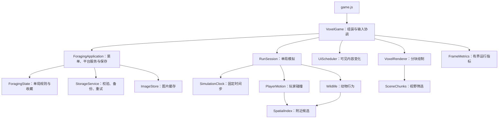

# 现有引擎架构优化

2026-09-14。本轮继续使用原有 WebGL 1 渲染和原创素材，完成运行架构整理；没有进行 Cocos 迁移。

## 模块职责

`VoxelGame` 不再继承旧 `ExplorationGame`，启动时只构造一次当前玩法状态。旧版本控制器保留供原有测试使用。`ForagingState` 仍复用经过验证的 `ExplorationState` 收藏和规则基础，界面仍复用原有绘制组件；并未声称全部旧代码已经移除。

## 时间与暂停

- 玩家、动物和挑战计时采用相同的固定步长：每秒60个模拟步。
- 100毫秒的一帧执行6步，而不是“玩家走50毫秒，倒计时走100毫秒”。
- 单帧最多纳入250毫秒，严重卡顿超出的时间对所有模拟系统统一舍弃，并记录在诊断数据中，避免无限追赶。
- 暂停、切后台、WebGL上下文丢失后清空累积时间；恢复首帧建立基准，下一模拟步继续原来的位置与跳跃速度。
- 收藏鉴别等待和4秒采集卡仍使用现实时间，不受游戏模拟暂停影响。

## 空间、绘制与资源

- 静态碰撞体和遮挡体按2单位网格建立索引，查询附近候选后仍执行原来的包围盒或三角形判断。玩家与动物导航共用查询入口。
- 静态渲染网格按8单位分块。每个三角形完整保留，分块边界包含跨格三角形的完整范围；镜头方向和放大镜都会更新视锥判断。
- 图片采用按需加载和LRU淘汰，默认32张、估计解码内存64 MiB。当前界面正在使用的图片不会被淘汰，因此可见图片本身超过预算时，这是软限制。
- 图片加载完成或失败会通知界面更新；显示内容未变化时不重绘静态菜单。
- UI纹理尺寸未变时更新已有纹理，保留微信Canvas上传不兼容时的像素回退路径。
- 离开探索返回首页、分区或场景列表时释放场景GPU缓冲和世界引用；手记、采集清单与通关后继续探索保留当前世界。
- 场景生成完成后释放多余的MeshBuilder顶点数组。恢复WebGL上下文时使用保留的TypedArray重建GPU数据。

索引用于当前静态地形；若后续增加移动倒木或可破坏地形，应显式重建受影响索引并清除动物导航缓存。当前尚未引入动态模型LOD、完整物理引擎或场景异步流式加载。

## 存档兼容

保留原存档键和第5版收藏结构。存储层新增`rainy-save-1`封装、完整性校验和上一份有效快照；仍可读取旧的裸对象存档。主记录损坏时尝试备份，重复保存相同内容不重复写入；失败时保留序列化快照，每3秒最多自动重试一次。

校验用于发现数据损坏，不是加密或防作弊。备份也不能替代云端同步；主记录和备份都损坏时仍可能无法恢复。

## 检查方法与结果

- `npm test`：197项测试通过，包含固定时间步、暂停、空间索引与全量查询对照、视锥边界、存档恢复、图片淘汰和界面更新。
- `npm run check`：语法检查通过。
- `scripts/voxel-smoke.html`：真实WebGL全流程通过，包括33种菌物、采集卡、跳跃、猛兽、额外探索、后台恢复和WebGL上下文重建。
- 静止手册连续120帧，UI纹理新增上传次数为0；反复切换场景GPU缓冲数量受控，离开场景后为0。
- 微信开发者工具重新编译后可显示首页和场景列表，原来的12种鉴别与7次通关记录保留。仍存在游客模式`webapi_getwxaasyncsecinfo:fail` SDK报错；没有据此宣称控制台零错误，也没有完成手机帧率验证。

运行`npm run benchmark:engine`可复现几何提交量采样。结果保存在同目录`engine-benchmark.json`。以各场景入口、320/568画面比例、8个水平方向计算：

| 场景 | 静态总顶点 | 平均提交顶点 | 减少比例 |
|---|---:|---:|---:|
| 暖湿针阔混交林 | 254,424 | 105,543 | 58.5% |
| 高寒草甸 | 86,103 | 28,578 | 66.8% |
| 红松白桦混交林 | 301,683 | 123,556 | 59.0% |
| 林缘湿草地 | 191,541 | 66,841 | 65.1% |
| 冷湿针阔混交林 | 283,527 | 107,593 | 62.1% |
| 冷湿河谷 | 325,359 | 108,926 | 66.5% |
| 落叶阔叶林 | 270,873 | 120,007 | 55.7% |
| 山脚林缘 | 232,182 | 90,686 | 60.9% |

河谷入口一条4.8单位的视线段，候选遮挡体从5151个缩小为24个。以上是固定场景的工作量指标，不是手机FPS提升比例；分块会增加绘制调用，仍需真机评估净收益。

`scripts/engine-review.html`提供不读写存档的实时检查页，可开关裁剪、查看CPU帧耗时P50/P95、顶点数、缓冲数和UI更新频率。CPU耗时不包含GPU完成绘制的时间。

下一步应在目标手机上记录稳定帧率、入场耗时、反复切换后的内存与发热，再决定分块大小、模型细节等级和是否制作Cocos对照样板。
