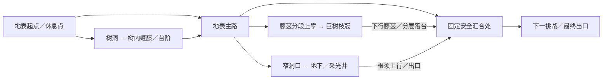
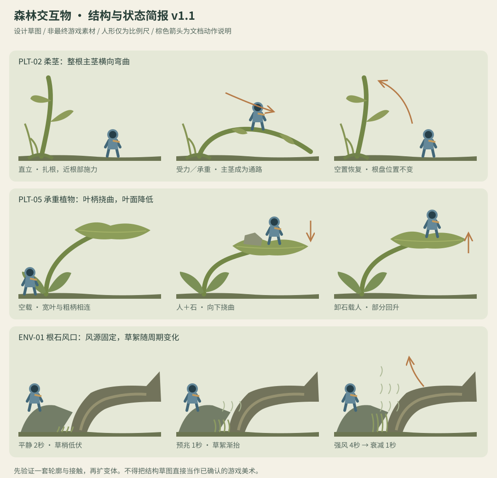

# 《雨后的归途》游戏设计 PRD

> 文档状态（2026-09-21）：归档版本。保留当时规格，不能覆盖现行文档。 当前基线见[设计文档索引](../../design/design-document-index.md)。

> 运行状态更新（2026-09-21）：[前十关试玩版说明](../../playtest/first-ten-2026-09-21.md)记录本轮已接入机制、逐关分路、测试与未完成验收。本文既有“现状差距”描述保留其制定时背景，当前实现状态以该记录为准；玩法目标没有被降级为已全部验收。

版本：v1.3 · 日期：2026-09-21 · 阶段：代表样板制作规格，运行验收待执行  
对象：策划、程序、美术、动画、音效、测试。配套文件：[关卡设计 PRD](level-design-prd-v1.3.md)。

配套视觉与声音制作规范：[全素材视觉、交互与声音设计规范](../../design/archive/visual-interaction-asset-design-v1.1.md)。覆盖全部素材ID、角色动作、场景层次、光照、UI和音效；不改变本PRD玩法规则。

## 0. 文档约定与适用范围

本文件定义“这个世界有什么、玩家能做什么、物体遵守什么规则、如何生产和验收”。配套文档定义“这些内容怎样组成前十关”。首批内容以两份文档为共同基线；同一机制不允许在单关中偷偷改变规则。

状态统一使用：

| 标记 | 含义 |
|---|---|
| 已确定 | 用户已明确表达的方向，后续开发保持 |
| 已实现 | 当前代码或资源中存在，不能等同于审美、真机或玩法验收通过 |
| 制作要求 | 本次策划提出的目标，尚需制作或修订；写入文档不代表已上线 |
| 后续候选 | 不进入首批十关必需依赖，不能提前形成开发阻塞 |

P0＝首批发布前必须满足；P1＝核心体验稳定后补齐；P2＝后续候选。所有新增数量、时长、比例、性能指标均为本次制作建议，未经玩家测试验证。本轮只编写文档，不修改游戏。

### v1.3联合评审修订

本版落实J-01…06及R-01…06：明确登冠地形、模拟分区、可推生物状态、毛虫载荷、交互目标与取消、测试前置、分阶段素材及音频合同。配套LDD v1.3、素材规范v1.1共同使用。[修订与复核记录](../design-revision-v1.3-2026-09-21.md)逐项区分文档修正和待执行证据；[旧v1.2](game-design-prd-v1.2.md)保留评审依据。此次修订不代表游戏实现已更新。

### v1.2历史修订说明

本版根据用户的新方向扩充早期空间与生物，并引入生命／休息点规则。下文新增部分为**制作提案，未实现、未试玩**。上一版“生物扩展均后置”“死亡回最近CP且无生命系统”的限制被本版相应章节替代，其余尺度、支撑、自由解法和安全落地原则保留。

[机制扩展评审](../mechanics-review-v1.2-2026-09-21.md)记录采纳、改造、延期及证据边界；[习性依据](../mechanics-sources-v1.2.md)区分自然事实与游戏化规则。v1.0/v1.1已归档。首批仍为十关，但新增范围会增加制作成本，旧时长目标不构成排期承诺。

## 1. 产品目标

### 1.1 一句话体验

玩家化身昆虫尺度的兜帽冒险者，在雨后的森林地表观察植物、借用重量与风，沿自己理解的路线寻找归途。

核心感受依次为：微观世界的惊奇 → 看懂环境的满足 → 克服阻碍的轻快 → 到达安全处的安心。不是战斗数值成长，也不是惩罚性精确跳跃。

### 1.2 首批范围

- 已确定：2D横向森林冒险；统一、酷而略可爱的旅人；不区分男女。首批十个可连续游玩的关卡。
- 已确定：自然交互优先，植物有支撑关系；失足落到真实地面可重新攀爬；危险死亡有倒下过程。
- 制作要求：移动、攀爬、跳跃、推物、承重、风与滑翔，加树内／树冠／地下路线和生命容错，组成完整探索体验，尽量提供可解释的替代路线。
- 使用场景假设：偏好探索、轻解谜的玩家，手机短时游玩为主；浏览器键盘用于开发试玩。首批微信小游戏仅横屏可玩；竖屏仅提示旋转，不运行关卡。此范围已于2026-09-21由用户确认。
- 首批不做：战斗武器、等级技能树、职业差异、抽卡、体力、付费复活、多人、真实流体／软体模拟、随机生成关卡。商业化另立需求，不夹带进本次制作。

### 1.3 设计原则与取舍

| 原则 | 玩家可感知结果 | 必须避免 |
|---|---|---|
| 昆虫尺度 | 草茎是高处路线，树根像坡坎，树干、树枝和树冠均只呈现巨大局部 | 微缩整棵树、树干上贴平板叶、尺度随关卡变化 |
| 看外形猜用途 | 柔茎能弯，轻物能推，粗叶轴能承重 | 依靠白线标碰撞、同形物体无提示地遵守不同规则 |
| 自由但一致 | 同一块石头既能垫脚，也能挡甲虫或压植物 | 必须按攻略顺序才生效、靠隐形锁封死自然解法 |
| 失败可恢复 | 看清失败原因，短暂倒下，再尝试 | 一闪回原位、落地即死亡、关键物永久丢失形成死局 |
| 少机制、多组合 | 十关逐步改变判断与路线 | 每关新增按钮、重复障碍单纯拖长时长 |

### 1.4 核心循环与回报

看见下一处安全落点 → 观察支撑、重量和危险 → 选择攀爬／借力／推物路线 → 执行动作 → 从变形、位移与动画理解结果 → 到达新区域或发现另一条路。

立即回报是到达、解开空间关系和角色反馈；单关回报是明确的终点与下一段森林；长期回报是十关多层旅程与已掌握的环境语言。首批不靠金币、装备或每日任务支撑循环。可选探索点以景观、绕行和更顺畅的路线为回报，不增加必须收齐的收集品。

## 2. 当前基础与开发差距

事实基线来自 `js/microforest/MicroForestState.js`、`ForestPhysics.js`、`ForestLevels.js`、`ForestProgress.js`，角色导出脚本与当前图集；运行状态参考根目录交接文档。

| 领域 | 已实现 | 本次制作要求 |
|---|---|---|
| 内容 | 十关配置、选择、逐关解锁、连玩、重玩 | 扩展为有教学、变化和探索的正式路线；当前短回放不算正式时长 |
| 主角 | 统一兜帽旅人；走、跳、落、攀、推、滑翔、藏身、六帧倒下 | 接触点、姿势过渡和声音打磨；不重新设计人物身份 |
| 自然交互 | 石头、柔茎、蕨柄、菌盖、蒲公英、间歇风、承重叶、树皮 | 统一材质规则、失败提示与重置边界；消除例外 |
| 生物 | 甲虫巡逻、步态、碰撞；蜗牛慢行和站立支撑 | 甲虫危险预告、蜗牛足部与触角运动、不同场景的合理用途 |
| 画面 | 82帧、2048×2048图集，加程序绘制的植物、地形、特效 | 三套场景补件、自然轮廓和遮挡层次；逐项做游戏内审美验收 |
| 失败 | 约0.9秒倒下／淡出后回检查点；普通落地不死亡 | 落水、深沟独立表现；暂停、重置、视野外死亡验证 |
| 存档 | 完成关卡和最近选择，本地备份与失败提示 | 明示只保存关级进度；关内恢复属于P1新增能力 |
| 声音／设备 | 尚无本轮新增的环境动作音效；没有完成真机验收 | 首批声音最小闭环和手机实际操作／性能验收 |

图集里的旧枯枝、叶桥、蚂蚁等资源不因为“仍存在”就获得新关卡使用许可。下方资产台账才是制作清单。

## 3. 世界尺度、视觉与场景规范

### 3.1 比例与空间

以角色站立可见高度记为 V；碰撞高度记为 H。当前 H=44逻辑单位，可见高度约56，二者不是同一个尺寸。资产画稿使用V，关卡碰撞和可达性使用H。数字是制作比例，不是现实厘米。

| 对象 | 建议视觉尺寸 | 轮廓原则 |
|---|---|---|
| 可推小石 | 高0.35–0.55V | 有底面、接触影、非球形积木 |
| 固定重石 | 高0.7–1.1V | 宽底、部分埋土，与小石区分 |
| 甲虫 | 长1.3–1.8V、高0.5–0.8V | 足部接地，头部与安全壳面清楚 |
| 蜗牛 | 长0.9–1.5V、高0.4–0.7V | 壳体承重，软体低伏 |
| 弹射菌盖 | 冠宽2–3V、高1.4–2.3V | 低矮圆鼓，菌柄支撑；不与蕨柄顶齐 |
| 路线蕨叶 | 高3–7V，可分多级 | 直伸、斜生、低垂混合；不能每株同一弧线 |
| 根缝入口 | 能容纳弯身旅人 | 是大树根的局部空间，不是微型门屋 |
| 巨树与树冠 | 单株局部超过视口高度，树枝粗度显著大于草柄 | 地表不能摆完整微缩树；树冠关使用真实粗枝局部，不缩小整树 |

所有同层实体的视觉上表面与碰撞上表面必须一致。柔茎与叶片变形时，绘制与碰撞读取同一形状。多物体重叠时不能让埋入地下的低表面覆盖真实地面。

PLT-03总高不是首次登冠高度。每个冠形必须记录总高、最低有效入口冠面和弹射起点；入口冠面前配置自然根肩阶，单跳上升先按≤0.7H、有效间隙≤0.5H、承接宽≥1.5H起测。L02外侧路线从干地经根肩登冠，不依赖藤蔓或蒲公英；树内路线复用攀爬与台阶，在水洼远岸汇合，作为避开弹射落水风险的替代路；具体候选见LDD L02，实际控制器通过才可用于地图。

### 3.2 分层与可读性

1. 远景：树干、林冠暗影、低对比雾色，无碰撞，不与旅人产生假接触。
2. 中景：大树根和植物群剪影，色彩收敛，避开落点轮廓。
3. 玩法层：土地、根脊、石头、完整植物、动物、旅人；轮廓与接触关系最清楚。
4. 前景：少量根须和草叶；只允许局部遮挡，不挡目标、脚部或关键握点。
5. 特效层：孢子、风絮、水纹、接触尘；不能形成误认的实体平台。

首批三套基础环境；新增内部／树冠／地下见3.4：

| 编号 | 场景与情绪 | 配色方向 | 构图地标与补件 | 使用关卡 |
|---|---|---|---|---|
| ENV-M | 苔藓根际，安全启程 | 深青绿、苔绿、少量暖土色 | 巨大树根弧面、露根台阶、湿苔土肩 | 01、02、04 |
| ENV-W | 浅水湿岸，开阔与借力 | 冷青水面、暗湿土、灰绿岸草 | 水纹流向、天然石隙风口、岸边树皮 | 03、07、08 |
| ENV-F | 蕨丛朽根，层次与归途 | 墨绿、灰褐朽根、终点柔暖光 | 多方向蕨轴、根缝、地面安全回路 | 05、06、09、10 |

末关暖光是背景氛围，不是悬空传送光圈。出口由可站立的路线末端、细小木路标和画面向右延伸共同说明。

### 3.3 自然合理性的边界

这是自然启发的幻想森林，不承担植物科普准确性的承诺。孢子弹射、可承重叶轴和稳定上升风是游戏化规则，首次出现必须用现象教会玩家。风口采用风从根石间狭缝上涌的世界设定，强风期有上扬草屑，平静期停止上涌，预兆与周期一致；不再通过拨开枯叶“凭空开风”。

大多数柔软、细长草本可以弯，但不是所有绿植都可推；短苔、粗根和厚木固定。成熟蕨叶不画作树枝，幼卷芽只作自然变体，不能所有植物都弯成同一个钩子。

### 3.4 多层森林：树内、树冠与地下

空间扩展采用三种手段组合：地表到树冠以连续上攀／随镜头上移为主；树洞和地下狭口用成对入口过渡；分路在固定安全面汇合。全程保持2D侧视与昆虫尺度，不做三维自由相机，不复制参考游戏管道外形。树干空洞可借鉴朽心形成的树内空间[B01]；兔洞原型限定为有地下洞系的穴兔[B02]，不能泛称所有兔类都挖同样的洞。

| 空间ID／资产 | 空间构成与独特玩法 | 入口、路线与返回 | 早期安排 |
|---|---|---|---|
| Z-TREE／ENV-07 树内 | 巨树局部空腔；纵向木纹、内壁朽木台阶、侧孔透光；沿内壁缠藤攀附、跨固定朽木台阶到上侧孔 | 真正可进入的洞口有纵深及内侧光；手掌进入后到独立内景。入口／出口双向，出口回地表稍前方 | L02在蘑菇练习前体验短树内通路，与外侧地表路汇合 |
| Z-CANOPY／ENV-08 树冠 | 粗树枝穿出画面，叶簇局部大于人物数倍；固定树枝路线＋侧风间歇＋承载生物短途移动 | 沿藤蔓／连续握点上攀，风只帮助跨缺口；上层路线最终沿下行藤蔓或安全落台回到地表主路 | L03先看低层枝冠；L08进入高树冠，L10综合汇合 |
| Z-BURROW／ENV-09 地下 | 根须顶棚、粒状土壁、嵌石、旧洞道；间歇滴水冲刷窗口与石缝挡水位 | 土口边缘松土和根须说明入口；保留向上可攀的出口与地表旁路。前期不做封闭迷宫／氧气值 | L04可选短地下回路，L06承重叶位于地下出口采光井 |

逻辑连通图（不代表物理尺寸，也不要求每关同时出现所有分路）：

**尺度审核：** 地表不能一屏显示完整小树，再爬两步叫到树顶。L03表现低枝层而非最高梢；高树冠以多个相接的竖向段和画面外延伸的巨干表达距离。只有已经看到下一握点的连续攀爬才直接跟镜头；长旅程可以通过同一树体的内壁连接段省略，但入口／出口先展示方位与高度，不把普通一阵风宣传成从地表直达巨树顶。

地下先采用废弃小洞和根际孔隙；兔洞只画巨大的局部洞壁／旁支，兔子最多远景局部，不放同人物等大的兔门或主动追逐大动物。完整昆虫巢穴社会模拟不属于本批。

**不同空间的机制而非换皮：** 树内强调纵向支撑和光孔导航；树冠强调提前看落点、横风与移动载体；地下强调顶棚净空、滴水间歇与回升出口。新增侧风ENV-10只改变水平力、不恢复蒲公英时长；新增滴水ENV-11为有前兆的局部冲刷区，每次命中扣1格，不引入窒息条或全洞淹没。具体节奏见6.3。

每关主线路标只指一个清楚方向；第一次分路不同时摆三种入口。三层不要求每关齐备。可选空间提供更安全的绕行、短捷径或本挑战段一次治疗芽，不设必须收齐的钥匙。

## 4. 角色与动作 PRD

### 4.1 旅人 CHAR-01

已确定：深色脸部、发光小眼、蓝灰兜帽短披风、暖色小围巾、短靴与手套／手部。酷感来自利落剪影和克制表情，可爱来自头身比例与略笨拙的受力反应。手掌要看得出抓、推、撑地，不能用圆球代替。

首批只有一个角色，所有玩家具有相同基础能力。角色差异、外观解锁均为P2，不在本批接口里假定性别或职业。

| 动作ID | 状态与开始条件 | 表现要求 | 状态出口／验收 |
|---|---|---|---|
| AN-01 | 待机 | 微小呼吸、围巾轻动，脚不滑 | 移动立即响应 |
| AN-02 | 地面移动 | 八帧步态按移动距离播放 | 松手停步；被阻挡不能滑冰 |
| AN-03 | 普通跳／下落／落地 | 起跳伸腿、落下展臂、落地缓冲 | 落地不锁操作；脚对上真实表面 |
| AN-04 | 攀附／上攀／下攀 | 展示背面，双手交替，脚找支点 | 停止输入就停住；跳跃能脱离 |
| AN-05 | 推轻物／推不动／压柔茎 | 躯干前倾、双手接触、蹬地步态；重物静态撑住 | 以真实位移驱动步态；松手退出推姿及主动推力，不复位物体，桥按载荷和空置5秒规则恢复 |
| AN-06 | 蒲公英携带／展开／收起 | 获取时可见；携带在身侧；展开有支撑关系 | 过期消失；不允许无伞滑翔 |
| AN-07 | 藏身 | 身体收低，进入根缝前后遮挡层 | 移出即取消，不穿过实心根壳 |
| AN-08 | 死亡倒下／复活 | 屈膝、撑手、侧倒、停留、淡出；当前六帧约0.9秒 | 不瞬移打断、不重复计数，恢复站姿和控制 |
| AN-09 | 孢子受力 | 菌盖压缩，旅人重心下沉后被弹起 | 起飞与特效同一时刻 |
| AN-10 | 落水／深沟耗尽表现 | HP归零时独立下沉／失足表现与淡出，不在空中平躺；尚有HP使用AN-12 | 镜头外失败仍能理解，不被触控按钮遮住 |
| AN-11 | 非致死受伤 | 收肩、护住受击侧、短暂失衡；不整段倒下 | HP>0原地恢复操作，与1秒受伤保护同步 |
| AN-12 | 落水／深沟尚有HP的救回 | 短下沉／失足遮挡再回CP，不在半空平躺 | 约0.6秒候选；扣血一次，保留剩余HP |

动作过渡不得改变碰撞身高来制造不可预测的通路。身体倒下期间仅作表现，暂停危险结算、环境模拟时钟与角色操作；暂停游戏也暂停动画。复活后不能残留滑翔、推物、攀附或死亡姿势。

## 5. 通用交互规则

### 5.1 “所有物体可互动”的可执行定义

玩法层的实体都要声明可站立、可攀爬、可平移、可弯曲、危险和承重属性，不允许因为没有单独写脚本就变成可穿透装饰。背景、特效、没有承重能力的细毛细羽片不算实体；必须通过层次、透明度和体积区别，不能摆在可落脚处误导玩家。

| 材质／对象 | 站立 | 攀附 | 平移 | 受力行为 |
|---|---|---|---|---|
| 地面、巨根、重石 | 足够宽的外表面可站 | 仅有明显连续握点的表面 | 不可 | 固定；不能因为玩家按推就抖动位移 |
| 轻石 | 可站、可配重 | 不可 | 接地后按住手掌配合方向推 | 受阻停止、失去支撑下落 |
| 柔茎 | 弯至可承重的缓坡后可站 | 首批只开放有明确握点的类型 | 根部不平移 | 允许双向弯，承重保持 |
| 蕨柄／粗叶轴 | 已定义路线轴可站 | 有连续粗柄的部分可攀 | 不可 | 首批固定路线；细羽片无独立碰撞 |
| 承重叶 | 叶片主体可站 | 默认不开放，除非素材显示握点并配置 | 不可 | 载荷向下挠曲，卸重恢复 |
| 菌盖 | 整个可见承重冠面 | 菌柄默认不可攀 | 不可 | 站稳后主动跳触发孢子弹射 |
| 树皮薄片 | 主体可站 | 不可 | 岸上可推，水中随流 | 按载荷改变浮高；靠实体停止 |
| 已定义生物 | 可承载壳面可站 | 不作为藤梯 | 默认不可手推；仅BIO-04已完成蜷球态可推 | 自身运动带着站立者；状态、载荷与危险部位按6.3，不向其他生物继承球态例外 |
| 水、风、孢子、细草毛 | 不可 | 不可 | 不可 | 环境场或特效，不使用实体平台外观 |

攀爬不是“只有藤蔓”。可抓的连续草茎、粗蕨柄、缠绕藤以及v1.2明确标定的粗根须都可以；光滑菌柄、锋利岩面、细叶尖默认不可以。无连续握点的实心根壳自由攀爬仍作为P2，不在首批临时开放。

### 5.2 输入与优先级

键盘：A/D或左右移动；空格跳跃，获得蒲公英后长按滑翔；E抓取、松手、压弯、藏身，E+方向持续推物；W/S或上下攀爬。

触控：左右、手掌、跳跃人形四个基础按钮；只有靠近可攀物或攀爬中才显示上攀／下攀。不得把手掌改成暗示攻击的拳头，也不新增“每种道具一个按钮”。

**唯一目标合同（制作要求，当前代码待适配）：** 展示与输入读取同一个`interactionTargetId/action`，动作成立条件与物理接触同源。先执行当前状态的专用动作（攀附→松手、藏身→出来），再按下表选新目标。死亡／硬直／切区期间不产生新的情境动作。蒲公英仍靠近获取，不占手掌目标。

| 顺序 | 候选动作 | 成立与处理 |
|---|---|---|
| 0 | 已在持续推石／推球／压茎 | 按住期间保持原ID；受阻保留撑住姿态。松手、跳离、失去接触或目标失效才结束，不自动切到洞口 |
| 1 | 推石、推球、试推重石／受阻反馈 | 位于目标侧面且有合法推接触；重石只做受阻动作，球需状态就绪 |
| 2 | 压柔茎 | 近根施力点可达，方向选择弯曲侧，根不平移 |
| 3 | 抓柄／藤／已标握点的粗根须 | 握点连续、可达，无实心体阻隔 |
| 4 | 根缝藏身 | 固定入口面且净空允许；已藏身时走专用退出动作 |
| 5 | 进入成对洞口 | 固定门槛、空手推物状态已结束、目标空间可用；不自动搬物 |
| 6 | 治疗芽 | 缺HP且本尝试未取用；满血不消耗，不抢占有效动作，必要时短提示 |
| 7 | 确认新休息点R | 尚未确认且符合前进顺序；旧R不抢占目标，重试挑战从暂停菜单进入 |
| 8 | 触碰行走态西瓜虫 | 近侧可触碰且非转换中；触发一次蜷球请求，持续按住不重复触发 |

除实际接触目标外，情境作用点候选距离≤0.6H且在面向侧；近身±0.15H不按左右剔除。先比表中顺序，同顺序按作用点距离，再按稳定实例ID决定。当前提示目标仍有效时，同优先级新目标须近至少0.15H才切换；失效立即清除，不保持幽灵目标。数值为统一候选，不得逐关暗改。

手掌按下沿冻结当时已显示目标，本次只执行该动作；实际失效则取消并短提示，不能转而触发邻近对象。持续推压仅在持键及合法接触期间延续；单次进入／取用／休息／惊扰消费一次按下，须松手后才能再次触发。持续作用结束后先松开再重新选取。西瓜虫触碰到球态完成期间保持“等待蜷球”提示，完成后也需一次新按下才能推，不把旧按键当第二动作。

摆放约束：关键洞口／休息点不能与不可移动受阻目标的交互热点完全重合；每个动作必须有一个可走到、能独立选中的位置。重叠用例覆盖石＋根缝、洞口＋握柄、休息点＋治疗芽及西瓜虫＋石，测试缺血／满血、面向变化、持键与目标失效。规则一致但目标永远选不中也算关卡失败。

### 5.3 接触与恢复的硬规则

- 同层物体不可互相穿透；小石挡住甲虫，实心根壳挡住小石。隐藏入口仅供旅人使用，不代表石头可穿整个树洞。
- 起跳后横向可修正；落点来自实体上表面。按轮廓连续行走不能踩空小边角。
- 从高处落到安全地面不扣血、不死亡、不自动拉回高处；真正没有可承接地面的水域／无底沟才触发扣血救回（见9.1），外观需要区分。
- 弯桥有人或石头承重时不回弹；所有载荷离开后计时5秒；再次承重重置计时。恢复路径被挡时等待，不能弹进玩家身体。
- 移动支撑体带人运动，不能依靠图像移动而让碰撞留在原地。物体边缘下沉到地面以下时由地面承接，不吸入地下。
- 首批只支持经过验证的有限堆叠，默认最多两层可移动石；拒绝继续推动时用动作和短提示解释，不让物体爆飞。
- 关键物丢失、堵死路线或错过树皮后，可用暂停里的“重置本段物体”。按下方恢复组合同处理；当前按位置半径重置只是已有实现，不能据此宣称无死局。

### 5.4 恢复事件与状态合同（v1.2更新）

**玩家语义：** 菜单显示“返回检查点并恢复物体”，副文案列出检查点名和涉及区域。尚有生命的落水／深沟救回执行该范围；生命耗尽先倒下再按9.1回休息点，恢复整个挑战段。安全落地不触发恢复。跨过新检查点不会重置现场；向回走也不会自动退回旧检查点。

每个物件有稳定`objectId`、不可变`homeSegmentId`与`resetGroupId`；当前位置单独记录。每个检查点声明`recoveryGroupIds`及安全出生面。视觉区域A/B/C不必各自成为恢复组；有共享载荷或分路交换的相邻区域可共组。对象被推过边界后仍属于出生组；不设隐形墙阻止搬运。

**范围选择：** 救回／手动恢复以最近激活的检查点为起始范围；生命耗尽以当前休息点的挑战段集合为起始范围，不按人物当前x、不猜玩家选择哪条路。L10两条分路共用C恢复组。若一个组的物体正在跨组支撑／接触其他动态物，或其出生位置会与组外动态物重叠，把关联物的出生组一并纳入；反复扩展直到范围不再变化。包括桥恢复扫过的动态物、承重链上每一层和甲虫／蜗牛；固定地形不迁移。清理范围的计算同时检查当前姿态和拟恢复姿态，组数量有限，不按时间无限重试。

初态必须可解：叶面按初始载荷求平衡后再摆放石头，不能把“offset=0”等同于有石初态。初始支撑为有向无环关系，移动物最多两层；记录实例ID，不按同款素材重建多份。

| 事件 | 人物与输入 | 物件、支撑、桥／叶 | 生物与风 | 蒲公英与进度 |
|---|---|---|---|---|
| 安全落地 | 原地接地，解除失效攀附 | 正常模拟，不恢复 | 正常模拟 | 剩余时间继续；CP不变 |
| 落水／深沟扣血后仍存活 | 扣1格、救回计数一次；短反馈后回最近CP；清速度、抓取、推物、滑翔及缓存输入 | 恢复范围内对象回配置初态，重建支撑；桥直立、空置计时5秒，叶按初态载荷就位 | 范围内生物回安全初态；风回平静起点；范围外保持冻结前状态 | 清携带效果；范围内补给冷却归零；CP及完成记录不变 |
| 手动恢复 | 不扣血也不回血；不计死亡，不等倒下；回同一CP | 同救回恢复 | 同救回恢复 | 清携带效果，补给可再取；已消耗治疗物不补发 |
| 生命耗尽 | 倒下约0.9秒；死亡计数一次，回当前休息点并恢复3格；撤销本段临时CP | 整个挑战段恢复初态并扩展关联组 | 对应组安全初态；段外冻结前状态保留 | 清携带效果；治疗物进入新尝试可再取；关级完成不撤销 |
| 激活新CP | 必须落在其固定安全面；更新返回点，无瞬移；仅向前激活一次 | 不移动物件，不保存现场快照 | 不重置位置、相位 | 不回血；剩余时间继续；不写关内持久存档 |
| 整关重开／退出后再进 | 回关入口、生命3格、清输入和本局死亡数 | 全关配置初态 | 全关初态 | 清效果，补给可用；保留关级解锁／完成 |
| 暂停／后台／旋转布局 | 冻结输入，恢复后不沿用旧按下状态 | 不恢复；冻结模拟时钟 | 相位、巡逻、计时冻结 | 有效期冻结，不补发30秒 |

倒下期间只有表现时钟推进；环境、风相位、桥、补给和携带计时冻结。风需要按实例保存相位／时钟，不能继续直接借用未暂停的展示时间。未在恢复范围的环境与物体，在恢复完成后从冻结状态继续。以上是目标合同，现有死亡、种子剩余时间、`resetNear`不完全符合，须另作实现与回归。

**原子恢复顺序：** 冻结→计算完整范围→在暂存状态移开人物、断开受影响支撑／接触→按固定体、植物平衡、动态支撑从下到上恢复→放人物到CP→重算接触与载荷→检查无穿透、无旧ID、出生安全→一次提交并恢复输入。计算失败保留原状态，显示“本段恢复失败，可重新开始本关”，记录错误；不偷偷扩大为全关重开、不提交半成品。正常配置不应走此兜底，出现即阻塞相关关卡验收。

范围扩展可能恢复较远物体，但它们只回自己的出生点，不被拉到当前段。手动菜单列出扩展区域；救回提示“已回到××，生命−1”；耗尽提示“返回休息点，重新挑战”。固定安全CP不得依赖任何可移动支撑，关联组恢复也不得撤掉CP地形。

### 5.5 空间入口与跨区状态（制作要求）

**分区定义：** `zoneId`仅指模拟分区（语义为simulationZoneId，不要求改现有字段名）；Z-TREE／Z-CANOPY／Z-BURROW是空间类型，SCN是视觉配方，cameraSegment是镜头段，均不自动创建模拟分区。首批连续可走、可推物、可跌落相接的地表／枝冠必须同属一个zone；离屏地形和支撑仍参与该zone物理解算，不按镜头裁掉。只有成对洞口切zone，连续边界不做对象迁移、冻结或恢复。全关恢复事件也可加载对应zone，但不是新路径入口。

L03和L08的地表、水岸、连续藤蔓、枝冠、承接低地均属于各关的单一外部zone。树内／地下通过成对门槛建立独立zone；L10从树内侧孔返回外部zone的高枝，外部地表与高枝仍同区。动态对象归属其模拟zone，跨视觉配方不改变ID、支撑或出生恢复组；禁止首批把连续树体拆为互斥活动zone。

- 根缝庇护ENV-02是原地藏身，洞道入口ENV-12才切换空间。前者低矮遮挡，后者可见通路纵深；近身手掌分别显示短词“藏身”“进入”，不增加按钮。
- 空间记录`zoneId`；入口记录`portalId、pairedPortalId、arrivalSupportId、arrivalFacing`。同一关可有多空间，但只在最终出口结算forest-ID，树内出口不是通关门。
- 首批跨入口只允许旅人及绑定携带的蒲公英；轻石／生物保持原区。洞口画成需弯身转过的窄缝并检查物体净空：推动石头时不触发进入，提示“先松手再进入”；不能把石头穿门后悄悄删除。连续藤蔓／树冠边界没有这项搬运限制。
- 操作成立需在入口固定面、非受伤硬直／死亡／攀附／推物状态，手掌一次触发。切换0.35秒为候选；冻结所有区模拟与道具计时、清输入，在目标固定面放人后解锁。一次按住不能往返触发，必须松手且离开入口触发范围才能重入。
- 区域离开后冻结其动态状态；回访恢复原状态而非重新生成物体、治疗或生物。全关HP、治疗已取集合、最近CP和休息点唯一，不按zone各建一份。当前区才模拟；新鲜度与性能优先于离屏生态模拟。
- 入口不能免费回血／续蒲公英，不能自动激活更前CP。死亡／救回可跨区回正确支持面；需要的目标区加载成功后才提交恢复。切换失败保持源区和全部数值，可原路继续；反复触发、加载失败、前后台中断须测试。
- 跨区依赖恢复沿用出生组，包含冻结区；先在全关数据中计算完整集合再呈现当前区。首次进入树内／地下提供入门后可回头的安全台，不把玩家扔进攻击窗口。

**镜头合同：** 攀到视口上部前开始平缓上移，目标落点留在HUD之外；进入上层暂显“枝冠”，再收起。下落时提前显示下一承接面，下层确有地面就正常落地；不因离开上层相机框判死。跨较长高度至少有可见中间落台，避免盲落几屏。树内／地下切换用短遮挡过渡，关级进度和路线方向不变。

## 6. 机关与生物需求卡

每张卡与关卡文档中的ID对应。以下除特别标注外为P0正式制作要求；“已实现”代表基础行为存在。

| ID／内容 | 触发与过程 | 玩家反馈 | 失败、取消与恢复 | 首次关卡 |
|---|---|---|---|---|
| OBJ-01 轻石 | 已实现，接地时手掌+方向平移；松手停止主动推力 | 手掌压在轮廓，脚按位移迈动、摩擦声 | 重物／根壳／甲虫挡住时撑地；掉沟不自动瞬移，段落重置取回 | 05 |
| OBJ-02 重石 | 已实现，不可推动，可垫脚 | 埋土、宽底；推不动姿势 | 不作为必须搬走的唯一出口；允许绕／跳 | 05 |
| PLT-01 路线蕨 | 已实现，近柄抓取，停手悬停，爬到轴面后行走跳离 | 后背攀爬、交替握点；主体轴比细羽片清楚 | 松手或跳离回重力；落地原处重爬 | 01 |
| PLT-02 柔茎桥 | 已实现，根部近身施力，朝施力方向弯；载荷保持 | 叶柄逐渐弯曲，空置将恢复时小幅抖动 | 5秒空置后恢复；遇障停止恢复；可再次压弯 | 04 |
| PLT-03 弹射蘑菇 | 已实现，先登上菌盖，再主动跳跃；蓄力约0.14秒 | 冠面压缩、环状孢子、起飞动作 | 普通接触不强制弹飞；空中修正落点；失手有检查点 | 02 |
| PLT-04 蒲公英 | 已实现，靠近获取30秒效果，不占背包；跳起长按展开 | 获取飘絮、携带绒毛、展开轮廓，最后5秒渐弱 | 到期消失；原补给点短冷却后可再次获取；失败不能耗尽整关资源 | 03 |
| ENV-01 间歇风口 | 已实现周期风；制作要求由根石缝与草絮共同表现 | 平静→草絮上扬预兆→稳定上升→减弱 | 错过等下个周期；等待位可安全站立；不要求猜隐形开关 | 03 |
| PLT-05 承重叶 | 已实现，人和石头使叶面下降，卸重缓慢回升 | 叶柄随载荷弯曲，水珠／叶脉表现受力 | 不穿土，不突然把人夹入岸壁；首批过载以有限下降处理，不做随机断裂 | 06 |
| OBJ-03 浮树皮 | 已实现，推入指定水段后漂浮、载人随流 | 薄木边、湿痕、水纹、受载后水线变化 | 靠岸停住；载荷过大先可见下沉；错过可重置；不允许无提示永久沉没 | 07 |
| ENV-02 根缝庇护 | 已实现，近地面手掌进入，移动退出 | 前沿根壳遮住身体，眼部低亮 | 同层实心根壳挡石挡虫；入口不能被可推物永久堵死 | 09 |
| BIO-01 甲虫 | 已实现，往返巡逻；遇障停顿再转向；头／身体侧部接触扣1格，背部可站 | 六足交替接地，触角先探；转向前停顿 | 提前跳越、走高路、藏身或用石阻挡；不追踪玩家到安全检查点 | 09 |
| BIO-02 蜗牛 | 已实现，缓慢移动、壳面可站；制作要求补足腹足运动 | 身体前探、壳跟随、触角轻摆，不能整张图匀速滑动 | 无接触伤害；等待路线须短；未上壳也能继续主线 | 05 |
| ENV-03 终点路标 | 已实现关末检测；制作要求统一落点与视觉路标 | 到达安全面后角色停稳、短结算、下一关 | 不能在终点下方地底触发；重复到达不重复写奖励 | 每关 |

### 6.1 核心参数基线

以下数值来自当前实现，保留为回归参照，不作为真实物理量：移动速度158、跳跃初速度310、重力720；普通平地理论最大高度约66.7、同高水平距离约136。连续跳、空气修正、坡面、宽容窗会改变实际可达性，必须运行真实控制器测试。

当前离地宽容约0.1秒、落地前跳跃缓存约0.12秒；孢子弹射初速度660、弹射空中水平速度220；蒲公英30秒，下降限速48；风周期8秒，平静2秒、预兆1秒、强风4秒、衰减1秒；死亡约0.9秒。柔茎空置恢复计时5秒，恢复过程约0.8秒。承重叶与树皮参数读取物体配置，不能由贴图大小推断。

正式调参要同时跑原试玩、十关路线与极端输入；单关不要私自改变玩家速度或跳跃高度。风若支持独立周期，必须让提示、粒子和力场读取同一配置；当前仅能视为统一周期基线。

### 6.2 承重叶数值与接触（PLT-05）

当前参照参数：人质量1、小石0.7、容量2、最大下降52。无地面限位时，目标下降`d=min(52,载荷/2×52)`；每步趋近比例`1-exp(-3×dt)`，恒定载荷约1秒到达95%位移，不是瞬时电梯。质量用逻辑单位，不能从图画大小临时推算。

| 载荷 | 下降d | 若空载上表面Y₀=172，平衡Y（向上为正） |
|---|---:|---:|
| 空载 | 0 | 172 |
| 石头 | 18.2 | 153.8 |
| 人物 | 26 | 146 |
| 人＋石 | 44.2 | 127.8 |

地面限位制作要求：实际下降不得超过叶片活动区与固定地形允许的净空；若接触地面，由真实地面承接人／石，重新计算叶载荷，不能仅钳人物Y来掩盖穿透。边缘每个有效支撑点与绘制曲线共用数据。载荷阈值附近不得因接触反复切换导致抖动；在60／30fps及一次长帧恢复中检查。

L06的候选出口和两种观察顺序详见[关卡设计PRD](level-design-prd-v1.3.md)的L06参数表。玩家也可站在石头上借高；这属于合理替代解，不为强迫卸重加隐形限制。石头本身高度、坡度和运动中的瞬态须纳入可达回放。

### 6.3 新机关与承载生物的共用规则

数值均为样板候选，不是现有运行时：

| ID | 周期／动作 | 风险与反制 | 重置与验收 |
|---|---|---|---|
| ENV-10 枝冠侧风 | 8秒：平静3、草叶预兆1、侧吹3、衰减1；初始水平加速度±45单位/秒²，来自风的附加水平速度上限35 | 固定握点上攀不被吹脱；起跳后修正漂移。地面等待台在风区外，先演示再放缺口 | 提示、叶动与力场同相；不与首次上升风教学同屏。同一位置不叠加两风场，风图层有明确边界 |
| ENV-11 洞顶滴水 | 6秒：干燥3、聚滴预兆1、落水冲刷1、收尾1；首次出现有旁侧挡水石缝 | 冲刷区命中扣1格，有足够宽的停步位；允许等空档、走上侧根须或绕行。不是碰到任何背景小水滴都受伤 | 液滴粒子与危险体同一时钟；恢复起于干燥期；静音可看懂 |
| BIO-03 蚂蚁队列 | 4–6只按固定路径分批前进，中间保留可步行或起跳穿越的空档；非物理堆叠群模拟 | 普通身体阻挡、足够宽的背面可短踩但不作稳定载具路线；堵在头前先停步扬头≥0.8秒，再短咬击扣1格。首见队列在独立下层，不伤玩家 | 石头挡住首只则停队／转向，不穿石挤爆；不给无限复制的“蚂蚁砖块” |
| BIO-04 西瓜虫 | 缓行可踩背；手掌首次触碰请求蜷球，卸载且净空允许后开始0.4秒预兆／收拢，球态完成才开放推；空载、未推且安全静止3秒后展开 | 球态用一次新手掌按下＋方向轻推；载人／载石不蜷或展开，已受惊请求待卸载；主动推球期间暂停展开计时，停推重新计3秒，展开路径被挡则等待 | 无攻击；行走、预兆、展开态不可推。松手仅撤主动推力，不立即展开；载人推球按接触／承载同步，不压碎乘客。球态仍同一ID，不下水／不作永久耗材 |
| BIO-05 蜻蜓 | 先停栖可观察；0.9秒转头／翼振预兆→固定通道掠过→3秒回栖休整 | 只在掠过的头胸接触区扣1格，不全屏追踪。首批不允许当可靠飞行坐骑；等待叶簇后方或换低路 | 翅膀不作伤害大矩形；离开挑战范围回栖；首次出现与侧风考验隔开安全台 |
| BIO-06 光滑毛虫 | 选无刺的原创外形，沿粗枝缓爬；身体承载面连续，示范路程3–5秒 | 可站背随行，无接触伤害；不把所有毛虫当安全，其他外形要另核验[B07]。两端有固定落点，可不等它走地面绕路 | 承载为游戏化设定；净载荷≤1.2可移动：仅人1、仅轻石0.7均可；人＋石1.7超载停步，保留支撑。卸载至≤1.2且前路安全后恢复，禁止弹飞载荷；检查整条支撑链，不漏算叠物 |

生物承载统一：可站部位独立于伤害部位；足、翼、触角不作稳定落点。载人速度与支撑同步，变形前判断载荷和净空；跳离正常继承被验证的水平速度，不无端加弹力。玩家不从伤害无敌获得穿实体能力。NPC不能被推过窄门、不能转化为背包道具。移动生物遇水／缺地面有明确停步或回路，推球也需扫掠边缘并受阻停止；石头失去支撑下落、树皮入水漂浮仍按各自规则。首批不靠杀生取物。

### 6.4 生物扩展库与制作分级

这是可持续扩展的常见小生物库，**不声称覆盖所有昆虫，也不承诺本批全部制作**。首批新增四类互动：蚂蚁、西瓜虫、蜻蜓、光滑毛虫；与现有甲虫／蜗牛合计六类。昆虫以外成员单列，生物学事实和设计效果不能混用。

| ID／生物 | 习性依据／核验状态 | 本游戏建议角色、站立与伤害 | 范围 |
|---|---|---|---|
| BIO-01 地表甲虫 | 现有原创原型，不泛指全部鞘翅目 | 壳可站，头侧扣1格，不再一碰即死 | 已有，适配生命 |
| BIO-02 蜗牛 | 现有原型；软体动物 | 安全慢载具／情绪缓冲，不强制久等 | 已有 |
| BIO-03 蚂蚁 | 蚂蚁气味路径可作为队列灵感[B03] | 队列交通与预告咬击；不是所有蚂蚁默认攻击 | 新增，L02看见／L05交互 |
| BIO-04 西瓜虫 | Armadillidium vulgare，陆生甲壳类，可蜷球[B04] | 安全壳面、球态可推的临时垫脚 | 新增，L04看见／L05交互 |
| BIO-05 蜻蜓 | 成虫捕食飞虫，稚虫水生[B05] | 成虫为定线掠过危险；不当温顺悬停出租车 | 新增，L03远景／L08交互 |
| BIO-06 光滑毛虫 | 不同种表面差异大，并非有毛就有毒[B07] | 筛选后作慢速枝冠载具；承载能力是幻想设计 | 新增，L03短示范／L08复用 |
| BIO-07 瓢虫 | 部分种捕食蚜虫[B06]，不等于只因可爱就无害 | 可观察的壳面停驻候选；起飞前预兆与乘客处理未定，不进必经路线 | 后续互动候选 |
| BIO-08 蝴蝶／BIO-09 飞蛾 | 需选定具体物种与活动时段 | 本批可选远景点缀；不把薄翼画成坚固平台 | 背景选一，不新增行为依赖 |
| BIO-10 蜜蜂／BIO-11 胡蜂 | 需分别核验物种、采食与防御条件 | 未来有范围的警戒区；刺击扣血，不能“碰到翅膀即死” | 后续 |
| BIO-12 蚱蜢／BIO-13 蟋蟀 | 需核验跳跃与栖息特征 | 未来预告起跳的动态障碍；站背能否安全起跳须独立样板 | 后续 |
| BIO-14 螳螂 | 待具体种捕食行为核验 | 未来强预告捕食区，非全身致死；初批不用 | 后续 |
| BIO-15 竹节虫 | 待具体种核验 | 伪装枝条、接近后显露动作；只允许清楚标定背面承载 | 后续 |
| BIO-16 蝉 | 待成虫／若虫生活史核验 | 声音地标或树皮攀附观赏，不让声音成为唯一解谜线索 | 后续 |
| BIO-17 萤火虫 | 待物种／阶段核验 | 未来洞口光点引导；不给所有幼虫统一温顺形象 | 后续 |
| BIO-18 草蛉／BIO-19 蚜虫 | 待物种关系核验 | 未来枝叶生态细节，无必须打怪任务 | 后续 |
| BIO-20 白蚁／BIO-21 天牛幼虫 | 待物种、取食和洞道尺度核验 | 未来朽木空间路线依据，不能随便画会飞的地下幼虫 | 后续 |
| BIO-22 蜘蛛 | 非昆虫；待具体种结网习性核验 | 未来蛛丝路线／危险区需先证明丝强度与可读性；本批不做整张杀人网 | 后续 |
| BIO-23 蚯蚓 | 非昆虫，不同生态类群洞道方向不同[B08] | 地下背景与路线暗示；不把所有蚯蚓都画成同样的升降平台 | 背景可选 |
| BIO-24 马陆／BIO-25 蜈蚣 | 非昆虫；两类须分别核验 | 不按脚多统一判敌；承载／危险暂不定稿 | 后续 |

“本批背景可选”也要占用明确美术预算：最多两类背景新生物，先蝴蝶和蚯蚓，不临时把表中全部物种加入图集。尚未核验的条目只有玩法候选，没有已确认习性结论；选入下一批时补来源、生命周期、外形、动作和伤害面再生产。

**即死审核：** 前十关没有普通生物全身一碰即死。危险由攻击动作／部位和预兆决定，普通伤害扣1格；严重捕食、压碎等即死候选本批不制作。不要把“对人无害”和“昆虫尺度安全”混为一谈，也不把真实捕食率直接换成游戏伤害值。

## 7. 资产制作台账

数量为首批目标变体数，动画帧不算变体。组合需要程序参数时，以“参数化一套＋指定样式”交付，不强制复制贴图。已有资源可复用，但仍须满足尺度、轮廓和接触要求。

| 资产ID | 制作内容／目标数量 | 状态与优先级 | 交付要点 |
|---|---|---|---|
| CHAR-01 | 统一旅人1套、AN-01…12 | 已有主体；基础动作及AN-10失足／下沉为P0；AN-10额外逐帧细化P1，见7.4 | 身份、靴底锚点、左右翻转、动作状态表 |
| PLT-01 | 路线蕨4种姿态：直伸、斜生、低垂、幼株搭配 | 已有参数化；P0 | 粗柄连续，根部真实落土，同图形驱动路线曲线 |
| PLT-02 | 柔茎2种冠叶轮廓、双向受力 | 已有基础；P0 | 直立、受力、承重、抖动、恢复，根部不漂移 |
| PLT-03 | 弹射蘑菇2种冠形 | 已有一种；P0 | 同弹力下可换外观，不暗改规则；完整菌盖碰撞 |
| PLT-04 | 蒲公英植株、携带、展开、消散一套 | 已有；P0 | 效果与人物动作同步，不能获取后无表现 |
| PLT-05 | 完整承重植物1套，叶宽2变体 | 已有基础；P0 | 叶柄接根、叶面连柄，空载／载人／载石状态 |
| OBJ-01 | 小石3轮廓 | 已有部分；P0 | 质量档明确，滑移／堆叠碰撞一致 |
| OBJ-02 | 重石2轮廓 | 已有基础；P0 | 埋土和固定感，不做无法推动的假小石 |
| OBJ-03 | 薄树皮2轮廓 | 已有基础；P0 | 非木筏；岸上／浮水共用实体，水线独立 |
| ENV-01 | 根石缝风口1套、上扬岸草2种 | 已有风场，实体外观需补；P0 | 风预兆和方向清楚，吹动细屑而非白色线柱 |
| ENV-02 | 根缝2入口变体 | 已有；P0 | 后层暗部、承重外壳、前沿遮挡分别交付 |
| ENV-03 | 关末路标1套、最终林缘景1套 | 部分已有；P0 | 无光圈误导；路标比例像旅人留下的小物 |
| ENV-04 | 苔土面、斜坡、土肩、湿岸、沟壁各2样式 | 部分已有；P0 | 无悬空块；接缝可复用，安全地面和深沟可辨 |
| ENV-05 | 巨根弧段3种、露根台阶3种 | 部分已有；P0 | 露根不是切断小树桩，末端埋入地面但不能吸人 |
| ENV-06 | 背景巨大树干3种、远林剪影2组、雾光1套 | 已有基础；P0 | 使用局部尺度、低对比，不遮可玩轮廓 |
| DEC-01 | 苔、草、铃形草花、地面小菌、根须、卷芽各2种 | 部分已有；P1补变体 | 仅背景使用；不能伪装成同层可站物 |
| BIO-01 | 甲虫1种、8步态帧＋停顿／转向衔接 | 已有步态；P0 | 移动距离驱动，头侧伤害和壳面接触一致 |
| BIO-02 | 蜗牛1种、慢行／触角／承重反馈 | 已有静态主体；P0慢行动作，P1承重细节 | 壳与腹足运动相位一致 |
| FX-01 | 孢子压缩喷发、落地尘、死亡淡出 | 已有基础；P0 | 分离特效与身体图集，保持落点可见 |
| FX-02 | 风絮、蒲公英获取／到期、水面波纹／入水 | 部分已有；P0 | 无高频闪烁，颜色之外还有运动线索 |
| UI-01 | 左右、手掌、跳跃／滑翔、攀爬、暂停、提示、关卡状态 | 已有基础；P0 | 统一图标语言，长文本不缩小成细字 |

v1.2提前制作蚂蚁队列、西瓜虫、蜻蜓及一类承载毛虫，范围见6.4；地下滴水进入首批环境节奏。根表自由攀附、蜗牛缩壳、额外角色仍为后续候选。不能把全部生物库自动转成首批必做。

旧资产处理：`branch-bridge`、`branch-support`、`branch`、`leaf-platform`为旧玩法或原型命名；不能用回直立断枝或独立叶桥。`ant`仅为现存素材，不等于新增队列行为已开发；须按BIO-03重新验收。`plant-birch/pine`只允许巨大背景局部。淘汰资源须先检查引用，当前文档不授权批量删除。

### 7.1 交付与美术验收

每个资产需交付：源文件、预览、逻辑尺寸、锚点、层级、状态／动画列表、碰撞轮廓、材质属性、引用ID。帧内留出手脚、围巾和倒下范围；动画切换不改变世界锚点。已有矢量资产继续用原生源扩展；不能临时换风格不一致的占位图。

验收按四张截图／录像完成：单体实际比例、与人物接触、复杂背景中的轮廓、移动或受力全过程。静态图漂亮但踩空／穿透，不通过。当前维持2048²图集；新增资源若增加图集或内存，先给测量和取舍，不静默翻倍。

### 7.2 三类代表形态简报（先样板，后变体）

以下是原创自然启发造型，不以真实物种名称承诺生物学一致性。用户已接受“混合直伸、斜生、低垂的蕨丛”方向；下列三项仍需游戏实际尺寸审美确认，不能标为用户已批准。保持现有旅人身份，示意中的人形只作比例尺。

图为设计结构草图，不是最终游戏素材；线条用于文档说明，不移植为游戏中的碰撞白线。图中箭头表示运动方向，脚下实心体才是承重对象。

| 项目 | PLT-02 柔茎桥 | PLT-05 承重植物 | ENV-01 根石风口 |
|---|---|---|---|
| 形态构成 | 簇生根盘、2–3根长短不同的细茎，一根主受力茎；节间长，小披针叶交错着生 | 地表莲座式叶丛，短叶陪衬；一根粗长叶柄从基部弧伸，连接宽椭圆／肾形叶底；叶缘不画直板 | 巨根局部跨过不规则石肩，缝口朝斜上方；根与石都延伸入环境，不做独立喷管 |
| 比例V | 主茎可见长3.5–5V，宽0.10–0.16V；按沟宽校验弯后弧长和厚度 | 冠宽2–3V，冠高2–3.2V，叶柄粗0.12–0.20V；叶厚有体积 | 缝宽0.8–1.3V；两侧至少3H固定等待岸，竖向气流影响区另配 |
| 正常 | 主茎上伸略偏，不自带水平平台；左右都能从土面近根施力 | 空载叶面略拱，底部接柄可见，旁叶不伪装落点 | 缝内暗、草梢低伏，无上升粒子 |
| 受力 | 弯曲分布于主茎全长；根不移动，弯后上侧粗茎承重，小叶随动 | 柄向下挠、叶面整体降低，少量倾斜；可站区始终与碰撞一致 | 预兆草梢渐抬、细屑试探上升；强风向上连续运动，出口落点保持清楚 |
| 恢复 | 空置5秒后沿原曲线回正；载荷保持，受阻等待；末1.5秒轻颤 | 卸石载人只回升18.2；全卸才恢复空载，不能突然折叶 | 强风结束1秒渐弱，回平静；不在停风时仍画大股上升絮流 |
| 可抓／可站 | 首批本型号只近根推动；弯平的粗主茎可站，不攀无握点的细直茎 | 主叶主体可站；叶柄无明显握点，不攀；背景旁叶弱化且避开路线 | 两侧实际根石面可站；风没有碰撞表面 |
| 禁止 | 断枝切口、小树冠、尖杆插叶、每株同向弯、根部漂移 | 孤立叶桥、横板贴茎、尖三角托盘、载荷变化只挪贴图 | 白色风柱、枯叶开关、机械风扇、无风时上扬草屑 |

样板交付：每类先一套，柔茎补镜像方向；并排放在现有旅人旁，给正常、接触、受力、恢复四段短录屏。无文字／无调试线／静音下辨认用途；至少4/5首次玩家能区分“推弯通过”与“站上下降”，结果记录为探索性样本。未达标先改主茎、叶面和支撑的剪影，暂缓第二种冠形，不用补长提示掩盖。

### 7.3 v1.2增量素材与动作包

| 资产 | 最小交付 | 验收重点 |
|---|---|---|
| ENV-07／08／09 | 树内、树冠、地下各一套连接件与远中近层 | 入口、出口、人物比例、固定落点与遮挡；仍复用基础土／根材质 |
| ENV-10／11／12 | 侧风预兆／力场边界、滴水全过程、成对洞口 | 无白线力场；入口与庇护区区别；切换前后方向一致 |
| PLT-06／ENV-13 | 治疗芽、苔窝休息点各一套 | 治疗芽用完干瘪；休息点是可辨苔窝，不画成另一个出口 |
| BIO-03 | 蚂蚁走／停／探触角／预告咬击 | 脚按路程运动；队列间距／拐弯／挡石，不能复制静图滑行 |
| BIO-04 | 西瓜虫爬行／预兆／蜷球／展开 | 分节壳包住脚，碰撞随形变，载人不突然变球 |
| BIO-05 | 蜻蜓停栖／翼振预兆／掠过／回栖 | 头胸伤害面清楚，透明翼不形成超大碰撞 |
| BIO-06 | 毛虫收缩伸展／承载／停步 | 腹足接地，顶面连续不把人抛起，头尾与路线一致 |
| AN-11／AN-12、UI-02 | 非致死受伤／救回动作；3格生命与休息点确认 | 受伤与最终倒下区分；不在空中平躺，不新增常驻状态栏 |

四类生物先各一个代表变体，不提前复制配色；82帧图集为当前事实，新资源尺寸／打包数须测量后安排，不承诺无成本塞入现有图集。新增音效最小集为SND-11受伤／治疗、SND-12洞口过渡／休息点，复用已有风、水与脚步系统并控制叠音。

### 7.4 分阶段交付矩阵（唯一排期口径）

S1为光照／角色接触样板，S2为对应机制可玩样板，S3为十关候选发布；S2按实际接入的机制选行，不要求一次交齐。下列清单约束配套素材规范的ART/LIGHT/AUDIO验收；“全部设计覆盖”不等于S1全部制作。

| 资产／反馈 | S1首个样板 | S2对应机制接入 | S3十关候选发布 | 可后补 |
|---|---|---|---|---|
| CHAR-01／AN-01…12 | 待机、走、推、跳、背攀及接触点 | 每个接入状态有基础反馈；HP接入必须含AN-08/10/11/12 | 十二类基础动作全部通过，AN-10落水下沉／沟中失足不能空中平躺 | 更细的布料／面部／AN-10中间帧 |
| PLT-01…06／OBJ-01…03 | 蕨柄、轻石各一套与固定苔地 | 当前机制所需一套；含各载荷／取消状态 | 所有十关实际使用型号；每种冠形登冠、支持与反馈通过 | 第二冠形、额外配色／非路线必需变体 |
| BIO-01…06 | 不强求 | 当前生物的走停、转向、危险／承载／取消全状态 | 六类互动各一代表变体，不能以静图替代步态 | BIO-07…25候选，背景蝴蝶／蚯蚓亦可延期 |
| ENV-01…13／DEC-01 | 固定地面、巨根、前沿、基础背景 | 当前空间连接件、入口／CP／R与危险来源 | 十关全部连接、安全地面、路标、必要装饰层可读 | 非必要装饰第二变体 |
| FX-01/02／UI-01/02 | 接触反馈、基础控制／暂停 | 当期机制、HP、绒毛、恢复／失败状态齐全 | 所有启用状态、错误恢复、横屏与竖屏旋转提示通过 | 非提示用途额外粒子 |
| LGT-01…08 | 基础档12秒脚本必验；标准增强作对照 | 当前空间的基础光照／遮挡成立 | 基础档全路线可读；启用的标准档须同路径验证 | 未达预算的局部身体受光、更多反射 |
| SND-01/02/08 | 脚步、推／停／受阻、安全落地 | 追加当前机制的反馈 | 依下行全部声音合同完成 | 同一事件额外音色变体 |
| SND-03…07/09…12 | 不要求全包 | 对应机制首次接入即含必要起／停／预兆；HP需11及08救回，洞口／R需12 | SND-01…12所有已用子事件，有去重与关键优先级 | 不影响理解的更多变体 |
| AMB-01…07 | 一条根际环境底可选 | 当前空间至少一套可复用底音／混音预设，机制声优先 | 七种空间混音预设可由共享母音派生，不要求七条新录音 | 额外装饰滴／鸟声 |
| MUS-01…03 | 无音乐也可验 | 不阻塞机制样板 | 可暂不启用音乐；完成反馈仍须SND-10 | 三方向主题编配；启用哪种就验哪种切换 |

AN-10基础版可用失足姿、遮挡／下沉和淡出组合，不用横躺悬空；高级逐帧细化后补不代表可以缺基础因果反馈。任何可后补项若被地图用作提示／主解依赖，必须先移除该依赖或提前验收，不得把延期变成隐形规则。旧台账数量是目标库数量，S3是否必须有第二变体以本矩阵为准。

## 8. 声音、界面与辅助

### 8.1 声音最小清单（制作要求）

SND-01脚步（土／根／叶三类）、SND-02石头摩擦与受阻、SND-03叶柄受力／恢复、SND-04菌盖压缩／孢子、SND-05拾取／展开／绒毛散去、SND-06风预兆／强风／停歇、SND-07六类生物动作／攻击预兆、SND-08安全落地／耗尽／救回／返回站稳、SND-09浅水／树皮碰岸／危险滴水、SND-10关卡到达、SND-11实际受伤／治疗、SND-12洞口／休息。HP减少事件只交SND-11；SND-08不再消费同一受伤事件，转入耗尽／救回才接对应状态声。环境母音可复用，空间混音按AMB-01…07区分。

无声音也必须能通关。风／虫的关键预兆用运动同步表达；重复触发音限频，同一石头连续摩擦不叠几十个音源。首次浏览器操作后启用音频，暂停静音或淡出，恢复不爆音。阶段范围统一按7.4；旧六类最小集不再作为S3验收清单。声音子事件路由／并发按素材规范10.4，不按父素材包简单分配危险预兆。

### 8.2 HUD与菜单

- 常驻保留基础控制与暂停；原关卡名区域整合3格生命，不新增第二条HUD横栏，关名入场短显后收起；蒲公英有效期仍放在跳跃／滑翔按钮旁，避免再加一根资源条。
- 提示优先短句，行动成功后收起；首批提示可重开。长段教学在暂停页阅读，不永久遮住上半屏路线。
- 选关展示关名、已到达／已完成状态、继续；完成页给下一关、重玩、返回。首批不设置三星压力。
- 暂停提供继续、提示、重置本段、重新开始、返回选关；重置目标和失去的本段操作应有简短说明。
- 建议按钮有效触区不少于48逻辑像素，主动作字样以18等效字号、正文16作为起点，仍须实机检验。不能为容纳内容缩小字，采用换行或滚动。
- 先验收568×320、812×375、844×390横屏及平板横屏，再测真实手机；竖屏仅检查旋转提示与暂停。摇杆／按钮不得覆盖预计起跳点与危险接触位置。
- P1辅助选项：减少镜头运动、跳跃长按滑翔改为切换、延长风预兆。选项必须保持同关路线可达且不影响存档。

### 8.3 平台与屏幕验收矩阵

**2026-09-21用户已确认：首批微信小游戏，仅横屏。** Android／iOS容器；桌面浏览器仅作开发回归。独立安装包、移动浏览器公开发行、云存档不在本批范围。发布渠道确认不等于授权直接发布。

横屏承担完整通关，竖屏仅显示旋转提示、暂停推进并释放全部输入。回到横屏后重算安全区与镜头，玩家点继续后恢复；不切地图、不清状态、不补有效期。若微信容器锁定横屏，不另造竖屏游戏；对后台／尺寸改变仍释放按键并暂停。尺寸为CSS／布局逻辑单位，不是硬件分辨率。

| 环境／尺寸 | 用途与必测范围 | 当前状态 |
|---|---|---|
| 桌面568×320、812×375、844×390、1024×768横屏 | 布局下限、长屏、平板；L01攀爬、L03风跃、L07漂流；320×568／375×812只测旋转提示 | 布局候选，不代替实机分辨率／安全区 |
| 小米13／微信Android | 多指、暂停／后台、存档、声音、10关连玩帧时 | 用户可提供；内存／系统／微信版本／构建号与测试结果待录 |
| iPhone 17 Pro／微信iOS | 同上，含系统手势、安全区、回前台方向 | 用户可提供；系统／微信版本／构建号与测试结果待录 |
| iPad Pro／微信iPadOS | 平板横屏、手指可达、UI不随大画面无限放大 | 用户可提供；具体代际／尺寸／系统版本待录 |

以上是用户现有测试设备，不自动称为最低配置或所有旧机兼容。iPad型号可在实测前补录；三类设备未实测前不能关闭发布验收。是否追加低性能设备由实测结果与性能目标决定，不以无根据硬件推断预先扩大采购。

每台记录：输入丢失、主动作触区、风中落点、长文本、前后台、声音恢复、离线关级保存、完成后重开，以及10分钟连续游玩的帧时。候选门槛为至少95%帧≤33.3ms、无持续超过1秒低于30fps的段落；首次加载单列，最终阈值随选定基准设备校准。未填设备、未实测则G-10仍未通过。

## 9. 进度、失败与兼容

保留 `forest-01`…`forest-10` 稳定ID，关名或地图修改不更换ID。只有到达对应出口并完成状态结算才解锁下一关；反复触发不重复计数。复玩不撤回已解锁进度。

当前只保存关级完成和最近选择，退出后关内重新开始应明确告知；本批不得声称支持云同步。关内持久检查点为P1，需要版本化存档和旧版本迁移方案，单独实现。写入失败时提示“本次仍可游玩但尚未保存”，不得静默清空已完成关卡。

单次救回后建议10–25秒内回到决策点；生命耗尽则回休息点，重做本挑战段，目标回退30–90秒、不超过约2分钟。以上都需实测，不为达到下限拉长路线。不设付费复活／等待体力；生命合同见9.1。检查点须远离巡逻范围、回弹桥体和移动水面；除2秒快速检查，还须通过关卡PRD 6.4的完整危险周期与初相位检查，不能靠短暂无敌掩盖错误出生点。

### 9.1 生命方案比较与推荐

用户希望失败有代价，同时保持探索自由。减少复活次数不是机关有趣的充分条件；首先保留看得懂的预兆、合理操作窗口和短失败回路。以下为本轮设计判断，不是已验证的玩家偏好：

| 方案 | 收益 | 问题 | 本轮选择 |
|---|---|---|---|
| 一碰即死＋近CP无限复活 | 规则简单、重试快 | 缺乏轻重伤区别，易形成盲撞或挫败 | 不沿用为正式版 |
| 3格生命＋有限总命数，用完整关／游戏重来 | 压力明显 | 容易压制探索，长回退重复已掌握内容 | 不作默认，可留后续挑战模式 |
| 3格生命＋临时CP＋休息点分段重试 | 小失误容错；累计失误会失去本段推进 | 需要清楚区分CP与休息点，并阻断重置回血 | **推荐首批默认** |

**明确代价：** 允许重新尝试，但一次挑战只拥有3格生命；临时CP只缩短救回距离，不补血。累计第三次普通伤害／落水使生命归零，回当前休息点重新完成这一段，不能在每个障碍前无代价满血复活。没有全局命数耗尽后锁住游戏、看广告、等体力的机制。

### 9.2 伤害、恢复与防刷合同（HP-01）

| 事件 | 生命与位置 | 世界与反馈 |
|---|---|---|
| 普通安全落地，包括从树冠落至可见地面 | 不扣血，原地继续 | 保留玩家高处跌落可重爬的既定方向 |
| 甲虫头侧、蚂蚁咬击、蜻蜓掠过、滴水冲刷 | 扣1；剩余>0留在现场，短受伤动作，不调用死亡恢复 | 候选硬直0.15秒、受伤保护1秒；控制尽快恢复。实体仍阻挡，不能借保护穿石／穿虫 |
| 真正落水／无底深沟 | 扣1；剩余>0救回最近临时CP，HP不补 | AN-12短救回约0.6秒、清瞬时动作与蒲公英；按5.4恢复相关物体，救回不计死亡 |
| HP归零 | 倒下约0.9秒，回当前休息点，HP=3 | 清本挑战段临时CP和物体进展，恢复对应组；死亡计数一次 |
| 新临时CP | 位置推进，HP不变 | 小型路标轻提示“返回点”，不画治疗符号 |
| 休息点ENV-13 | 在固定苔窝手掌确认，HP=3，记录新挑战起点 | 仅按前进顺序解锁；回旧苔窝不回血。未推进也可选“在当前苔窝重新挑战”，但必须重置整个挑战段，不是免费补血 |
| 治疗芽PLT-06 | 靠近手掌取用＋1，上限3；满血不消耗 | 每挑战尝试每实例最多一次；手动恢复／跨区不会再长出。死亡回休息点开启新尝试才刷新 |
| 手动恢复本段物体 | HP保持原值，回最近CP | 不刷新已用治疗芽；蒲公英仍是重复可得的移动能力，不能混成治疗物 |
| 主动重试挑战段 | HP=3，回休息点 | 和归零同范围回退但不计死亡；菜单明确“重做本段”，清临时CP、重置治疗取用记录 |
| 暂停／切区／前后台 | HP不变，保护与所有模拟计时冻结 | 松开旧输入；不把暂停时长当作保护时间消耗 |
| 重新开始本关／退出后重进 | HP=3，回关入口；不保存关内CP | 失去关内推进，不能回原CP却获得满血；保留已完成关卡 |

休息点是挑战分段起点，不等同普通CP。候选间距为1–2个挑战、重做30–90秒，最长先控制约2分钟；位置都在固定安全面，不放在移动毛虫／回弹桥上。每关入口自动建立R0，长关可有需手掌确认的R1；相关组恢复不得移动其固定支撑。允许跳过新R继续走；此时旧R的挑战范围扩展为其后所有已进入的恢复组，归零不能只重置旧小段而保留前方机关进展。跳过R可能加长回退，入口提示应让玩家知道当前休息点，但不以隐形墙强制休息。新休息点首次确认后将`attemptId`推进、清旧临时CP，激活该处CP，新的`challengeGroupIds`涵盖前方关卡段。返回旧区不会重复领治疗。治疗记录以challengeId＋attemptId＋实例ID标识，仅当前重新挑战的组刷新，已通过挑战的治疗物不因新R确认而重生。

**结算顺序：** 单物理步只结算一次接触伤害；多攻击同帧合并为1格。受伤保护阻止接触重复扣血，不能阻止落水救回。若同一接触导致击退立即落水，在同一救回事件只扣一次，不能两连扣；救回结束置`pendingRescue=false`，之后再次落水仍扣血。HP归零优先进入死亡，入口切区／出口结算／手动恢复不得把0HP变成存活；死亡状态只允许暂停或明确整关／挑战段重试。

击退候选最多0.35H，不能把首个轻伤强制推入水；先碰撞扫掠，受阻则停止。保护期不取消危险实体的阻挡、不自动打断巡逻；不在出生点靠1秒保护掩盖错误摆位。所有主解必须能无伤通过，不能把故意受伤硬穿设为唯一答案；玩家合理冒险硬闯仍可完成，测试若普遍靠硬闯优于观察，则先改地形／预兆和段落，不直接减血上限。

**HUD：** 3格生命占原关卡名区域，数量同时用填充／空心区分，静音和色觉差异下仍可辨；关名仅入场显示。受伤短反馈，低血不持续闪屏；不另加命数、氧气、耐力三条资源。首次救回提示“生命−1，返回点不回血”；首次耗尽说明回苔窝的范围。

首批候选测试对照：同一路线比较旧一击死与新3格方案，记录无伤完成率、连续失败数、主动探索／硬闯比例、回退时长、HP规则理解；不用小样本宣称留存提升。默认方案写入规格供样板验证，尚不是玩家验收通过。

## 10. 验收与制作顺序

### 10.1 P0验收标准

| 编号 | 标准 | 验证方式 |
|---|---|---|
| G-01 | 首批实体全部有交互属性；外形与规则相符 | 资产台账逐项走查，静态／动态碰撞叠图仅用于开发 |
| G-02 | 跳过虫、挡虫、压桥、攀爬、落地均可重复 | 自动用例＋真实引擎操作，左右方向都测 |
| G-03 | 安全地面不穿透，重叠地形不吸人 | 固定根沿用例、混合输入、移动叶片接地回归 |
| G-04 | 每关至少一条无伤主解由纯输入完成；允许合法洞口切区，不允许调试传送、改坐标、死亡／救回或手动恢复捷径 | 键盘回放与手动触控；合法portal事件单列，不计失败恢复 |
| G-05 | 丢关键物、错过树皮、蒲公英到期可恢复 | 每关失败矩阵，每种恢复都真实操作 |
| G-06 | HP>0受伤／救回、HP=0倒下回R分别成立；普通落地不扣血 | HP-01…08；已确认／跳过R1分别测，暂停／重置／入口／出口同帧优先级 |
| G-07 | 风预兆、蒲公英状态、危险轮廓静音也可辨 | 无音试玩；不依赖单一颜色 |
| G-08 | 角色手脚接触和动物位移无明显滑动 | 以实际游戏尺寸录像审阅 |
| G-09 | 存档损坏／写失败不导致玩法中断或破坏备份 | 自动测试与浏览器重开 |
| G-10 | 真机输入与性能符合最小设备目标 | 依8.3明确容器、具体设备与横屏与竖屏旋转提示记录，采用其中帧时门槛；设备待填或缺真机证据即未通过 |

### 10.2 制作顺序与负责人角色

1. 策划＋程序：锁定材质规则与关卡段落重置合同，建立失效用例。先验证HP、R点与跨区恢复的小夹具，不同时叠加新机关。
2. 关卡策划＋美术：完成01、06、07三个代表样板（攀爬／受压／浮动），通过轮廓、可达和恢复验收。
3. 动画＋音效：接触、预兆、落地与死亡反馈；同时验收触控，不等所有地图做完。
4. 关卡策划：按配套PRD扩展其余七关；每次只增加一种组合难点，保留综合试玩回归入口。
5. 测试＋策划：至少5名未接触本项目的试玩者无口头指导体验；记录首次理解、失败点、提示使用、通关时长和替代解法，不把小样本当市场留存数据。

先削减P2生物、重复场景变体和额外收集，再削减P1装饰；不能削减关键预兆、恢复能力、真实接触或首关教学。人力和排期未提供，本文件以依赖顺序排产，不虚构交付日期。

### 10.3 首轮待验证决策

| 问题 | 本次默认方案 | 推翻条件 |
|---|---|---|
| 攀爬输入是否过多 | 四基础按钮＋情境上下 | 首关多名玩家找不到上攀，优先调提示／触区，再考虑自动攀爬辅助 |
| 蜗牛是否值得保留 | 温和可踩生物和可选捷径，不强制等它 | 主要体验变成等待，取消必需搭乘路线 |
| 30秒蒲公英是否足够 | 保持当前时间，难点入口可补充 | 多次失败主要因为找路耗时，先前移补给点而非无脑加时 |
| 路线自由是否变成看不懂 | 一个清楚主方向，一条短分路 | 多名玩家把背景当路线或长时间不知去哪，调轮廓与地标 |
| 新增素材是否必要 | 先补接触与环境连接，再补物种 | 新素材不能改变判断或提升空间理解，延后制作 |
