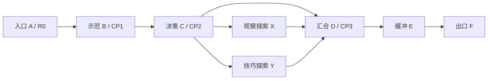
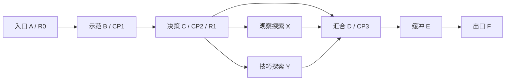

# 《雨后的归途》关卡设计 PRD

版本：v1.4 · 2026-09-21 · **十关重新设计基线，已接入可玩迭代；玩家与真机验收待进行。**

实际改动、输入回放和已知边界见[制作记录](../../production/first-ten/readiness.md)。

本轮按用户“联合评审所有设计并重新设计十关”重构旅程、路线与奖励，稳定ID保持forest-01…forest-10。新地图不能借旧回放PASS声明可达。[旧v1.3](level-design-prd-v1.3.md)保存原地图区域和测试背景；[设计文档索引](../../design/design-document-index.md)区分现行、参考、历史。规则母文档为[游戏PRD v1.4](../game-design-prd.md)，奖励细则为[探索奖励v0.3](../../design/exploration-rewards-direction.md)，表现为[全素材规范v1.2](../../design/visual-interaction-asset-design.md)。

## 0. 设计状态与目标

已确定方向：微信小游戏仅横屏、C版蓝灰兜帽单旅人、昆虫尺度、2D自然交互、十关、有真实地面就可安全落下重爬。重设计目标：主路有清晰旅程，支路有观察或技巧的不同价值，奖励能使用与保存，失败恢复不矛盾。所有新区域/物品、工具价格、时长是制作候选，不冒充用户逐项批准。

本稿不按工作量削减乐趣；按教学负荷分开新决策。十关都有两种可选探索兑现方式，并非每关都放树洞/树冠/地下三套入口。主路无工具、无收藏也能无伤通关。完成普通结局不要求金币、工具或探索率。

## 1. 旅程总览与节奏

| 关卡 | 记忆点 | 本关主决策 | 奖励的体验 |
|---|---|---|---|
| 01 苔间起步 | 露根与混合蕨丛 | 从哪个握点上去、怎样下来 | 第一处秘密，安全理解永久收获 |
| 02 孢子轻跳 | 水洼和树内侧孔 | 外侧弹射或树内绕行 | 首工具免费，第一次当场试用 |
| 03 借一阵风 | 风井和低枝冠 | 等哪一阵风、何时横移 | 首次营地选择、操作纪念 |
| 04 压弯小径 | 双向柔茎和滴水洞 | 从哪侧施力、走桥或洞道 | 观察与操作都值得探索 |
| 05 石头的用处 | 岔路石与甲虫 | 垫脚、挡虫或配重 | 物体多用，诱饵是可选解法 |
| 06 叶片的重量 | 地下采光井 | 保留多少载荷、走高或低 | 同一植物产生两条秘密路线 |
| 07 浅水渡口 | 漂流停靠湾 | 何时登乘、是否中途离船 | 舒缓探索，不为了奖励久等 |
| 08 顺流上岸 | 巨树局部高枝 | 风向、落点和返回路径 | 难操作的独特衣装，不锁基本工具 |
| 09 甲虫的领地 | 根间交通 | 绕行、阻挡、等待还是借高 | 用已学能力选择通过方式 |
| 10 回家的光 | 地表/树内高枝/地下归一 | 自己熟悉哪种路线 | 普通结局完整，额外发现留纪念 |

表中“高枝”是巨大树体局部，不是几株小树搭平台。预计首次主路约31–46分钟，探索另计且不限定时；只是设计范围，不能用当前熟练回放耗时证明。若实测短而好玩不靠重复段凑时间。

教学按是否实际见过/完成动作判定，不能只按关号假定已学。新动作在安全地首次试，再单独考验，再组合。L05甲虫危险、L08侧风与蜻蜓分不同区域，L09蚂蚁和球态分别安全补教；L10不引入新机制。

## 2. 所有关卡共享合同

### 2.1 空间、比例和相机

H=碰撞高44；V=站立可见高约56；举手动作最高包络按约70世界单位起测。美术用V、碰撞净空用H，不能把早期稿H当美术单位照搬。首次跳起测上升≤0.7H、同高间隙≤1.6H；熟练同高≤2.2H，上升跳同时缩短横距。落点宽≥1.5H，危险后优先≥2H，首次等待区≥3H。曲面取有效顶面而非图像包围盒，绘制/碰撞/接触影同源。

这些是灰盒上限建议，不是可达性证据。弹射、风、移动载体按真实控制器包络选中部落点；要提交最小输入、落点余量与30/60/120Hz失败回放。允许合理捷径，不加隐形钥匙/墙维护预设解。

镜头以扣除HUD和触控后的可玩区中心跟随身体，关卡边界可限制横向中心；额外前瞻不能把玩家压在顶栏下。上行含手部包络，下落预见承接面；同一outside中地面/高枝持续碰撞，不以离屏判死。每根可攀物都验上/下/停/跳离/登顶无输入/顶端重新抓住，下端回地面而非悬空grounded。

### 2.1.1 两类藤蔓的出场与可达合同

按GDD5.1.1区分垂挂藤GRIP-HANG与缠绕藤GRIP-WRAP；原粗蕨柄/粗根须仍可攀。L01继续地面起攀学习上/下/停/登顶，可在粗主茎上展示WRAP，不先要求跳抓；L02树内沿可靠粗根/主干的WRAP稳定上行；L03-Y在安全地面上方首次HANG跳抓；L08-Y才组合高处起跳抓HANG，旁设WRAP/固定根链返程；L10复用已学组合，不再加荡绳。

每个HANG提交上端支点ID、最低手部抓点、起跳台支持ID、下方承接面、顶端站面或仅可停挂标记。每个WRAP提交宿主ID、可见攀爬侧、连续握点及上下支持面。抓点不是人物脚底点，配置转换须由控制器明确；现有拓扑区域/门户/奖励ID不因此改变。

首次HANG最低抓点高于地面站立伸手范围，但低于普通跳手部可及上限且留余量；用真实动画/控制器扫掠确认宽容窗口，不只凭贴图估算。下端悬空时下爬离开进入落体，不在空中grounded。首教抓空落安全地面；后续高处落点/水面风险须提前可见。不能把下行悬藤用作唯一返程却没有安全落台。

新增验收：站立抓不到/跳起能抓、早按/晚按/按住不会抓后即松、抓空落地不转推物、顶端无输入站稳/重新抓回下爬、末端放落、回头上爬需再次跳抓、宿主实体不被穿越、视野外地面仍碰撞。

### 2.2 统一区域、返回点与挑战段

以下统一记号在十关卡片和[机器可读拓扑](../../production/first-ten/redesign-topology.json)中一致：A入口、B安全示范、C路线决策台、X观察探索、Y技巧探索、D汇合、E缓冲/熟练验证、F最终出口。拓扑只表示连通，不表示物理等距离或同屏摆位。

固定出生/返回面采用每关前缀的`surface-A/B/C/D/F`；有内部区时按卡片说明给出zone。地图制作必须建立这些真实平台实例，不能只建逻辑触发器。CP0在A、CP1在B示范之后、CP2在C、CP3在D；rank建议0/10/20/30，回访不降低返回点。即使不走支路，C/D的主路支持面仍可达。

| 项 | 恢复组与规则 |
|---|---|
| gA | A/B的动态物；CP0/CP1从gA恢复并依GDD关联规则扩展 |
| gB | C/D/E/F/X/Y及相关洞内对象；CP2/CP3从gB恢复并依关联规则扩展 |
| R0 | A处自动起始，HP耗尽恢复gA+gB、清本次后续CP |
| R1（03/04/05/06/08/09/10） | C固定台首次确认，绑定CP2；此后HP耗尽恢复gB，包含所有支路zone/部署工具 |
| 不设R1（01/02/07） | 全关一个挑战，仍有普通CP缩短非致命救回 |
| 跳过R1 | R0仍覆盖之后全部已进入组，不允许保留前方机关成果 |
| 永久奖励 | 不在gA/gB回退，按rewardId/grantId记录；本次工具次数只在新attempt补满 |

R不架在桥/船/动物身上；CP/R与宝藏各有独立可选中的作用点。生物被石头改巡逻后仍不能到达出生面。新R确认会废弃之前CP，rank继续向前；同R不反复回血/补次数。跨组物体按出生组和关联支撑闭包恢复，不把下一组物体拉到本组。

### 2.3 奖励实例与领取

每关F发`forest-NN:main`20金币一次；X/Y共用`forest-NN:explore`10金币一次。X独特见闻为`forest-NN:note-X`，Y技巧纪念为`forest-NN:keepsake-Y`，两个独特grant各一次；箱子只是在世界中的不同领取入口。20+10是完整货币预算，没有额外散币。两路都探索可以收齐不同纪念，不能拿两份探索币；已领取提示必须说明金币已领、此路仍有哪些独特发现。

L02教学灯使用全局唯一`tool:lamp:first`，树内X或F前补领都指向同grant；补领不要求通关重玩。L10普通旅程纪念`journey:first-ten`与主路完成同次发放，不检查所有收藏。没有宝箱数硬性进度条，收藏完成度放暂停/营地。

### 2.4 可逆空间与失败

所有↔门户都可原路返回；过门不刷新HP/次数/蒲公英。携带的已装备工具是角色状态可过门，石头/生物保持原区，部署诱饵切区结束不返次数。tree与burrow各自有固定承接底面；只有成对门槛切区，不允许独立区自由跌进另一模拟区。回访保持动态状态，恢复事件才重置关联组。

主路/支路都不要求故意受伤、救回或调试传送作为解法。真的落水扣血救回CP、归零回R；普通地面下落原地继续。领取完成后的永久奖励保留，但返回路径须有意思且短，不用惩罚安全跳下来防快捷。

## 3. 十关详细卡片

### L01 · 苔间起步（forest-01）

**记忆点：** 雨滴下的苔藓谷。**要让玩家学会/决定：** 学会看落点、抓住粗柄、爬上后停住，再主动选择下行；第一份奖励让绕路有意义。

**时长候选：** 主路2–3分钟；探索另加0.5–1分钟。**分区：** outside：全部区域。

**A · 起点与世界线索：** A是巨大板根下的固定苔窝R0，前方一条露根通向光处。蜗牛在低处缓行，有一条从旁边走过的固定地面，既可短暂搭背也可不等。

**B · 安全学习与首次验证：** B用两级低露根教跳跃，再在无水的凹地立两株不同方向的蕨柄。第一株粗柄顶有足够站位；上爬到顶不动、按下回地面、跳离各自成立。

**C · 决策与无工具主路：** C为蕨丛脚下的岔口，能看见低处果壳包与高处旧布条。主路沿根脊向右；X、Y是两条可选探索回路。

**X · 观察/低操作探索：** X沿低矮根拱绕到背面，观察光点从缝隙透出，走进同一zone的开放凹室取果壳包。不是切房门户，也不是藏身状态；拾取后从另一侧回D。

**Y · 技巧探索：** Y从第二株蕨柄上行，走到粗轴末段，跳一次到另一粗轴的安全节点取布结。可以直接攀第二株、站石上跳或中途跳离，不要求脚本顺序；失足落真实地面。

**D/E/F · 汇合、返程与完成：** D在蕨丛右侧固定根肩汇合，CP3不架在叶片上。E是一段让玩家自行选走低路或跳高根的短路，F为能站稳的木路标。

**几何与接触约束：** B首跳上升≤0.6H、间隙≤1.0H；Y同高间隙≤1.4H，落点宽≥2H。抓点端面与支撑面相接，X通道净空≥1.3H。所有高处下方铺可见连续地面，无惩罚坑。

**奖励与用途：** X果壳包或Y布结处领同一探索10金币；X独特见闻“根缝里的天光”，Y独特背包布结；完成F得20。没有工具使用或商店教学。

**视觉/声音重点：** 近景湿苔细节、远景巨干截面；蕨丛直伸与斜生混合。金币藏物用布结/果壳轮廓，不能画成悬浮灯串引导盲跳。

**本关必须反证的失败场景：** 登顶静止、顶端重新抓住后下爬、两轴端点落地、低路通关、不取任何奖励都必须成立。重复进X/Y只记各独特发现一次，探索金币只记一次。

**恢复绑定：** 只有A的R0；归零恢复gA+gB，普通救回仍按CP组恢复。 X/Y属于gB；观测、领取、工具次数与世界实体分别按§2.2/奖励合同保存或恢复。

### L02 · 孢子轻跳（forest-02）

**记忆点：** 蘑菇洼地与朽心窗。**要让玩家学会/决定：** 先安全理解主动孢子弹射，再选择快捷外侧路或较稳的树内绕行；免费工具在安全位置试用。

**时长候选：** 主路2.5–4分钟；树内或技巧探索另加1–2分钟。**分区：** outside：A/B/C/D/E/F/Y；tree：X内壁回路，C入口↔X入口、X侧孔↔D远岸。

**A · 起点与世界线索：** A干地有一朵低菌盖，其前后都有固定根肩；跳上菌盖仍能站住，只有再次跳才弹射。练习区下方是地面，绝不先把玩家弹进水。

**B · 安全学习与首次验证：** B在正式水洼前提供观察和干岸回落练习，远岸轮廓先能看见；CP1在菌盖前干岸，真正跨水在C选择路线后进行。若入口根肩被玩家绕过，不禁用菌盖或出口。

**C · 决策与无工具主路：** C位于水洼近岸决策台，左侧巨根中可见树内光，右侧能看到远岸木纹。主路从低菌盖主动弹射到D；X树内为避开弹射风险的可逆替代路线；Y是外侧成功后可选择的高台回路。

**X · 观察/低操作探索：** X从近岸门槛入树内，沿内壁真实粗根须爬到低木肩，再跳两级朽木节点到高侧孔。中部固定台上有观察灯藏匣；领取后向旁侧纹理试照，可发现一段额外见闻。高侧孔回到水洼远岸D，两个外侧口绝不挤在同一安全岸。

**Y · 技巧探索：** Y在D后回望，借一朵与练习同型号的菌盖弹到低枝固定台，取旅人小包，再经宽根坡回D。主路与Y弹力一致，难度来自选择落点，不靠换皮暗改弹速。

**D/E/F · 汇合、返程与完成：** D是树内侧孔和外侧落点共用的远岸；CP3与岸边留缓冲距离。E以短自然根阶收尾，F之前的安全台提供错过观察灯者同ID免费补领与同样的试照壁。

**几何与接触约束：** 根肩逐阶≤0.7H、间隙≤0.5H，菌盖有效接触宽≥2H；X跳距≤1.4H、上升≤0.6H。水宽和Y台高度只按实际弹射包络中部落点定稿，不用理论极限。X所有落空均落到内景固定底面，不跨zone自由跌出。

**奖励与用途：** X藏匣或Y小包共用探索10金币；X纹理见闻、Y孢子纹披风扣各自独特；观察灯是独立免费grant，X或F任一处获得，不包含在金币目标里；F完成20。

**视觉/声音重点：** 圆鼓菌盖低于内壁高肩，菌柄扎入苔地；洞内巨大木纹与小人形成尺度对照，亮侧孔清楚。试照增加细节，不把基础台阶或危险藏在黑暗中。

**本关必须反证的失败场景：** 从X出口反向回访、弹射方向错误、满血/缺血切区、灯在X领取后F不再初始化次数；轻石不能穿门跟入。漏掉树洞仍能学灯且正常通关。

**恢复绑定：** 只有A的R0；归零恢复gA+gB，普通救回仍按CP组恢复。 X/Y属于gB；观测、领取、工具次数与世界实体分别按§2.2/奖励合同保存或恢复。

### L03 · 借一阵风（forest-03）

**记忆点：** 湿岸风井与低枝冠。**要让玩家学会/决定：** 从间歇风中选择起跳时机，离开风柱时控制方向；用低枝冠体现第一次技能奖励。

**时长候选：** 主路3–4分钟；探索另加1–2分钟。**分区：** outside：地面、风井、X凹岸、Y低枝冠全部连续，不能按镜头高度拆区。

**A · 起点与世界线索：** A准备处首次展示工具选择：观察灯免费已有；示踪绒球目录开放，有安全演示但无需购买。两关主路已有40金币，可选择买40的示踪，也可保存。A随后可见无缺口的风口演示。

**B · 安全学习与首次验证：** B先观察一整个预兆/强风周期，再在固定岸边取蒲公英。跳进风、按住展开、横移到宽高岸；失败落水回CP1，重新取绒毛，不逼等一次性资源。

**C · 决策与无工具主路：** C高岸是新R1和CP2，先休息再看两种探索：X在根石背风侧，Y由可抓藤蔓通往低枝。主路沿宽根脊到D，主动跳过两条探索也可。

**X · 观察/低操作探索：** X从背风侧宽台观察第二个风口的不同相位，沿两级低根到侧后方藏匣。路径考观察和绕行，不是站原地发钱；可不使用示踪/观察灯，天然絮流已给完整信息。

**Y · 技巧探索：** Y先在安全地面上的固定起跳台跳起抓住由低枝垂下的GRIP-HANG，沿藤攀到低枝，顶端有完整站台；经过两次宽落点跳跃到旧包，低处可选毛虫载具仅作安全捷径，旁边固定粗枝可绕。取包后沿贴主干的GRIP-WRAP下行或沿分层根肩回D，不强迫从高悬末端盲落。

**D/E/F · 汇合、返程与完成：** D在两探索出口后的固定根脊汇合，CP3；E给一阵较短横向离风操作，复用已学上升风，不引入侧风；F在高岸的安全木路标。

**几何与接触约束：** B风前等待位≥3H，下一落点显示在可玩视野；Y平台宽≥2H、同高缺口≤1.8H、上升时收窄到≤1.2H。低枝只画巨树一段，下方固定承接坡每隔一个镜头段可见；不会一阵风直达整棵巨树梢。

**奖励与用途：** X藏匣/Y旧包共探索10；X风纹见闻，Y叶脉披肩纹样；F完成20。示踪试用不返利，不购买也能取得两路奖励。

**视觉/声音重点：** 风的预兆、上扬絮流、强弱与实际相位同源；树冠落点不被光束、顶栏或毛虫遮住。树枝以巨干局部承接，不画水平三角托盘。

**本关必须反证的失败场景：** 半空30秒到期、风停未起跳、毛虫错过可走固定路、Y登顶不动/向下攀/安全落地、示踪不增加风力/时长，确认R1后的死亡不回风井前。

**恢复绑定：** R1在C，首次确认后gB为新挑战；未确认仍回A的R0并恢复gA+gB。 X/Y属于gB；观测、领取、工具次数与世界实体分别按§2.2/奖励合同保存或恢复。

### L04 · 压弯小径（forest-04）

**记忆点：** 双向柔茎与地下滴水回路。**要让玩家学会/决定：** 理解根固定、两侧可施力、载荷保持与离开后回弹；地下是主动选择的绕行，不是装饰门洞。

**时长候选：** 主路3–4分钟；探索另加1–2分钟。**分区：** outside：A/B/C/D/E/F/Y；burrow：X，C土口↔X入口、X采光井出口↔D。

**A · 起点与世界线索：** A浅凹地先试压茎向左右弯，掉下可走出；植物根盘有可见固定点，施力和形变连续。

**B · 安全学习与首次验证：** B用一株弯茎通过真正沟段，CP1在近岸。让玩家在桥上看见下一岸与植物承重，无需赶着5秒跑。

**C · 决策与无工具主路：** C为中间固定岛，R1/CP2。第二株茎根在远侧但近端可经固定石肩接近，双向试推有足够空间；主路压茎通D。X是地下替代路，Y为地表技巧回路。

**X · 观察/低操作探索：** X经土口进入旧根洞，先在挡水石后看到滴水全周期，再选择干燥窗口走短通道；头顶有可见净空，末端粗根须可爬出到D。不能只有掉下入口没有上行出口。

**Y · 技巧探索：** Y在第二桥外侧先通过再返身，从另一侧弯茎接住一个低根节点，跳到固定台取包；石头配重尚未教学，因此不要求配重。取得后沿根节点下到D，不把回程锁在5秒中。

**D/E/F · 汇合、返程与完成：** D位于第二沟远岸，X/Y回归后都是固定面；E短路可回看柔茎空置轻颤与恢复，F出口。

**几何与接触约束：** 正式桥沟起测3.4–3.6H；茎弧长必须覆盖实际跨距与两岸各≥0.25H承接量，两方向分别验证。X等待台≥3H，冲刷带长度按实际步速与6秒周期校验；Y单跳≤1.6H且落台≥2H。

**奖励与用途：** X土壁匣/Y根台包共探索10；X滴水记事，Y弯茎造型营地挂饰；F完成20。西瓜虫仅在旁侧地面观察，不把球态作为本关依赖。

**视觉/声音重点：** 茎从根盘生长，交替小叶随形变，不画断口；地下暖暗土色和采光井区分门户与藏身缝。滴水危险是带聚滴预兆的局部冲刷，不是所有雨粒。

**本关必须反证的失败场景：** 桥上站10秒、石/人承重兼容、向错误方向推、途中回弹受阻、X错过干燥窗口、死在地下回C；不因返回另一zone自动补工具或HP。

**恢复绑定：** R1在C，首次确认后gB为新挑战；未确认仍回A的R0并恢复gA+gB。 X/Y属于gB；观测、领取、工具次数与世界实体分别按§2.2/奖励合同保存或恢复。

### L05 · 石头的用处（forest-05）

**记忆点：** 石隙与甲虫的小径。**要让玩家学会/决定：** 同一轻石同时承担垫脚、阻挡、配重用途，生物绕行首次成为有预兆的真实考验。

**时长候选：** 主路3–4.5分钟；探索另加1–2分钟。**分区：** outside：全部连续区域。

**A · 起点与世界线索：** A新工具诱饵目录开放，先展示有效对象和一次安全试用。场景本体先摆轻石与嵌土重石，让玩家靠推姿和位移辨别，不靠红绿颜色。

**B · 安全学习与首次验证：** B推轻石到根阶下借高；随后在固定安全位看甲虫走、停、转向，头侧危险和可站背甲分开。CP1在危险区外。

**C · 决策与无工具主路：** C为受根壳保护的土肩R1/CP2。主路可推轻石挡住甲虫再走，或者从根壳顶跳过；X通过根壳后方观察回路，Y则把轻石用作柔茎配重。

**X · 观察/低操作探索：** X沿宽根缘绕到甲虫巡逻背侧，从有侧向开口的凹室取观察记事和藏物，再回D。必须绕行和判断头部方向，不能穿过实心根壳；不要求踩动态虫背。

**Y · 技巧探索：** Y将轻石推上弯茎的平缓段，保持桥形后从旁侧根阶跳到固定藏物台；回程直接下根阶至D。也允许用自己承重后直接跳过去，不用隐形锁强迫配重。

**D/E/F · 汇合、返程与完成：** D在巡逻范围外汇合并设CP3，E是安全石肩，玩家可看到自己摆的石头确实改变了虫路；F出口。

**几何与接触约束：** 轻石初态质量0.7、重石视觉嵌土不可推；B垫脚上升总量按石顶轮廓与跳跃包络检验。甲虫前等待面≥3H；X静态跨距≤1.6H。Y桥沿用L04规则，石头稳定载荷要连到根/岸，支撑链不重复计重。

**奖励与用途：** X根背藏物/Y配重高台共探索10；X甲虫足迹见闻，Y小石铃营地饰品；F完成20。诱饵只改变有标签的甲虫局部寻路，不让石块或植物凭空消失。

**视觉/声音重点：** 可推石在草前，边缘与碰撞一致；虫足按位移行走，危险预兆清楚。根壳轮廓是巨大根局部，不是可穿小房子。

**本关必须反证的失败场景：** 石挡甲虫两侧/中段、石压茎后离桥、两层堆叠、石卡角恢复、甲虫背面落脚与跳越；诱饵耗尽仍能无伤通关。蚂蚁队列本关不另设伤害考验。

**恢复绑定：** R1在C，首次确认后gB为新挑战；未确认仍回A的R0并恢复gA+gB。 X/Y属于gB；观测、领取、工具次数与世界实体分别按§2.2/奖励合同保存或恢复。

### L06 · 叶片的重量（forest-06）

**记忆点：** 根下采光井。**要让玩家学会/决定：** 重量改变植物路线的高度；让玩家在较低通道与较高出口之间主动调整载荷，而不是等一部叶子电梯。

**时长候选：** 主路3.5–5分钟；探索另加1–2分钟。**分区：** outside：A入口/F出井；burrow：B/C/D/E/X/Y，A↔B门槛、E↔F高侧口。

**A · 起点与世界线索：** A在地表看到井底透光和另一侧出口方向，R0。旁侧可安全观察西瓜虫缩球/展开，但主线不依赖这项动作，未学者在后关另有补教。

**B · 安全学习与首次验证：** B入井后先站无风险单叶，观察压下和卸载恢复；附近轻石可推上叶。地面有连续承接坡，CP1在固定石肩。

**C · 决策与无工具主路：** C是井中固定土台R1/CP2，能同时看到主路的低根窗与上方出口肩。主路把石推到叶上压低后穿低窗到D，也可卸石让叶回升后跳到高根阶接D。

**X · 观察/低操作探索：** X利用较低的叶位进入旁侧宽通道，观察根须背后采光纹并取藏匣；窗口净空按载荷高度计算，路末爬粗根回D。没有观察灯也能看清开口。

**Y · 技巧探索：** Y选择减少载荷，从更高叶位跳到固定光斑台取纪念物；可以站石顶借高，只要物理稳定就承认为替代解。拿完沿固定下行根阶到D。

**D/E/F · 汇合、返程与完成：** D位于两种高度路线的共用固定肩，CP3。E沿内壁低阶接高侧孔，F回地表出口；不能从井底屏幕外一落就切到outside。

**几何与接触约束：** 叶样板Y0=172、容量2、最大下降52时：石0.7→153.8，人1→146，人石1.7→127.8（单位同当前控制器）；值为无地面限位平衡，不当瞬时脚位。低窗净空按“足位+H”检验；高出口起测188、有效空隙≤0.8H，根阶允许垫脚替代。不可同时按普通跳极限高差和水平距离摆位。

**奖励与用途：** X低窗/Y光斑台共探索10；X根系纹样见闻，Y透明叶脉营地屏片；F完成20。两路线由同一植物状态决定，不改素材颜色假装不同规则。

**视觉/声音重点：** 完整根生植物，主叶轴与叶柄连续；叶面薄边不当刚性平板。光束由上方孔隙进入，角色和边缘保留对比，奖励高光让位于出口透光。

**本关必须反证的失败场景：** 人石顺序相反、站石顶替代、叶压到地面、卸载时顶碰、两层支撑、HP归零跨区回R、错过Y能回C重做；每种摆法均可恢复，无工具钥匙。

**恢复绑定：** R1在C，首次确认后gB为新挑战；未确认仍回A的R0并恢复gA+gB。 X/Y属于gB；观测、领取、工具次数与世界实体分别按§2.2/奖励合同保存或恢复。

### L07 · 浅水渡口（forest-07）

**2026-09-22 试玩碰撞修订：** 水上两个探索落脚面调整为 x465–605/y156、x662–755/y178，厚12；Y宝箱随第二处抬高。漂流主路须给完整56单位角色轮廓留净空，上层跳跃支路仍可从左岸到达。有限厚度物体的上下轮廓必须与碰撞一致；载具携带位移也须检查侧面阻挡，不能只检查玩家主动移动。当前露根仍是原型图形，水上根系的生长连接美术尚需打磨。

**记忆点：** 漂流后的安静岸湾。**要让玩家学会/决定：** 推入水、登乘、观察靠岸再跳离；降低上一关的思考密度，让漂流本身有风景和小选择。

**时长候选：** 主路2.5–4分钟；探索另加0.5–1.5分钟。**分区：** outside：全部连续水岸与树皮。

**A · 起点与世界线索：** A在固定岸坡看一片脱落树皮和缓流，R0，岸边小涡流只作方向反馈不暗加吸力。

**B · 安全学习与首次验证：** B先在短水槽推树皮入水并登乘，两端都可靠岸；CP1在干岸。玩家可走边侧短根阶接近船头，不必追着已漂远的船盲跳。

**C · 决策与无工具主路：** C正式岸湾CP2仍属于R0挑战。主路随流到D；X是近岸步行观察凹湾，Y是途中可跳离的高根停靠台。两种探索都能重新接回同一片树皮或走固定根缘到D。

**X · 观察/低操作探索：** X沿固定岸缘看水纹和漂浮种壳，在湾后取小包；根缘直接回D，不需要让船逆流或无限等待。

**Y · 技巧探索：** Y从树皮跳到中途固定根台取旧包，再从台上沿可见下行坡到D；失足落水按现有HP救回，错过停靠直接走主路，不重置关级成果。

**D/E/F · 汇合、返程与完成：** D有低角度岸肩供树皮停靠，CP3；E是安全苔岸，可观察蜗牛短途随行，F出口。

**几何与接触约束：** 树皮有效站面≥2H，起落目标≥2H；岸台跳起落差≤0.6H、有效间隙≤1.4H。船程首轮以3–5秒可见岸为候选，最终按真实速度/流向定；水宽不拿船程反推拖长关卡。

**奖励与用途：** X湾后包/Y根台包共探索10；X水纹见闻，Y树皮纹背包饰片；F完成20。不在船上强制播放开箱说明。

**视觉/声音重点：** 树皮为薄层不规则自然脱片，干湿面和水线随载荷一致，不画木筏。水面反光只随低频运动，角色脚底接触影不漂离船体。

**本关必须反证的失败场景：** 船错过、撞岸、装石过载、船下无地面、乘客跳离、取Y后船已离开；所有固定台有独立回路或可达的恢复入口，不把奖励点变死岛。

**恢复绑定：** 只有A的R0；归零恢复gA+gB，普通救回仍按CP组恢复。 X/Y属于gB；观测、领取、工具次数与世界实体分别按§2.2/奖励合同保存或恢复。

### L08 · 顺流上岸（forest-08）

**记忆点：** 从水岸进入巨树高枝。**要让玩家学会/决定：** 用熟悉漂流抵达中岛，再分段升上高枝；新增侧风只教一次，蜻蜓在之后独立空间预告。

**时长候选：** 主路4–6分钟；探索另加1–2分钟。**分区：** outside：所有连续漂流/升降/侧风/高枝/地面落台同区。

**A · 起点与世界线索：** A工具目录开放抓地鞋套，演示仅降低站立时侧风漂移；不是增加跳高或黏墙。正式起点仍用已学树皮，R0。

**B · 安全学习与首次验证：** B短漂流到中岛，CP1；不叠虫、风和新落点，结束后先给安静固定土台。

**C · 决策与无工具主路：** C中岛R1/CP2，沿几段粗根须到低枝后，主路在有地面承接的缺口安全学侧风，先看草向再跳；X为下层背风路线，Y为更高枝冠探索。

**X · 观察/低操作探索：** X沿背风侧固定粗根找到有光的旧匣，需要识别哪条根真正连着地面；沿连续背风粗根缓坡接到D中层固定枝。这个观察替代不需要鞋套，也没有缩小落点。

**Y · 技巧探索：** Y先沿GRIP-WRAP分段上攀，再在固定枝台跳抓上方GRIP-HANG换层，稳定站上新枝台后才经过侧风跨枝，固定避风台后才看见蜻蜓停栖及掠过通道。可等它休整或沿同枝下侧的固定粗根绕过，取高枝旧包。毛虫是短捷径，有固定绕路，不能强制久等。

**D/E/F · 汇合、返程与完成：** D为两路相接的中层固定粗枝CP3；Y先沿根链下行到D，X沿背风缓坡到D，再逐段通到E地表，最后到F。相机沿身体居中且预见下一承接段，最高处不把整棵树缩进一屏。

**几何与接触约束：** 侧风前等待位≥3H并在风区外；Y同高间隙先≤1.6H，上升跳更短；蜻蜓危险区与首个侧风缺口至少隔一个宽固定台，无两新预兆同时压迫。连续下落每镜头段可见承接面；主路高差取控制器包络余量。

**奖励与用途：** X根匣/Y高枝包共探索10；X树影见闻，Y完整高枝披风（无属性）；F完成20。高难衣装不另收制作费。

**视觉/声音重点：** 巨干与枝叶只露局部；上层斑驳光通过叶隙投下，侧风时影子变化不伪装实体平台。蜻蜓薄翼透明边不作巨大伤害矩形，宝藏不会被翼遮住。

**本关必须反证的失败场景：** 确认R1后风段耗尽不重做漂流、跳过R1后正确重做全后续段、侧风鞋套空中不生效、蜻蜓无提示攻击/等待台被扫中为失败、从Y安全掉到地面不判死。

**恢复绑定：** R1在C，首次确认后gB为新挑战；未确认仍回A的R0并恢复gA+gB。 X/Y属于gB；观测、领取、工具次数与世界实体分别按§2.2/奖励合同保存或恢复。

### L09 · 甲虫的领地（forest-09）

**记忆点：** 朽根路网与蚂蚁交通。**要让玩家学会/决定：** 把已学推石、跳越、躲藏组合成有选择的穿行；蚂蚁队列只在独立段落教停步预兆。

**时长候选：** 主路3.5–5分钟；探索另加1–2分钟。**分区：** outside：根壳前后通路均有实际深度区分但连续碰撞。

**A · 起点与世界线索：** A从远处看甲虫往返、石头和根缝，R0；漏学前关者仍有安全说明，不按关号假定玩家已踩过虫背。

**B · 安全学习与首次验证：** B低难短甲虫段允许跳过或藏身待它走开，CP1在段后。藏身是原地根缝，外形与切房洞口区分；出洞不自动无敌。

**C · 决策与无工具主路：** C宽根台R1/CP2。主路用石挡甲虫或走上根缘绕过，再在安全台观察蚂蚁队列的空档。X沿低根背侧观察，Y经高根和可推球态西瓜虫的技巧回路。

**X · 观察/低操作探索：** X从队列旁的固定等候台看一轮流动，再沿石缘空档走到侧后藏匣；可等待、跳越或用石停住队首，无诱饵也可。成功后接D，蚂蚁不能挤穿石头。

**Y · 技巧探索：** Y在独立无水缓台安全补教西瓜虫蜷球，推到低阶垫脚后跳上根壳顶部取纪念物；可改用轻石或直接从另一握柄攀上。球展开受载/受阻就等待，不能突然扔掉玩家。

**D/E/F · 汇合、返程与完成：** D在全部巡逻/队列范围外CP3，E为固定回落台，取物后没有必须原路走过队列的二次收费式考验；F出口。

**几何与接触约束：** BIO头侧与背面分区，跳越间隙按真实虫体宽度/移动速度回放；队列等待位≥3H，危险预告至少既定0.8秒。Y低阶可用石替代，不依赖像素球顶，落点宽≥2H。

**奖励与用途：** X队列匣/Y根顶纪念共探索10；X交通见闻，Y甲壳纹腰包装饰；F完成20。生物不掉钱、不被捕获变道具。

**视觉/声音重点：** 可触物与背景根交叠时保持玩法层轮廓；诱饵影响通过探触角和偏转路径表达，结束回巡逻有可见转向，不闪烁传送。

**本关必须反证的失败场景：** 虫被两石夹住、蚂蚁停队、载人球不展开、进入根缝时石阻挡、诱饵失效与工具用尽、任何合理上路绕行仍可结算。

**恢复绑定：** R1在C，首次确认后gB为新挑战；未确认仍回A的R0并恢复gA+gB。 X/Y属于gB；观测、领取、工具次数与世界实体分别按§2.2/奖励合同保存或恢复。

### L10 · 回家的光（forest-10）

**记忆点：** 多层森林汇成一条归途。**要让玩家学会/决定：** 让玩家用偏好的方法完成旅程，不再新增工具规则、敌人或专用钥匙；三种空间最后共同看到林缘。

**时长候选：** 主路4.5–6分钟；探索另加1–3分钟。**分区：** outside：A/B/C/D/E/F/Y高枝；tree：Y内壁连接；burrow：X地下回路；所有洞口成对。

**A · 起点与世界线索：** A是熟悉苔窝R0，用一小段根阶让玩家恢复操作；可准备任意已拥有工具或空槽，普通结局不检查购买或收集数量。

**B · 安全学习与首次验证：** B给熟悉的柔茎与轻石二选一解法，CP1在段后，不把前九关每种机关串成复习长卷。

**C · 决策与无工具主路：** C中央固定根庭R1/CP2：主路是地表石/桥的组合；近侧仅显示一个向下洞口X。沿主路再前进一小段，才显露通向Y的树内入口，不在一屏堆三个同等入口。

**X · 观察/低操作探索：** X地下路用滴水窗口与承重叶连接采光井，中途有固定小台可停；出口回D前的地表肩，沿坡到D。早前漏学承重/滴水者在门后安全段补教，不锁门要求回旧关。

**Y · 技巧探索：** Y先沿树内旧根须上爬，经成对高侧孔进入outside高枝，之后固定粗枝/毛虫两种走法到旧包；下行贴主干的GRIP-WRAP回D；不把悬空藤末端当落地面。树内不能通过自由掉出画框切outside；高枝与地面则共享连续模拟。

**D/E/F · 汇合、返程与完成：** D是三路固定汇合台CP3和一幅林缘景观。E最后只有一次熟悉普通跳或宽根绕行，F到安全路标后结束旅程；暖光是背景，不是空中传送门。

**几何与接触约束：** 主路同高缺口≤1.8H、上升时收窄；X沿用6秒滴水和L06载荷合同，Y沿用安全粗枝规格，末段不收紧已学操作窗口。每条分路各有足够宽的退出台，不靠某工具独占出口。

**奖励与用途：** X地下纪念点/Y高枝旧包共探索10；X根下星点陈设，Y林缘落羽纪念；F完成20＋普通旅程纪念。地表未探索也有完整结局；主题收藏册只提供额外展示，不锁真正结局。

**视觉/声音重点：** 从深绿根庭经过朽木暖暗到林缘柔光；保持同一旅人、真实接触与微观尺度。末关展示前期植物材质的自然组合，不堆所有资产做陈列柜。

**本关必须反证的失败场景：** 两路互相回访、跨区耗尽回C且关联组全恢复、奖励永久层不回滚、共享金币不重复、低于出口X位置不通关、零工具三条路线均从初态验证。

**恢复绑定：** R1在C，首次确认后gB为新挑战；未确认仍回A的R0并恢复gA+gB。 X/Y属于gB；观测、领取、工具次数与世界实体分别按§2.2/奖励合同保存或恢复。

## 4. 交付数据与制作依赖

每关必须提交：侧视尺寸图、真实支持面与grip端点、zone/portal配对、对象出生组/质量/支撑、CP/R全周期静止检查、每条零工具路线回放、奖励grant清单、工具合法目标、教学进入/成功/失败条件、素材/光声配方、故障矩阵与版本。

本轮[拓扑数据](../../production/first-ten/redesign-topology.json)只有逻辑连接、恢复绑定和奖励身份，不是运行地图配置。**仍缺经实际控制器验证的绝对坐标与实例形状，明确不得直接导入游戏宣称可玩。** 自由物理解法不能由routes数组锁门。旧L01尺寸图是v1.3运行基线，不直接代表本次A…F/X/Y新地图。

样板顺序：奖励/保存/次数恢复最小夹具 → L01操作与第一秘密 → L02完整树内/外侧/教学灯 → L03第一次消费与探索 → L06载荷/跨区恢复 → L07移动承载 → L04/05/08/09组合 → L10整旅程。顺序按依赖与验证，不是成本砍玩法或承诺排期。

新增奖励素材归入GDD7.5；镜头、动作与接触回归必须先满足，不能用宝箱掩盖基础操作故障。旧S1/S2/S3证明只覆盖原玩法，不包含奖励交易和新地图。

## 5. 联合验收清单

### 5.1 逐关路径与物理

- 每关无工具主路、X与Y分别从初态走通；使用合法门户，不能靠死亡/重置捷径完成。支路可以与主路共享部分段，但必须实际完成奖励挑战。
- 每个可攀点上下/停留/登顶不动/顶端抓住向下/跳离测试；每种台边/斜面从高处下落；草在实体后、角色不被顶栏遮住。
- 入口/CP/R在首次、恢复、重进三态无输入等待：风与滴水完整周期＋一个物理步，虫实际往返/转向周期，桥空置5秒+0.8恢复；相位边界组合另测，2秒冒烟不算完整验收。
- 两方向推弯、人石持续承重、两层支撑、回弹受阻、船过载/错过/撞岸、虫被石挡/夹住、真地面落下不瞬移。
- 轻石/生物不能穿狭门，连续高枝落地不换zone；出口必须存活站在指定支持面，不按x坐标在地底通关。

### 5.2 奖励与恢复

共享币两路先后领取、只走主路收入、完整收集收入；同箱快速双击、开箱同帧死亡、写入失败重试、完整旧存档迁移、已领后退出、买已有/余额不足/取消/重复购买。每个grant至多一次，进度与钱同时保存。

本段用光工具后小CP、手动恢复、跨区、旧R、装备切换均不补；完整重试同时恢复次数和世界，不保留机关利益。免费灯两入口只给一次；暂停/后台不耗时间；当前提示targetId与执行对象一致，非法使用不扣次数。

### 5.3 真人与视觉

首轮6–8人探索性测试，记录版本/设备/是否接触过同类游戏。L01多数人无需口头指导完成、超过2人同处反复误解就优先改图形/入口/反馈；观察是否自愿绕路、能否说出奖励用途、是否觉得必须全搜、是否故意死回城。不要用小样本推导留存。

568×320、844×390、1024×768及真实小米13/iPhone17Pro/iPadPro安全区；竖屏只测暂停与旋转提示。无声、色觉差异、暂停/返回、触控方向＋跳、手掌＋方向、工具触区出现/消失都验。装饰光不得把角色/危险变黑，UI不缩小硬塞。

### 5.4 证据与冻结

每关记录`levelId/mapVersion/rulesVersion/rewardVersion/artVersion/主路/X/Y/物理与恢复/发奖/真机/未决问题`。可达、视觉审美、经济体验、真机性能、发布分别给证据，不合并一个PASS。任一全局跳高/风力/承载/碰撞改动后重验受影响关卡。

## 6. 本轮结论与尚未完成项

已完成的是十关可追踪的设计：每关的主决策、两类探索、汇合/返程、奖励身份、区域/恢复组、视觉与失败测试均已给出；旧区域定义归档。联合问题闭环见[本轮评审](../joint-design-review-v1.4-2026-09-21.md)。

尚未完成：十张经控制器验证的尺寸灰盒、工具行为与触控样板、奖励存档实现、新资产、声音录制、玩家和真机验证。现有游戏仍是上一版试玩，177项旧回归/65项旧引擎结果不能当成本重设计通过。下一步按完整循环样板验证，再逐关制作。
