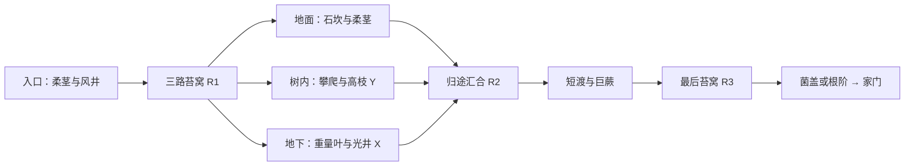

> **下蹲机制设计提案（未实现）**：[下蹲机关与前十关配置](../design/crouch-mechanisms.md)。当前只有下蹲动画；蹲行、姿态碰撞、低洞及避险机关为后续制作要求，不覆盖现行运行规则。

> **2026-09-22 运行版1.6覆盖合同**：前十关已按体验重设计替换。多数生物接触危险；每次受伤扣1格，倒下后从整关起点重来，零血显式重试。旧苔窝/检查点复活规则不适用于新地图。地图、物种、存档兼容和实测边界见[1.6制作记录](../production/first-ten/adventure-v1.6.md)。本文其余旧版布局和恢复点章节作为历史设计保留，不是1.6验收依据。

> 2026-09-22 同质化复审：用户再次否定当前十关的趣味性。[前十关体验重设计](../design/first-ten-experience-redesign.md)已列出结构性问题、十关独立目标及联合评审；用户已批准该提案，1.6试玩按此替换；实现范围见页首记录。旧通关测试不代表趣味性验收。

# 《雨后的归途》关卡设计 PRD

版本：v1.5 · 2026-09-22 · **长关卡设计目标；十关地图原型已接入，首次体验与完整空间表现仍待试玩校准。**

本版覆盖前十关布局、节奏与恢复点安排；微信小游戏仅横屏、昆虫尺度旅人、现有动作/物理规则、道具商城和稳定奖励ID延续。当前浏览器已切换为v1.5长地图试玩原型，具体实现与未验收边界见[试玩记录](../production/first-ten/long-map-playable.md)。此前地图与规则保存在[归档](archive/level-design-prd-v1.4-2026-09-22.md)，不得把旧关卡测试通过当作本版已实现。

## 1. 为什么重做

用户反馈每关太短。2026-09-22用当前CampaignReplay从真实初态输入回放，逐步累计跨区总模拟时间。**主路约7.4–30.6秒，十关合计约162.6秒**；这些是知道路线的脚本耗时，不是新手试玩、不含阅读/犹豫，也不是严格速通纪录。原文档的分钟级指标缺少地图内容支撑。

[30条路线基线](../production/first-ten/evidence/duration-baseline-2026-09-22.json)。注意不能读取结尾state.time作为整关时长：切换房间会重置它。新版测量必须从本关出发累计到出口，并记录暂停与后台时间。

整改是增加有变化的操作段、空间探索和局部替代路线。禁止按比例拉伸地图、降低移速、反复爬同一根藤、增加不可跳过等待、刷同一机关次数来凑分钟。

## 2. 新体验规模

首次主路目标合计**55–79分钟**，探索X/Y另加约**17–25分钟**；都是待试玩校准的设计范围。每关一个主要环境记忆点，8–13个具名场景段，其中L10三条替代路线不需要全走。段不是屏数；一次场景段通常含2–4个有关系的小操作。

熟练无伤目标用于防止关卡仍退化成十几秒短样例，不是强制最低耗时。允许玩家找到更快的合法路线；若明显短于目标，先检查是否跳过了整组内容，不能封死所有技巧捷径。

| 关卡 | 首次主路目标 | 熟练主路参考 | 主路有效路径候选（世界单位） | 总场景段 | 体验重心 |
| 01 苔间起步 | 3–4分钟 | 65–100秒 | 6000–8000 | 8 | 在雨滴与苔藓之间，第一次看见世界有上下两层。 |
| 02 孢子轻跳 | 4–6分钟 | 95–150秒 | 8000–11000 | 9 | 穿过菌落，再从一株巨树的内部看向外面的光。 |
| 03 借一阵风 | 5–7分钟 | 115–180秒 | 9500–13000 | 9 | 在风停与风起之间，沿林下风井升上低枝。 |
| 04 压弯小径 | 5–7分钟 | 115–180秒 | 9500–13500 | 10 | 沿扎根的柔茎过沟，学会利用承重留下自己的路。 |
| 05 石头的用处 | 6–8分钟 | 135–205秒 | 11000–15500 | 10 | 一颗小石头在不同地方，是垫脚、阻挡或配重。 |
| 06 根际暗河 | 待新版人测 | 当前回放约89秒 | 洞内7840横向单位 | 7 | 过暗河、走根道，再沿采光井返回地面。 |
| 07 浅水渡口 | 5–7分钟 | 115–175秒 | 9000–13000 | 9 | 走走停停地穿过三处岸湾，漂流只占旅程的一部分。 |
| 08 顺流上岸 | 7–10分钟 | 165–250秒 | 14000–19500 | 12 | 从近水的蕨丛升到巨枝，再沿树冠走出一整段路。 |
| 09 甲虫的领地 | 6–9分钟 | 145–220秒 | 12000–17000 | 11 | 进入虫群的日常，从观察节奏到主动选择穿行方式。 |
| 10 回家的光 | 8–12分钟 | 195–290秒 | 15500–22500 | 13 | 把一路学过的方法带回家，三条路最终成为同一段旅程。 |

路径候选指主路脚底轨迹总长，包含攀爬与地下段，不含X/Y额外回环，不是outside.width。普通速度约158单位/秒用于检查纯跑图占比；攀爬、载具和观察另计。每段先画有真实宿主的空间，再安排接触点，不直接用本表数值生成加长平台。1H=44碰撞身高，完整角色可见高约56；落点按实际控制器测量。

### 2.1 节奏预算

- 前30秒有第一个可完成操作；前60秒有一次方法选择或能看见的探索诱因。首关不弹商城或一长段教学。
- 首次体验约55–65%是移动/操作，20–30%是辨路/试解，10–15%是安全观察与回馈；不含死亡重跑和可选探索。比例仅观察参考，不用计时器强迫玩家停留。
- 每35–60秒让地形、操作目的或空间层次至少变化一项。相同机制再次出现必须变更方向、落点、载荷、回路或时机。
- 纯平地连跑通常不超过6秒；一次强制原地等候不超过8秒，等待处能看见节奏信号。错过后可立即重新尝试或选择主动绕行。
- 同屏最多一个新危险；侧风、滴水与新生物不叠加首教。前三关以宽落点和安全承接面建立信任。
- 长关卡不是长惩罚：每个容易失败的操作组前有固定CP；预期非致命失败重试回路10–25秒，HP耗尽从R回到最近关键操作的熟练重走上限90秒。试玩超出时增加R或调整挑战段，不强迫玩家反复重做。

### 2.2 长关卡恢复、暂停与旧档

以下是v1.5需要开发的合同，**当前v1.4只有既有R/CP能力，不能假设多休息点与中断续玩已支持**。

- R0为入口，新增R1/R2/R3按各关卡片列出。每个R首次主动确认后建立新的挑战段并恢复HP；重复确认同一个R不重复治疗或刷新工具。CP只更新局部救回位置，不补HP/工具。
- 对应恢复组为本关`segment-01…N`。同一支路的多个zone属于同一挑战段；跨界的船/石/植物依出生组与支撑依赖闭包恢复，已结束组不可被后方复位反向拉走。gA/gB仅是旧版本实现，不继续硬塞长地图。
- 新attempt的工具两次用量保持；首次新R建立新attempt，普通CP、门户、重访R和读档不补次数。商城准备窗口延续出发前/首次新R规则。
- 每2–3分钟以内有可保存的稳定R。退出/后台继续支持暂停，但正式交付长关卡前必须支持恢复到最近已确认R：本挑战段动态物按确定初态重建，HP/本attempt工具余量保存，永久奖励保持。明确提示“从最近苔窝继续”，不假装精确保存半空位置。没有确认新R时返回R0。
- 新存档携带地图版本、levelId、R稳定ID、attempt身份与工具余量；不能直接把旧x/y搬到新地图。旧关级完成、金币、道具、围巾和收藏按原ID保留；旧局部位置无法映射时回该关新入口并解释。迁移需幂等与备份，不重复补发奖励。
- R必须在干燥固定台、远离巡逻/风/水，空间中看得出休息用途；CP/R不得与箱子、藤蔓交互作用点重叠。

### 2.3 探索与奖励

保留每关X见闻和Y技巧纪念，各自独特收藏；两路共享一次10探索金币，首次出口20金币，共300金币的首批预算不变。**本轮不加付费、额外散币、第三类宝箱或强制购买工具**。新长路里的阶段回报主要是到达新景观、打开短回路、获得更好视野和确认休息点。

X不等于空路：低操作压力但要观察/辨路/换层。Y要求更精确操作，出口可明确下行回主路。长支路必须说明替代了哪段、在哪里汇合，以及物体移走后怎样返回。允许反向回访收齐两份纪念，但主路不要求全收集。

永久奖励沿用`forest-NN:main/explore/note-X/keepsake-Y`，观察灯仍是`tool:lamp:first`，终章仍是`journey:first-ten`。旧收藏迁移到新位置时显示已领取。经济节奏需要试玩复审：长关卡降低单位时间金币产出，本轮先保留价格防止无依据涨发，不能声称商城经济已平衡。

### 2.4 视觉与空间硬约束

- 冒险者是昆虫大小；蕨类、草茎、根系与菌盖提供近景路径，树呈巨大局部。不给细小草茎套树干/木柱模型。
- 高处路径必须有宿主与可解释的生长连接，不能靠一排悬空木片加长。写明前景碰撞体和后景树干的层次；通道不能填成看似实心的木头。
- 前景实体上下轮廓、边界与碰撞一致，装饰草不遮住挡路实体。宝箱箱体和翻盖不进入另一块木材，必须有真实承接面。
- 洞口成对且可逆，进出不补血/工具/蒲公英。外景连续高低层不拆成瞬移房间；独立洞内区必须有真实底面，物体与生物不跨门自动搬运。
- 洞口至少隔开一个有意义的障碍区；内部路线本身有两个以上辨识节点。不以两扇相邻门解释“地下冒险”。
- 镜头随角色升降，先露出落点/危险信号，再让玩家起跳；禁止因遮挡HUD丢失角色。支持回看方向和宽屏/窄横屏检查。
- 蘑菇弹射、弯茎桥、风井、重量叶片、船各有独立场景用途；不硬绑成每关同一套前置链。

## 3. 前十关逐段设计

下表顺序是空间游历顺序；写明X/Y的行是可选替代段，按每关支路说明连接。每段绝对坐标、跳距和素材尺寸在灰盒阶段交付；下面不是可直接导入的运行地图。

### L01 · 苔间起步

**记忆点：** 在雨滴与苔藓之间，第一次看见世界有上下两层。

**节奏目标：** 首次主路3–4分钟；熟练参考65–100秒。

| 段 | 空间 | 玩家行动与变化 |
|---|---|---|
| 01-01 | 雨珠坡 | 沿有起伏的苔面前进，在安全凹地完成短跳；远处暖光标记去向。 |
| 01-02 | 石缝台阶 | 低石形成不同高度的连续落点；可以逐级跳，也能借侧边坡绕过最高石。 |
| 01-03 | 蕨柄脚下 | 从地面缠藤上爬、停住，再主动向下爬回地面，形成完整操作闭环。 |
| 01-04 | 叶轴横行 | 沿有倾斜变化的蕨轴走到叶尖，跨到邻株；下方是可重新攀爬的苔地。 |
| 01-05 | 根旁苔窝 | 安全汇合与R1；从此处看见上方纪念箱和侧面低矮缝隙。 |
| 01-06 | 高低两条路 | 主路跨两段粗根，X从低处观察绕回，Y经短悬藤上高蕨。 |
| 01-07 | 雨滴间隙 | 地表连续两个短缺口，组合刚学的走近、起跳、落稳；无首次隐蔽致死。 |
| 01-08 | 回望林间 | 安全下行汇合，看到刚走过的高蕨，领取出口完成奖励。 |

**X观察回路：** 从低根缝观察雨珠与蜗牛，绕过一段高低跳，取见闻后由透光侧缝回到第7段。

**Y技巧回路：** 从第6段安全跳抓悬藤，登上同一蕨丛的高叶轴取纪念；必须能下爬或落回苔地。

**恢复安排：** R0入口、R1第5段；CP在第2/4/7段出口。

**必须反证：** 不能把首教做成必须精确跳抓；Y才要求跳抓。地面替代路必须有绕行与落差，不能一路按右到出口。

### L02 · 孢子轻跳

**记忆点：** 穿过菌落，再从一株巨树的内部看向外面的光。

**节奏目标：** 首次主路4–6分钟；熟练参考95–150秒。

| 段 | 空间 | 玩家行动与变化 |
|---|---|---|
| 02-01 | 菌落边缘 | 跳到低菌盖上，先看到菌盖压缩和孢子喷出。 |
| 02-02 | 干地试弹 | 第一朵菌弹向宽阔固定落台；允许不按方向观察高度，再重试。 |
| 02-03 | 偏移落点 | 第二朵偏向侧上方，起飞后选择落在近台还是远台；近台可接续。 |
| 02-04 | 宽水岸 | 第一次跨水；起跳台同时看见落点边缘，失败只回本岸CP。 |
| 02-05 | 树根门厅 | R1；外侧蘑菇路与内侧树洞路在这里分开，出口不能同屏相邻。 |
| 02-06 | 树内天窗 | X走两个树内小室：宽根梯上行、光照纹理观察，免费灯在明确的探索节点获得。 |
| 02-07 | 菌盖绕树 | 不进洞的主路沿两朵不同高低菌盖绕到远岸；Y在最高菌盖外侧固定托面。 |
| 02-08 | 树影汇合 | 洞内出口与外侧路线在远岸高台汇合；提前可见对岸树孔作为方向线索。 |
| 02-09 | 最后一跃 | 单独完成一次弹射后控制方向落下，安全走向出口；漏领灯可在出口前领取。 |

**X观察回路：** 第5段进树洞，经内壁两室到第8段，替代外侧第7段；距离更短但含辨路和低风险攀爬。

**Y技巧回路：** 从第7段最高菌盖落到侧面有宿主的固定平台；箱旁有下行缠藤回第8段。

**恢复安排：** R0入口、R1第5段；CP在第2/4/8段出口。

**必须反证：** 两条路都至少包含完整弹射体验；树洞不能瞬间跨过整关，不能依赖购买灯才能找出口。

### L03 · 借一阵风

**记忆点：** 在风停与风起之间，沿林下风井升上低枝。

**节奏目标：** 首次主路5–7分钟；熟练参考115–180秒。

| 段 | 空间 | 玩家行动与变化 |
|---|---|---|
| 03-01 | 绒毛草甸 | 获取蒲公英，显示携带和到期反馈；在低坡安全试滑翔。 |
| 03-02 | 无风落差 | 跳下短坡，比较自然下落和按住滑翔，落台可原路返回。 |
| 03-03 | 第一风井 | 看粒子预告再跳入间歇上升气流；错过可落回取种点。 |
| 03-04 | 井壁侧台 | 横向移出气流落在稳定侧台，再沿短根道行走，结束单次滞空。 |
| 03-05 | 背风苔窝 | R1与新蒲公英点，明确下一段有两个高度不同的出口。 |
| 03-06 | 双出口风井 | 主路从较低宽出口离开；Y继续升高抓垂挂藤；风停会落回井底安全面。 |
| 03-07 | 侧壁观察 | X沿干燥侧缝看风穿过根隙，从短下行路回第8段。 |
| 03-08 | 叶背走廊 | 风后的地面/蕨轴混合路线，需要判断两次起跳距离，恢复主动操作节奏。 |
| 03-09 | 低枝回地 | 从有宿主的低枝下行汇合，最后短滑翔到出口苔岸。 |

**X观察回路：** 第6段低出口旁进入侧缝，观察不改变风的示踪效果，取箱后回第8段。

**Y技巧回路：** 第6段高出口跳抓垂藤到低枝冠，经过两个不同方向的落点取箱，再沿藤下降回第8段。

**恢复安排：** R0入口、R1第5段；CP在第3/4/6/8段稳定出口。

**必须反证：** 一份限时蒲公英不承担全关；每个风段入口可重取，主路单次所需滞空必须小于期限且留30%余量。

### L04 · 压弯小径

**记忆点：** 沿扎根的柔茎过沟，学会利用承重留下自己的路。

**节奏目标：** 首次主路5–7分钟；熟练参考115–180秒。

| 段 | 空间 | 玩家行动与变化 |
|---|---|---|
| 04-01 | 柔茎坡 | 干地从两侧推弯柔茎，观察根不移动、茎随推力改变方向。 |
| 04-02 | 第一条沟 | 压弯第一株跨短沟；站在桥面停留，亲自确认承重时不回弹。 |
| 04-03 | 下桥回看 | 下桥观察空置恢复，远岸有明确可返回根道，不锁住初学者。 |
| 04-04 | 中间土岛 | 第二株靠另一侧生长，需先到可接近的根部选择弯曲方向。 |
| 04-05 | 蕨下休息 | R1；地下根洞、地面柔茎两条线路分开。 |
| 04-06 | 双岸接力 | 主路两次弯茎，中间是能站稳的岛；不用一口气抢在5秒内跑完两桥。 |
| 04-07 | 滴水根道 | X经两个有干燥等候点的洞室穿过滴水带，出口在第8段。 |
| 04-08 | 重量的提示 | 可推小石稳定一段弯茎，试后能从两侧取回；Y需借固定后的弯茎到蕨轴上。 |
| 04-09 | 弯桥汇合 | 确认R2；三条线路汇合，出口前再独立判断一次推弯方向。 |
| 04-10 | 归岸 | 短安全步行，回看弯茎与洞口在空间上如何连通。 |

**X观察回路：** 第5段地下入口→两个滴水洞室→第8段另一侧，替代第6段主路；清楚展示干/湿节奏。

**Y技巧回路：** 第8段用轻石压住柔茎，爬相邻蕨柄跳到另一端取箱；固定下行坡接第9段。

**恢复安排：** R0入口、R1第5段、R2第9段；CP在第2/4/6/8段出口。

**必须反证：** 每株根部双侧均可接近；落沟不形成不可恢复的软锁；不把5秒恢复当作全段倒计时。

### L05 · 石头的用处

**记忆点：** 一颗小石头在不同地方，是垫脚、阻挡或配重。

**节奏目标：** 首次主路6–8分钟；熟练参考135–205秒。

| 段 | 空间 | 玩家行动与变化 |
|---|---|---|
| 05-01 | 石滩 | 并排比较轻石和重石，推轻石、跳上重石；外观大小提示差异。 |
| 05-02 | 第一道高坎 | 推动轻石接近低坎再跳，坎旁有能退回的凹处。 |
| 05-03 | 窄根门 | 石头过不了窄口，玩家能走过；门前有足够空间把石头推回。 |
| 05-04 | 甲虫先声 | 安全高处观察一次甲虫转向，不立刻把角色放在撞击路径上。 |
| 05-05 | 根壳休息 | R1，供选择正面石挡路或绕壳上方路线。 |
| 05-06 | 封住巡逻口 | 主路用石挡住甲虫，利用空出的通道；也能以两次可读的跳跃绕过。 |
| 05-07 | 壳背观察 | X从壳背一段固定根缘观察足迹，绕回后半段。 |
| 05-08 | 配重分岔 | 轻石压柔茎作为Y路径，主路走较低石坎，不要求携带同一石头穿完整关。 |
| 05-09 | 第二片领地 | R2；甲虫与石头的关系换方向，配宽等待台，自己选挡虫或走高处。 |
| 05-10 | 远岸练习 | 主路高低跳中组合一块可推石与固定重石，出口在最后稳定台上。 |

**X观察回路：** 第7段沿壳背足迹走一条宽但弯折的观察路，到第9段；有明确入口和光照出口。

**Y技巧回路：** 第8段配重固定柔茎，借近旁攀爬点到上方纪念箱，再下行接第9段。

**恢复安排：** R0入口、R1第5段、R2第9段；CP在第2/4/6/8段出口。

**必须反证：** 石头和甲虫都必须尊重真实实体；错误摆放时可退回或重新接近，不能靠穿树壳解题。

### L06 · 根际暗河（2026-09-22试玩重做）

**记忆点：** 从狭窄根缝进入地下，穿过湿壁与暗河，在菌丝庭休息，最后沿采光井回地表。

旧版11段中5次复制叶杯布局。本轮改为7个有不同地貌与任务的区域，缩短模板后的空跑尾段。熟练输入回放约89秒；首次试玩时长和趣味性等待人测，不将旧版6–9分钟目标冒充当前结果。

| 段 | 空间 | 玩家行动与变化 |
|---|---|---|
| 06-01 | 根缝入口 | 在垂落根壁下压弯柔茎过缝；扣绳仍是可选工具 |
| 06-02 | 叶杯升降 | 透光裂隙下仅保留一次完整承重叶杯；移动石头再换落脚高度 |
| 06-03 | 滴水窄道 | 湿岩顶的聚滴预告危险；等停歇再穿过 |
| 06-04 | 朽木暗渠 | 主路推浮木过水；也可从入水前的缠藤上根道，取X并在对岸汇合 |
| 06-05 | 菌丝休息庭 | 本关唯一R1；观察西瓜虫，短暂休整，转向光井 |
| 06-06 | 采光蕨阶 | 蕨叶只出现在有光的区域；攀叶轴上土阶，额外攀根可取Y |
| 06-07 | 向上的风井 | 取绒毛、读风相位，上升到透光岸台，再回地面出口 |

**X探索路：** 暗渠左岸先上缠藤，走根道取宝箱，从右岸落回主路；不强制先乘浮木。水路与根道都有实际支撑和独立输入路径。

**Y技巧路：** 采光蕨阶后攀根进入高处收藏点，再回落到后续风井；保留稳定返程。

**恢复：** 一处R1在菌丝庭。旧R1按稳定ID恢复到新庭院；已删去的旧R2续玩映射到庭院的历史返回定义，保留HP和次数，不增加隐形回血。每段普通救回CP仍保留。永久关卡ID、金币和收藏grant不变。

**视觉：** 根壁／湿岩顶／暗河拱洞／菌丝庭／斜向孔光。地下取消等距森林草和巨树干；实际可走根面、石块、叶杯仍由碰撞几何控制。

### L07 · 浅水渡口

**记忆点：** 走走停停地穿过三处岸湾，漂流只占旅程的一部分。

**节奏目标：** 首次主路5–7分钟；熟练参考115–175秒。

| 段 | 空间 | 玩家行动与变化 |
|---|---|---|
| 07-01 | 短槽登船 | 把树皮推入短水槽，登上后很快看到可落的对岸。 |
| 07-02 | 苔岸行走 | 下船经过有起伏的安全岸道；新选择是登高还是沿岸走。 |
| 07-03 | 第一停靠湾 | 主路跳上固定岸肩；X沿根缘看水纹，在下一段汇合。 |
| 07-04 | 湾后的苔窝 | R1；显示第二片树皮，不要求追回第一片或让船逆流。 |
| 07-05 | 穿根水道 | 第二次漂流有真实头顶净空，中途有可跳离的干台。 |
| 07-06 | 登岸岔路 | 主路上岸绕行，Y从中途干台攀上靠岸高处；船走后仍有固定返路。 |
| 07-07 | 芦茎滩 | 沿岸走过双向柔茎和浅石坎，把主动动作放回旅程。 |
| 07-08 | 第三处渡口 | 最后一片树皮起落点更偏斜，需自己判断离船时机；失败在本岸恢复。 |
| 07-09 | 安静远岸 | 宽落台后短走向出口，三段水线的视差构成记忆点。 |

**X观察回路：** 第3段固定根缘回环取水纹箱，接第4段，不承担额外船程。

**Y技巧回路：** 第6段干台跳抓近岸垂藤取纪念箱，沿固定低根下降接第7段。

**恢复安排：** R0入口、R1第4段；CP在第1/3/5/7/8段干岸；最后渡口前有独立CP。

**必须反证：** 漂流单段目标4–8秒，连续强制等待不超过8秒；漏船后固定返回线可取下一片/重置本段，不靠无限等船。

### L08 · 顺流上岸

**记忆点：** 从近水的蕨丛升到巨枝，再沿树冠走出一整段路。

**节奏目标：** 首次主路7–10分钟；熟练参考165–250秒。

| 段 | 空间 | 玩家行动与变化 |
|---|---|---|
| 08-01 | 水岸接近 | 一段简短漂流接入大树脚下，复习不再占据整关前半段。 |
| 08-02 | 低蕨上行 | 攀蕨柄跨邻叶，给玩家看到上层路径和地面回路。 |
| 08-03 | 树侧缠藤 | 沿巨树局部表面的藤攀上固定枝肩；镜头预看上方落点。 |
| 08-04 | 枝肩休息 | R1；地面绕路与中层枝路开始分开，主路两者均可。 |
| 08-05 | 侧风首试 | 在宽平台上观察预告，在有安全承接地面的缺口尝试迎风跳跃。 |
| 08-06 | 背风回廊 | X沿真实树皮突起绕过强侧风，但有多段短攀和转折；不能是空白地面直达。 |
| 08-07 | 枝冠连接 | 主路低枝与X在第7段汇合；Y可从悬藤进一步上到高枝。 |
| 08-08 | 巨枝苔窝 | R2；从高处看回水岸，准备生物段。 |
| 08-09 | 蜻蜓栖枝 | 先在固定台观察蜻蜓起飞/返回，再通过它离开的空间；不与侧风同屏首教。 |
| 08-10 | 高低落点 | 两条短落点路线穿过相邻巨枝；Y收藏台在高路末端。 |
| 08-11 | 树皮下行 | 已有缠藤通向低处，中途掉落可在地面继续，再爬回枝侧。 |
| 08-12 | 枝端出口 | 上/中/下三路在固定大枝台汇合，最后跳跃结束关卡。 |

**X观察回路：** 第6段背风树皮回廊取风向见闻，接第7段；长一点但避开强风，保持主动操作。

**Y技巧回路：** 第7段悬藤→高枝→第10段箱台→第11段缠藤回路，不把箱子放入背景树干。

**恢复安排：** R0入口、R1第4段、R2第8段；CP在第3/5/7/9/11段稳定台。

**必须反证：** 每个台必须有可解释的宿主；高枝不是漂浮木片阶梯。旁路不能跳过整段关卡，只替换局部挑战。

### L09 · 甲虫的领地

**记忆点：** 进入虫群的日常，从观察节奏到主动选择穿行方式。

**节奏目标：** 首次主路6–9分钟；熟练参考145–220秒。

| 段 | 空间 | 玩家行动与变化 |
|---|---|---|
| 09-01 | 虫道外缘 | 先见蚁队从远处进入，角色在固定台上观察队列空档。 |
| 09-02 | 蚁路短跨 | 在宽落点之间跳过第一列蚂蚁，避免一碰就死的首教。 |
| 09-03 | 根壳岔路 | 低处等待队列间隔，高处缠藤绕行，两者各有一段主动动作。 |
| 09-04 | 甲虫边界 | 用轻石拦一次甲虫，观察转向后走出巡逻区。 |
| 09-05 | 枯壳苔窝 | R1，视野里可看到下一段西瓜虫和两层通路。 |
| 09-06 | 西瓜虫过客 | 使用已定义可站的壳背短途搭乘，固定边路可替代；不新增滚动攻击能力。 |
| 09-07 | 足迹回廊 | X在边路观察不同足迹、取箱后接第8段。 |
| 09-08 | 双层路口 | 甲虫在低处、蚁路在高处；选挡虫穿低路或攀上去分段跳过蚁路。 |
| 09-09 | 领地外苔窝 | R2与开阔等待台，下一段不同时触发两类危险。 |
| 09-10 | 技巧绕行 | Y经过壳背起跳、短悬藤和固定落台取箱；主路沿石阶绕过。 |
| 09-11 | 离开虫道 | 再判断一处空档完成最终短跨，回到安静苔地。 |

**X观察回路：** 第7段固定观察边路绕开西瓜虫搭乘，取见闻后接第8段。

**Y技巧回路：** 第10段可选壳背起跳→悬藤→箱台，踩空落到安全边路，可再次接近。

**恢复安排：** R0入口、R1第5段、R2第9段；CP在第2/4/6/8/10段出口。

**必须反证：** 生物行为保持统一：沿用现行接触伤害/可站面；不能为凑关长增加速度或把安全落台放进巡逻范围。

### L10 · 回家的光

**记忆点：** 把一路学过的方法带回家，三条路最终成为同一段旅程。

**节奏目标：** 首次主路8–12分钟；熟练参考195–290秒。

| 段 | 空间 | 玩家行动与变化 |
|---|---|---|
| 10-01 | 林间回望 | 宽苔地与熟悉蘑菇，远处暖光给出最终方向。 |
| 10-02 | 柔茎过沟 | 两侧推弯判断，任选直接过桥或走邻侧短攀路线。 |
| 10-03 | 熟悉的风井 | 重取蒲公英，借一次间歇上升气流到固定根肩。 |
| 10-04 | 三路苔窝 | R1；地面柔茎、树内高枝、地下光井三条路在同一地标分开。 |
| 10-05 | 地面旅程 | 主路为石坎→柔茎→蚁路短跨，三小段之间均有安全停台。 |
| 10-06 | 树内旅程 | Y路线为树洞内壁攀爬→孢子出侧孔→高枝箱台，以高处视野作为奖励。 |
| 10-07 | 地下旅程 | X路线为配重叶→干燥等候台→纹理观察室→采光井出口。 |
| 10-08 | 归途汇合 | 三路归到同一固定台R2；可以回到岔路探索，已领收藏不丢。 |
| 10-09 | 水纹短渡 | 一处短漂流，落岸后立即是主动行走，不把最终段变长等待。 |
| 10-10 | 巨蕨连接 | 两段叶轴与一处下行藤，允许从安全地面回爬。 |
| 10-11 | 最后苔窝 | R3；看到家门，最终挑战不要求重做之前两条探索路。 |
| 10-12 | 最后一次选择 | 短菌盖弹射或较长的固定根阶；无需消费道具、受伤或收齐收藏。 |
| 10-13 | 光里的终点 | 站在真实门前台完成；永久纪念按原ID发放，结算展示沿途发现。 |

**X观察回路：** 第4段地下分支替代第5段，经第7段取得见闻后到第8段；井出口不能回到入口旁。

**Y技巧回路：** 第4段树内分支替代第5段，经第6段高枝取纪念后到第8段；完整下行返路可见。

**恢复安排：** R0入口、R1第4段、R2第8段、R3第11段；CP在第2/3、每条替代路中转台、第9/10/12段出口。

**必须反证：** 三路各需90–150秒首次体验，不能用洞口瞬移抹去路程；主路不强迫三路全走，不要求买工具或全收集。

## 4. 实现切片与缺口

没有新的审美或渠道决策需要用户先确认：按微信横屏、现有动作和物理方向推进。本版55–79分钟首轮总长是可调候选；先做样板验证节奏，用户仍可要求更长或更紧凑。

| 顺序 | 交付 | 通过后才能做什么 |
|---|---|---|
| 0 | 修整计时采集；多R/恢复组、地图版本迁移、最近R续玩 | 长关卡正式替换旧图前必须通过恢复测试 |
| 1 | L01完整8段灰盒、X/Y与自然宿主侧视图 | 验证“长度有内容”而非只有跑图，再确定通用单段尺寸 |
| 2 | L07三渡口/岸路完整样板 | 证明拉长旅程但不拉长乘船等待、漏船也可继续 |
| 3 | L02/03/04 | 验证洞内替代、风段资源补给与柔茎回路 |
| 4 | L05/06/09 | 验证推物、载荷、生物组合与动态恢复闭包 |
| 5 | L08/10 | 处理最长的垂直路径与多区汇合，再整批验收 |

必须补齐的实现材料：每段带宿主的侧视布局、连续支持面/藤端点、空间相邻门配对、主路与X/Y无工具输入回放、CP/R安全周期证明、逐段计时/失败原因记录、旧存档迁移夹具。不能把本版拓扑JSON直接当作这些材料。

## 5. 验收方式

1. 所有十关新主路和X/Y回路从初态走通、不中途传送，不要求受伤或重置解题；高效技巧可以绕过局部操作，不能靠离开镜头穿越整片地形。
2. 逐段记录主动操作、静止观察、强制等待、无操作跑图、失败重做、可选探索。计时跨zone累计，暂停/后台不计入主动时长；保留总墙钟时长用于评估中断成本。
3. 用至少5名未看路线的试玩者分别记录首次主路中位数和范围，单独记录是否使用X/Y；样本小只能用于迭代，不能声称总体用户统计。脚本时间不能替代首次人测。
4. 第一轮低于目标不立即加长度：若纯跑超过35%或强制等待超过15%，优先删空段/加有意义转折；如果已有内容好玩且紧凑，可以下调时长目标。玩家合法速通不算缺陷。
5. 用iPad Pro（具体代际待确认）、Xiaomi 13、iPhone 17 Pro的横屏做触控体验；还需记录实际机型/系统。至少包含窄横屏、切后台、低帧率、两个方向推物、半空到期、从高处落地和所有藤蔓上下端点。
6. 每个挑战段至少覆盖：跳过R、首次确认R、重复确认R、非致命CP救回、HP归零、跨区返回、带工具/空工具、保存失败/重试、进程退出/续玩。恢复不能刷金币、HP或工具。
7. 所有可碰撞木材、岩石、箱体与可站生物做外形重叠检查；移动承载包含携带位移。角色脚、镜头及HUD不遮挡；宝箱可见开/关状态不与宿主相交。
8. 最终提交本版新回放证据和逐段截图，不引用旧250项通过来证明新增地图完成。

## 6. 联合评审结论

| 视角 | 判断 | 结论与未验证项 |
|---|---|---|
| 策划 | CHANGE | 将短演示扩为多段冒险，保留每关主机制；等待不能代替玩法。长度与趣味仍需样板试玩。 |
| 视觉/交互 | WARN | 已写清宿主、实体边界、垂直镜头和箱体净空；全部新空间的侧视设计尚未绘制。 |
| 产品 | WARN | 55–79分钟分布到10次旅程，必须先做最近R续玩；商城金币/分钟下降需要观察，不即时改价。 |
| 开发 | WARN | 可复用当前机制；新增多R恢复、版本迁移、跨区计时和续玩是基础工作。绝对坐标未验证。 |
| 测试 | UNVERIFIED | 有30条旧路线时间基线、新版本验收矩阵；新版地图尚未落地，所有新版可达性与真机结论留空。 |

**KEEP：** 一致物理、主路零消费、限时蒲公英、间歇风、固定安全恢复、永久奖励去重。
**CHANGE：** 地图规模、局部支路比例、挑战段数量、多R和跨区计时。
**CUT：** 无变化重复机关、长自动船程、浮空木片阶梯、相邻洞口捷径、靠隐藏进度计数强迫走指定路。
**TEST：** L01与L07两种节奏样板；首轮时长、恢复负担、购买收益节奏。

最小下一步是完成L01新灰盒并拿到逐段证据。本轮交付是全十关设计和拓扑，不是已经加长的游戏。

## 2026-09-22 工具可选解增量

不改变十关长度、奖励ID、X/Y预算和主线终点。L03第1段加入花蜜虫道（仍可跳过或攀到高路）；L06洞内第1段改为根井柔茎（仍可靠承重保持或及时通过）；L07第2段改为岸边叶杯（可使用原有石头或角色重量）。全部柔茎桥在落岸端布根结，所有载荷叶片标记叶杯；扣绳与露水只作用这些清楚表达的目标。L04/L05/L10等旧路线上的对应目标也能使用工具。

商城另有三处可重开的试用地，不发奖、不写续玩、返回原商城状态；试用结果不计关卡完成。仍以十关主路/X/Y零工具输入回放为可达性底线，不能用试用通过替代正常地图验收。规则见[实施记录](../design/coin-shop-v2-implementation.md)。

## 2026-09-22 苔窝密度调整（当前试玩生效）

用户反馈休息点出现过密。前十关可见苔窝由17处减为11处（约减少35%）：L01–L09各保留R1，L10保留R1/R2，删除其余可交互苔窝。保持固定点位，玩家可以记住位置；不采用随机出现。原有路段CP救回点保持，普通失足不因此要求重走整关。

删除点保留为只读历史返回点定义，供已有续玩记录恢复原位置、生命、次数与推进等级；它们不绘制、不提供休息或回血交互。新玩家不会激活这些点。死亡后较长的重试距离与更少工具补充是本轮需重点体验的平衡变量。

当前第六关规则以“根际暗河”详细卡为准，覆盖较早工具增量中沿用11段的位置描述；三工具价格和作用保持。

### 洞穴出入口间距硬约束（2026-09-23）

适用于当前试玩v1.6前十关，以及后续沿用该数据结构新增的关卡。按世界坐标的水平距离计算，不随屏幕尺寸或镜头缩放变化，也不能靠上下挪动规避。关卡终点光幕不属于洞口；单入口往返房间不强制凭空增加出口。

| 检查对象 | 最小水平间距 | 玩家体验目标 |
| --- | --- | --- |
| 同一支路在外部的入口、出口 | 640 | 避免进去绕一圈只前进几步 |
| 房间内部的入口、出口 | 640 | 两个端点之间保留实际探索空间 |
| 同一空间内不同支路的任意两个洞口 | 480 | 避免同一块地面并排堆洞，入口、返回口均检查 |

这些是最低门槛，不保证在宽屏中永不同框。按正常行走158单位/秒，分别约为4.1秒和3秒的水平移动；不能用空路拉长距离替代机关、奖励、路线选择。仍须检查落脚安全、触发范围、双向返回以及通关路线。

第十关重排：树洞入口400→250，地下入口650→800（间隔550）；树洞返回口2780→2750，地下返回口2890→3250（间隔500）。内部房间、宝箱永久ID和传送目标ID保留，三条归路仍可通关。

自动验收：`scripts/portal-layout.mjs`统一阈值；`npm run check`和Web／微信构建在导出前拒绝违规布局，并输出关卡、空间、两洞口ID、实际与所需间距。`tests/forest-portal-spacing.test.mjs`覆盖当前十关、阈值边界、异支路聚集和室内端点。历史未启用地图不作为当前试玩验收依据。

### L02菌群比例调整（2026-09-23）
四朵菌伞中心与冠顶高度保留，冠宽改为140／208／276／336，拱高随冠宽增长；详情见视觉规范“高矮菌伞的协调生长比例”。渲染与碰撞共用a/b/crownDrop，不再拉长菌柄保持相同小伞。允许宽冠增加落地容错，但相邻冠面必须留跳跃间隔，主线和X/Y奖励路线都须通过回放验收。
