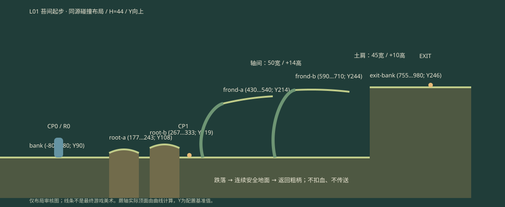

# L01 · 苔间起步 · 尺寸与实例包

> 文档状态（2026-09-21）：历史设计/记录。仅旧v1.3运行尺寸；不能与新A…F/X/Y混用。 当前基线见[设计文档索引](../../design/design-document-index.md)。

对应母文档L01-A。世界Y向上；H=44，入口地表Y=90，宽980。布局数据唯一来源为 `js/microforest/ForestLevels.js` 的forest-01；蕨轴轮廓来自 `FernGeometry.js`，下图按此导出，非独立手画碰撞。

| 区 | 实例／素材 | 范围／脚底高度 | 属性／支撑 |
|---|---|---|---|
| A | bank／ENV-04 | x=-80…980，y=90 | 固定、连续、安全土壤；所有高坠下方保留 |
| A | CP0／R0／CHAR-01 | x=65，y=90 | bank；入口安全带x=15…167，宽152>3H |
| B | root-a／ENV-05 | x=177…243，中心y=108，缘y=100 | 固定露根，宽66，最高0.41H |
| B | root-b／ENV-05 | x=267…333，中心y=119，缘y=111 | 固定露根，宽66，最高0.66H；前段净距24 |
| C | CP1 | x=355，y=90 | bank；前进越过355且落地才激活，不靠腾空经过 |
| C/D | frond-a／PLT-01 | 根x=385,y=90；轴x=430…540,y=210…226 | 可攀柄、可站轴；爬高120=2.73H，轴长110 |
| D | frond-b／PLT-01 | 根x=545,y=90；轴x=590…710,y=240…236 | 独立可攀、可站；第二入口也可地面攀，不设脚本锁 |
| E | exit-bank／ENV-04 | x=755…980，y=246 | 固定高土肩；比地面高156，普通跳无法直达 |
| E | exit／ENV-03 | x=890，y=246 | 脚落exit-bank后向右才通关；地面不结算 |

两轴最小间隙50=1.14H，边缘高度差14=0.32H；第二轴→土肩间隙45、升高10。图中浅色轮廓只用于审阅，不应在正式场景画白色可走线。

outside为唯一模拟zone，A…E只是教学区域。无portal、风、水、敌人、可搬物；不新造HP接口来伪装无危险首关已验证生命系统。

恢复组 `L01-fixed`：bank、root-a、root-b、frond-a、frond-b、exit-bank皆固定不可丢失；玩家支持面须清除旧引用再落回最新CP。CP0→(65,90)、CP1→(355,90)。R0设计绑定CP0，但现有运行时未接HP/R，当前只是入口；此处明确区分。正常跌落不触发恢复、不清进度，走回385抓柄重爬。可选直接攀第二柄属于自由替代解，不要求每次复跑第一轴。

纯输入主解记录于 `CampaignReplay.js`：从初态自动跳过低根→走至385→手掌抓柄→上攀1.2s→第一轴529处向右跳→第二轴702处向右跳→高土肩出口。回放无瞬移、无改能力、无恢复捷径。9项专项回归覆盖三步长落地与误结算，不代表真人通关时长；目标1.5–3分钟仍需新玩家观察。
