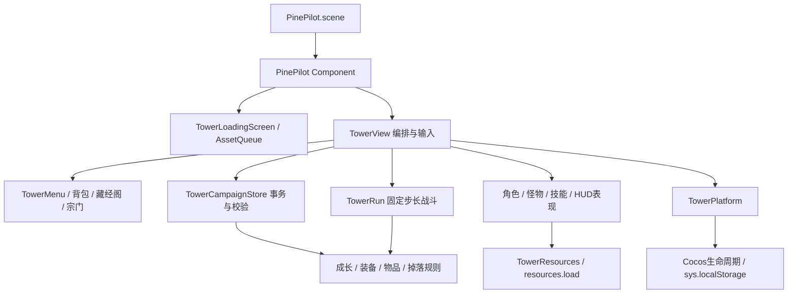
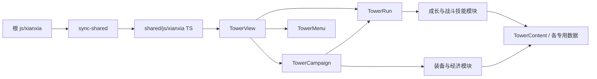
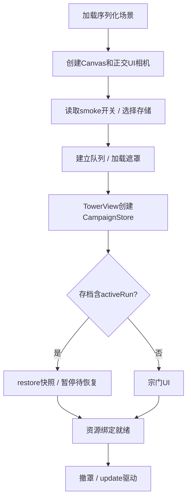
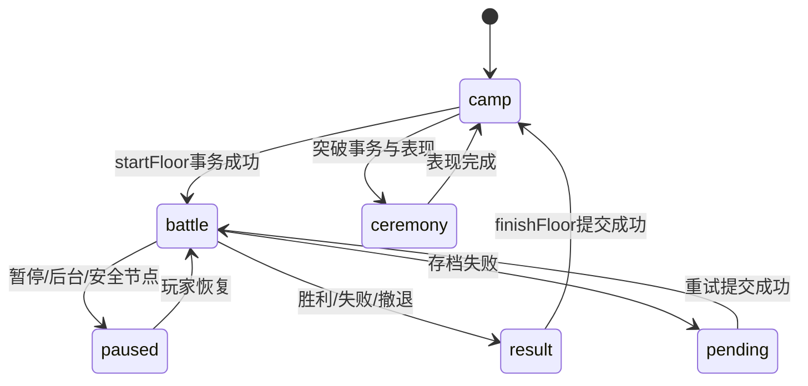

# 架构审计与问题登记

## 结构判断

纯逻辑与引擎表现已分层；状态以TowerCampaignStore和TowerRun为核心，不需要新状态管理框架。静态相对导入扫描未发现循环依赖；生成层只做根JS到TS的接入。`evidence/dependencies.json`保留完整边表，未解析运行时动态依赖，不把“无静态环”说成“无任何耦合”。

第二张为归并后的职责图，非全量逐文件拓扑。同步箭头是生成关系，不是运行时反向import。

## 启动和场景状态

这是同一个Cocos场景中的业务状态切换，不是每次director.loadScene。资源的宿主生命周期因此长于单次战斗。

## 应保持的设计

- Campaign先在候选副本应用、验证、写入，再发布冻结状态；写失败不替换内存状态。
- 读取损坏当前schema存档转只读，过旧schema依开发约定只重置本模式键。
- activeRun、attemptId、单调账本与结算清空共同防止普通重复领奖。当前乐观旧值比较不是跨进程数据库CAS，不将其宣传为强并发事务。
- 输入/生命周期注册有对应destroy清理；Cocos管理调度，无自建多套全局RAF。
- 伤害数字已有48条上限；已存在资源去重、重试及销毁后回调保护。
- 自定义碰撞和固定步长适配当前2D战斗，无证据应加物理引擎。

## 统一登记

P0（发布）意味着进入正式发行前必须处理，不表示当前开发预览立即崩溃。未做真机验证的问题明确保留“待量化”。

### R01 · P0（发布） · 正式构建缺少开发工具隔离

- **模块/位置**：`TowerPlaytest.js:45；TowerView.ts:168、431、785；TowerMenu.ts:912`（相对仓库根；区间用于阅读定位）。
- **现象/证据**：towerStorage始终allowPlaytestTools=true，宿主始终传入tools回调；内存探针成功执行playtestResources。
- **根因**：开发便利直接复用于普通存档，无发布能力开关。
- **影响范围/玩家影响**：全部普通存档与经济/难度；发布后可免费获得资源、无敌或重置。
- **技术风险**：高：发布阻断；当前开发期保留工具合理。
- **难度**：M
- **建议**：构建标志+存储权限双层限制，生产不读取辅助偏好；保留独立QA包。
- **是否必须重构**：局部必须
- **回归风险**：中：误关QA工具或误拒正常动作。

### R02 · P1 · 回归测试大面积失效

- **模块/位置**：`tests/xianxia-tower-host-tools.test.mjs:43；tests/xianxia-tower-inventory.test.mjs；evidence/tests.log`（相对仓库根；区间用于阅读定位）。
- **现象/证据**：563失败，其中TowerBreakthroughAudio未定义180、TowerCharacterArt未定义108、WeaponQualityArt未定义3。
- **根因**：若干VM测试手动剥离import后未同步注入新增类；其余规则断言有漂移，根因待逐项裁决。
- **影响范围/玩家影响**：宿主/背包等门禁无法有效区分新回归；用户可能收到漏检问题。
- **技术风险**：高：不可宣称全绿，也不能把缺桩错误认作生产崩溃。
- **难度**：M/L
- **建议**：先修公共测试夹具，再按现行设计裁决业务失败，保留失败清单。
- **是否必须重构**：测试设施需要局部调整
- **回归风险**：低到中：通过删除有效断言制造假绿。

### R03 · P0（发布） · TapTap交付链缺失

- **模块/位置**：`scripts/cocos/build.mjs:6；scripts/check-release.mjs:8；TowerPlatform.ts:11`（相对仓库根；区间用于阅读定位）。
- **现象/证据**：仅web-mobile/wechatgame，发布检查为wx AppID/微信资质；未发现Tap配置和TapBuild产物。
- **根因**：平台目标变化尚未进入构建和验收流程。
- **影响范围/玩家影响**：TapTap启动、网络、存储、广告、提审；包不可直接视为可发布。
- **技术风险**：高：官方转换可行，实际兼容尚未验证。
- **难度**：M
- **建议**：保留Creator3.8.8，以官方转换插件生成Tap包，独立平台门禁和真机冒烟。
- **是否必须重构**：局部必须
- **回归风险**：中：转换与现有二次packageWechat处理顺序冲突。

### R04 · P1 · 运行包混入候选旧版本且资源单包过大

- **模块/位置**：`scripts/cocos/package-wechat.mjs:12；cocos-pilot/assets/resources/tower-skill-fx/flight-stream-v2.png；TowerMonsterArt.ts:295`（相对仓库根；区间用于阅读定位）。
- **现象/证据**：运行资源123.06MiB；微信脚本将resources整体分包并按4MiB单包/20MiB总包拒绝。旧flight-stream-v2和boar.png仍位于运行目录。
- **根因**：所有资源集中resources，历史版本未区分发行依赖与归档。
- **影响范围/玩家影响**：首次下载、更新流量与发布构建；玩家等待增加。
- **技术风险**：高：超出现有项目预算已证实；不是Tap官方上限结论。
- **难度**：M
- **建议**：先建立资源依赖白名单，候选旧图移出发行输入但保留原文件；按宗门/层组/技能拆包或CDN。
- **是否必须重构**：资源组织局部必须
- **回归风险**：中：动态路径漏扫造成缺图。

### R05 · P1（待真机量化） · 大图集叠加会话驻留

- **模块/位置**：`TowerAssetQueue.ts:9、78；TowerResources.ts:4；TowerMonsterArt.ts:292`（相对仓库根；区间用于阅读定位）。
- **现象/证据**：队列持有addRef直到host销毁；妖猪常态/狂暴每张4096×3072，loadMotion一起请求，两张RGBA8估算96MiB。
- **根因**：缓存作用域是整宿主，业务场景切换仅清绑定；没有容量或阶段淘汰。
- **影响范围/玩家影响**：长时间跨层游玩内存峰值、低端机风险；实际OOM未复现。
- **技术风险**：中高：是有限工作集累积，不认定无限泄漏。
- **难度**：M
- **建议**：先测纹理/进程峰值，再做分层资源作用域、零使用LRU；复用仍需保留。
- **是否必须重构**：建议优化
- **回归风险**：中高：释放仍在SpriteFrame使用的纹理会黑图。

### R06 · P1 · 绑定失败被加载队列当作完成

- **模块/位置**：`TowerAssetQueue.ts:76–87`（相对仓库根；区间用于阅读定位）。
- **现象/证据**：探针中绑定回调throw后pending=0、failed=0、completed=1。
- **根因**：仅传输状态决定ready，catch日志后继续完成；重试仅处理failed。
- **影响范围/玩家影响**：必需图集解析/创建失败可撤罩并进入缺图界面；生产触发频率未知。
- **技术风险**：中：失败恢复可靠性。
- **难度**：S/M
- **建议**：分离传输就绪与绑定就绪，必需失败可重试，可选失败有降级结果。
- **是否必须重构**：局部必须
- **回归风险**：中：重复执行已成功的绑定产生重复节点/引用。

### R07 · P2（待真机量化） · 周期性完整快照与多次序列化

- **模块/位置**：`TowerView.ts:926；TowerRun.js:909；TowerCampaign.js:453、972`（相对仓库根；区间用于阅读定位）。
- **现象/证据**：每0.75秒snapshot、拷贝state、validate、encode、同步写入和freeze；M4内存checkpoint P95 1.426ms。
- **根因**：正确性优先的整状态事务，与战斗执行同线程。
- **影响范围/玩家影响**：长局账本增长后帧尖峰/同步存储延迟；当前轻负载未证实卡顿。
- **技术风险**：中；改动容易破坏原子性与反重复领奖。
- **难度**：M
- **建议**：先标记阶段耗时和档案字节；仅消除冗余拷贝/无变化同步，不先放宽校验。
- **是否必须重构**：非必须
- **回归风险**：高：不得简单加大存档间隔或删除校验。

### R08 · P2（待真机量化） · 每帧重绘/深度排序与高频临时对象

- **模块/位置**：`TowerView.ts:935；TowerDepthOrder.ts:4；TowerRun.js:1140、1868`（相对仓库根；区间用于阅读定位）。
- **现象/证据**：每帧clear绘图，children.slice.sort逐个setSiblingIndex，目标filter/sort；怪物离开可见集会销毁节点。
- **根因**：程序绘图与按需表现的直接实现，没有脏标记/完整可复用池。
- **影响范围/玩家影响**：密集特效或边缘往返可能增加CPU/GC；短测未见严重掉帧。
- **技术风险**：中。
- **难度**：M
- **建议**：真机profile后只改热点，静态层脏标记、排序不变跳过、可见对象池设上限。
- **是否必须重构**：建议优化
- **回归风险**：中：遮挡次序/特效节奏改变。

### R09 · P2 · 大宿主和弱类型扩大修改影响

- **模块/位置**：`TowerMenu.ts:1–2947；TowerView.ts:1–1339；TowerRun.js:1–2463；scripts/cocos/sync-shared.mjs:18`（相对仓库根；区间用于阅读定位）。
- **现象/证据**：多职责大模块，生成TS统一ts-nocheck，strict=false；check命令不执行tsc。
- **根因**：快速迭代形成宿主集中编排，TS主要作为引擎接入载体。
- **影响范围/玩家影响**：新增系统易遗漏清理/测试依赖；维护成本高，不等于当前功能错误。
- **技术风险**：中。
- **难度**：分批M
- **建议**：新增接口先定义窄类型；随功能修改提取面板/资源作用域，不大拆战斗内核。
- **是否必须重构**：可保持主体
- **回归风险**：中高：全局拆分会消耗进度并制造回归。

### R10 · P2 · 构建可追溯性未覆盖构建工具

- **模块/位置**：`scripts/release-integrity.mjs:6；evidence/probes.json`（相对仓库根；区间用于阅读定位）。
- **现象/证据**：digestSource不包含scripts、package.json或完整工具链；微信包摘要过期；工作树未形成交付基线。
- **根因**：指纹只追踪游戏输入目录；验收与构建工具变化未统一。
- **影响范围/玩家影响**：测试/构建结论可能对应不同产物，影响排障和回滚。
- **技术风险**：中。
- **难度**：S/M
- **建议**：发行manifest加入Creator/插件/构建脚本/配置哈希和原始资源依赖清单。
- **是否必须重构**：局部建议
- **回归风险**：低：不重写现有历史。
