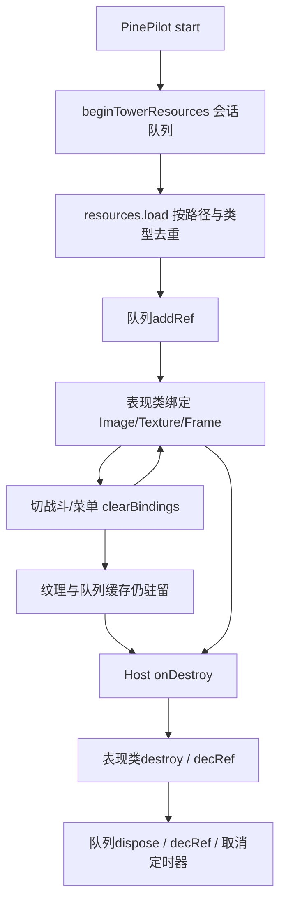

# 性能与内存审计

## 方法与结果

先做代码路径审阅，再执行Node纯逻辑基准及真实Cocos Web包短测。所有原始数据在evidence；没有伪造手机FPS或GPU指标。浏览器包的源码摘要与当前digestSource一致，但本轮没有重新构建，也未执行完整类型检查。

| 场景/指标 | 测量 | 解释 |
|---|---|---|
| Node floor1 8×60秒模拟 | 28800 tick，advance P50 0.012ms/P95 0.362ms/P99 0.579ms/max10.247ms | Apple M4、Node22.22.2，驻足新档、最多16怪；含冷样本 |
| 同步snapshot+checkpoint | 640次，P50 0.840/P95 1.426/P99 1.773/max2.278ms | 内存Map存储，不含磁盘/平台I/O；最终档26057字节 |
| Web宗门观察8秒 | RAF P95 9ms | 浏览器120Hz，不是引擎120FPS |
| Web第一层12秒 | RAF P95 9.3ms/max16.6ms；6个怪 | 仅观察帧调度，不是GPU耗时 |
| Web引擎update单独采样6秒 | 360帧，间隔P50 16.7/P95 18.3/max19ms | 约60FPS；不是update函数CPU执行耗时 |
| 宗门→第一层 | 844.1ms直到loading.blocked=false | localhost、宗门已加载；不是冷启动TTI |
| 首次宗门资源传输观察值 | 14708230字节，14.03MiB | Performance Resource Timing，未做缓存清空证明，不含顶层文档 |
| 进第一层后累计传输 | 56520160字节，53.90MiB | 增量约39.88MiB；不是平台首次下载包大小 |
| JS Heap采样 | 宗门约27.01MiB、进战斗约60.66MiB | 不含纹理、解码内存、原生引擎内存 |
| 5次进出后Heap | 约33–67MiB间波动，最后约33.83MiB | 未强制GC；不能从短序列推断泄漏率 |
| 5次进出资源请求条目 | 均242 | 该路径复用缓存有效；不代表跨全部楼层没有增长 |
| 暂停 | 500ms前后完整快照一致 | 仅桌面短测；恢复/退出完成 |

冷启动TTI、CPU百分比、GPU耗时、Draw Call、纹理实际显存、手机热降频、多技能满屏、长时挂机、真实Tap前后台切换：**尚未实测**。浏览器运行console有favicon 404及deprecated API告警；该404不是游戏素材缺失。

## 可定位热点

- R07：`TowerView.ts:926`每0.75秒快照。`TowerCampaign.js:453`深拷贝/全验证/编码/写入/freeze，`_checkpoint`再次校验快照并拷贝。优先测真实同步I/O，不要删校验换跑分。
- R08：`TowerView.ts:935`每帧清理Graphics并绘制，`TowerDepthOrder.ts:4`复制/排序/逐节点setSiblingIndex；`TowerRun.js:1140`目标筛选排序、1868弹道尾迹filter/slice。当前测量不足以认定是瓶颈，先插入profiler区间。
- UI动态Label/Graphics/Sprite交错以及根Mask可能打断合批；未测Draw Call前不批量合图。角色/技能透明区域可能导致过度绘制，需用GPU工具或遮罩面积/分辨率对照实验定位。
- `TowerMonsterArt.ts:217,373`离开可见集合后销毁，`TowerDepthOrder.ts:20`fallback类似。伤害数字已有上限池，不能说“项目没有对象池”。

## 资源生命周期

已看到合理的destroy保护、timeout清理、输入事件解绑、音频stop和decRef。暂未证实无限增长泄漏。主要风险是**合法引用持有太久**：同一宿主跨层会累积纹理，队列还持有一份引用，因此仅清Sprite节点不能释放图片。不要在未解除所有使用者之前直接resources.release。

妖猪两个4096×3072图按RGBA8各48MiB，合计96MiB；这只是纹理单层估算，不包含解码副本、mipmap或压缩格式差异。第一层会一起加载常态和狂暴图，需在手机测峰值。全库PNG解码尺寸相加约659.23MiB只是全驻留假设，不能标成实测Heap。

## 验收建议（项目目标，非平台硬要求）

60FPS为目标，先以低/中/高三档真机测10分钟战斗；帧间隔P95≤20ms、P99≤33.3ms为初始内部目标。达不到时记录具体机型并评审画质档，不改变模拟tick。设备内存预算经首轮真机样本确定；30次切换后同等场景、同等GC条件下资源数量应趋稳。后台10秒/5分钟/锁屏恢复必须零重复结算、零后台攻击。
