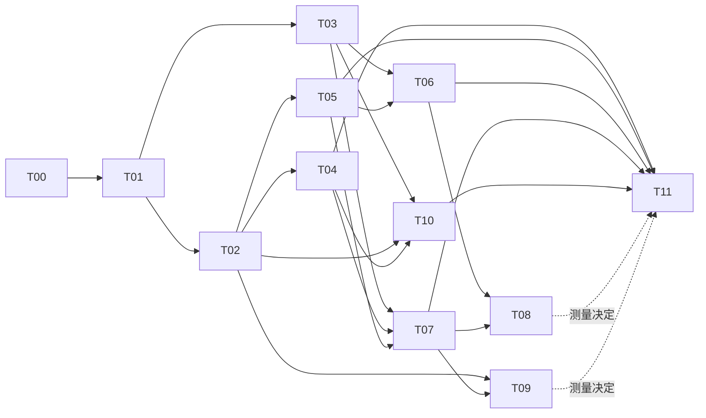

# 技术治理任务板

第一轮审计完成；用户已授权执行 T01–T09，并确认采用“TapTap 普通小游戏 + Cocos 官方转换插件”。目前没有 TapTap AppID/测试账号和真机，涉及这些资源的验收保持待完成。T08/T09 仍按测量证据决定，不自动实施。S约半天–1天，M约1–3天，L约3–7天；为工程量级参考，不含账号审批、真机获取和美术制作。T02失败裁决可能扩大，不承诺固定交付日期。

| Task ID | 名称 | 优先级 | 里程碑 | 前置 | 状态 |
|---|---|---|---|---|---|
| T00 | 完成本轮技术基线 | P1 | M0 | 无 | 已完成（有限环境审计） |
| T01 | 建立可回滚发行基线 | P1 | M0 | T00 | 已完成（1ae80fc；指纹、门禁、真实Web复验） |
| T02 | 恢复有判别力的测试门禁 | P1 | M1 | T01 | 执行中（测试恢复已实施；7项规则／视觉验收问题保留） |
| T03 | 验证Tap转换与平台构建 | P0 | M1/M4 | T01 | 本地转换已完成（53f7330；账号、导入、包体规则和真机待验证） |
| T04 | 封闭发行版开发者权限 | P0 | M1 | T01,T02 | 本地验证完成（4c63189；生产/QA双构建与编译包权限检查通过） |
| T05 | 修复资源绑定失败状态 | P1 | M2 | T02 | 本地实现完成（5a6a116；28/28、独立复审通过） |
| T06 | 资源发行清单与分组加载 | P1 | M3 | T03,T05 | 本地部分完成（精确staging与逻辑分组；平台限额、全路径和弱网待验证） |
| T07 | 目标设备性能基线 | P1 | M2/M3 | T03,T04,T05 | 工具及浏览器短测完成（43/43；目标设备基线待验证） |
| T08 | 按测量治理纹理驻留 | P1 | M2 | T06,T07 | 条件执行（现有证据不足，未进行缓存淘汰） |
| T09 | 按测量优化快照与绘制热点 | P2 | M3 | T02,T07 | 条件执行（现有证据不足，未重构快照或排序） |
| T10 | 平台能力及广告准备 | P1 | M4 | T03,T04,T02 | 待批准 |
| T11 | 全面回归与发行候选验收 | P0 | M5 | T04,T05,T06,T07,T10；T08/T09按测量结论 | 待批准/最终发布需用户授权 |

M0先固定基线；M1解决权限、门禁和平台试跑。M4的平台探索前移到M1，避免优化完才发现格式不兼容。M2/M3按真机证据推进；M5只验收冻结候选。未列“全面迁移引擎”或“全量改TS”任务。

本轮已完成本地可执行的构建、权限、资源与采样工具工作，但不将 T01–T09 整体标为完成。带已锁定官方插件的最终全量测试为 **2246 项：2239 通过、7 失败、0 跳过、0 todo**，`npm run check` 通过。T02 仍保留七项失败：两项装备预算／标准构筑、四项经验环／高清玉龙与当前横条 HUD 的需求冲突，以及一项单发剑破虚空末帧采样缺口。用户对 HUD 方案和合法装备测试基准的两个选择尚未回复，现有断言与游戏数值均保留。

T06 只从发行 staging 排除两张已审定旧 PNG 及对应 metadata，源素材保留；363 张保留图像的构建原生文件与源文件逐字节一致。分组目前是清单与诊断用逻辑分组，尚未实施物理分包、远程加载或技能特效延迟加载。最终 QA 与 Tap 本地转换包已重建；Tap 候选仍为 `releaseEligible=false`。

T07 已补真实 Web QA 功能回归：结算弹窗保留时立即入塔并暂停、三轮重复、继续／回宗，以及角色当前气血显示；控制台为 0 错误、62 条警告（61 条弃用、1 条窗口尺寸设置不支持）。该功能回归不是目标设备性能基线。资源与构建证据见 [T06](execution/T06/README.md)，采样及浏览器证据见 [T07](execution/T07/README.md)，T08/T09 的执行门槛见[测量决策](MEASUREMENT_DECISIONS.md)。

## T00 · 完成本轮技术基线

- 优先级/里程碑：P1 / M0；前置：无。
- 所属模块/涉及文件：`docs/technical-review`。
- 具体操作：记录源哈希、运行测试、短测和官方文档核对。
- 风险：把旧包当新包。
- 验收标准：十份文档和证据可追溯。
- 测试方案：文档链接与哈希复核。
- 工作量：M；状态：已完成（有限环境审计）。

## T01 · 建立可回滚发行基线

- 优先级/里程碑：P1 / M0；前置：T00。
- 所属模块/涉及文件：`scripts/release-integrity.mjs；发行manifest`。
- 具体操作：确认工作树所有权；建立用户认可的源码快照；补工具链/配置哈希。
- 风险：漏收未跟踪现行源码。
- 验收标准：固定输入可重复构建且产物可映射至源码。
- 测试方案：改任一构建输入应使旧manifest失效。
- 工作量：S；状态：已完成（1ae80fc；指纹、门禁、真实Web复验）。

## T02 · 恢复有判别力的测试门禁

- 优先级/里程碑：P1 / M1；前置：T01。
- 所属模块/涉及文件：`tests/helpers；host-tools/inventory等测试`。
- 具体操作：先补VM新增依赖，再分组裁决数值、schema和业务失败。
- 风险：错误放宽有效断言。
- 验收标准：有效现行规则套件全绿；每个废弃测试有依据；无未解释失败。
- 测试方案：复跑全量并比对失败名字；关键存档负向测试。
- 工作量：L；状态：执行中（测试恢复已实施；7项规则／视觉验收问题保留）。

## T03 · 验证Tap转换与平台构建

- 优先级/里程碑：P0 / M1/M4；前置：T01。
- 所属模块/涉及文件：`scripts/cocos/build.mjs；build-configs；Tap适配插件配置`。
- 具体操作：锁插件；独立输出Tap包；核对二次分包顺序、上下文和AppID。
- 风险：转换与packageWechat冲突。
- 验收标准：Tap开发工具及至少一台目标设备能启动、存读、进出战斗；取得包体上限。
- 测试方案：平台工具导入、日志、manifest、网络及生命周期冒烟。
- 工作量：M；状态：本地转换已完成（53f7330；账号、导入、包体规则和真机待验证）。

## T04 · 封闭发行版开发者权限

- 优先级/里程碑：P0 / M1；前置：T01,T02。
- 所属模块/涉及文件：`TowerPlaytest.js；TowerView.ts；TowerMenu.ts；发行配置`。
- 具体操作：编译环境标识；生产存储拒绝开发动作；隐藏入口且不读取辅助偏好。
- 风险：误破坏开发调试或普通行为。
- 验收标准：生产无法通过UI/直接action发资源、无敌、加速；QA仍可用。
- 测试方案：同源码生产/QA双构建；直接动作负测及已有存档测试。
- 工作量：M；状态：本地验证完成（4c63189；生产/QA双构建与编译包权限检查通过）。

## T05 · 修复资源绑定失败状态

- 优先级/里程碑：P1 / M2；前置：T02。
- 所属模块/涉及文件：`TowerAssetQueue.ts；TowerLoadingScreen.ts；加载测试`。
- 具体操作：区分传输/绑定，记录失败，幂等重试，明确可选项降级。
- 风险：重试重复绑定或永远遮罩。
- 验收标准：抛错不假完成；重试不重复节点/引用；成功恢复。
- 测试方案：故障注入throw、404、timeout、destroy晚回调。
- 工作量：M；状态：本地实现完成（5a6a116；28/28、独立复审通过）。

## T06 · 资源发行清单与分组加载

- 优先级/里程碑：P1 / M3；前置：T03,T05。
- 所属模块/涉及文件：`resources组织；TowerResources；package-wechat；构建配置`。
- 具体操作：可达性清单；候选旧版排除发行；分组或远程加载；保留归档。
- 风险：动态路径漏掉资源。
- 验收标准：满足核实后的平台大小上限；首屏/全路径无缺资源。
- 测试方案：所有楼层/技能路径、弱网、哈希、四口径大小前后对比。
- 工作量：L；状态：本地部分完成（精确staging与逻辑分组；平台限额、全路径和弱网待验证）。

## T07 · 目标设备性能基线

- 优先级/里程碑：P1 / M2/M3；前置：T03,T04,T05。
- 所属模块/涉及文件：`验收脚本；profile开关；性能报告`。
- 具体操作：测十种场景，收帧间隔、CPU分段、纹理、Heap、加载和热降频。
- 风险：模拟器结论外推真机。
- 验收标准：低/中/高设备基线明确，原始trace可追溯。
- 测试方案：按REGRESSION_TEST_PLAN；每场景重复3次。
- 工作量：M；状态：工具及浏览器短测完成（43/43；目标设备基线待验证）。

## T08 · 按测量治理纹理驻留

- 优先级/里程碑：P1 / M2；前置：T06,T07。
- 所属模块/涉及文件：`TowerAssetQueue；TowerResources；MonsterArt及高占用Art`。
- 具体操作：给加载组所有权；零使用资源淘汰；先妖猪/技能组试点。
- 风险：提前释放或频繁重下载。
- 验收标准：同场景30循环趋稳，目标设备无内存告警，画质不退。
- 测试方案：引用计数、切层、暂停、死亡、背景恢复，内存峰值对照。
- 工作量：M；状态：条件执行（现有证据不足，未进行缓存淘汰）。

## T09 · 按测量优化快照与绘制热点

- 优先级/里程碑：P2 / M3；前置：T02,T07。
- 所属模块/涉及文件：`TowerCampaign；TowerRun；TowerView；TowerDepthOrder`。
- 具体操作：分项profile；先脏标记/跳过不变排序，再考虑重复拷贝。
- 风险：改变碰撞顺序或事务语义。
- 验收标准：热点成本下降且回放/数值/原子性一致。
- 测试方案：固定seed事件轨迹、失败写入、p95/p99前后同设备。
- 工作量：M/热点；状态：条件执行（现有证据不足，未重构快照或排序）。

## T10 · 平台能力及广告准备

- 优先级/里程碑：P1 / M4；前置：T03,T04,T02。
- 所属模块/涉及文件：`TowerPlatform；广告adapter；Campaign奖励事务；日志模块`。
- 具体操作：能力检测；生命周期去重；无SDK接口及模拟测试；获广告位后真机接入。
- 风险：广告重复奖励/卡住暂停。
- 验收标准：无填充/早退不奖励；完成一次；失败保存可恢复。
- 测试方案：奖励幂等、超时、重复close、退出、真机广告矩阵。
- 工作量：M（不含平台审批）；状态：待批准。

## T11 · 全面回归与发行候选验收

- 优先级/里程碑：P0 / M5；前置：T04,T05,T06,T07,T10；T08/T09按测量结论。
- 所属模块/涉及文件：`发布配置；验收脚本；release清单`。
- 具体操作：冻结候选；完整回归、长时/弱网、包体核验；后台审核核对。
- 风险：范围持续变化导致结果失效。
- 验收标准：RELEASE_CHECKLIST全勾选或明确批准例外；无P0/P1未解决。
- 测试方案：候选哈希一致；真机原始trace/视频/错误日志。
- 工作量：L；状态：待批准/最终发布需用户授权。
