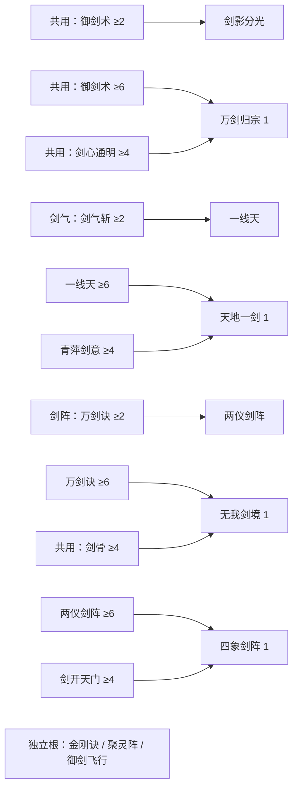

# 剑气 / 剑阵双流派技能树提案

> 依赖规则已由 [46号技能依赖精简](46-skill-dependencies.md) 覆盖。本文的11条旧DAG与被动前置仅作历史设计记录，不再用于开发或验收。

日期：2026-10-28。状态：设计提案，未批准实施。本文只增加设计文档，不改变技能、存档、战斗、UI 或构建。

## 1. 推荐决策与设计边界

推荐收为**剑气、剑阵两条主要投资路线，御剑与通用心法作为一条共用辅助带**。两流决定玩家如何站位、集中伤害与处理群怪；御剑填补攻击空窗、补刀和覆盖遗漏目标。选路线是投资倾向，不是永久职业选择，不增加流派选择存档字段、技能装备槽或第三套货币。

本提案建议替代 37 号文档中“三分支”的未来组织方向，但不修改该文档。保留当前全部 17 个节点、技能 ID、已学等级、四种进化及自动生效原则。**归属调整不等于效果已改变，也不能据此把已有的全局被动改成只对某一流生效。**

比较三种方案：

| 方案 | 优点 | 问题 | 结论 |
| --- | --- | --- | --- |
| 两条互斥职业树 | 定位直观，平衡组合少 | 禁止当前合法混搭，需迁移旧投资，限制玩家试错 | 不采用 |
| 两主流 + 共用辅助带 | 保留现有投资与混搭；共用只购买一次；适合当前36点 | 需要处理御剑实际伤害过强、剑阵触发不协同的问题 | 推荐 |
| 仅把御剑藏入其中一流 | 改动少 | 另一流被迫跨树买辅助，实际仍是三流且产生视觉上的前置税 | 不采用 |

第一步可只做分类、说明与推荐配点。真正让御剑成为“补伤”需要第二步独立平衡审批；当前数值不能宣称已经实现此定位。

## 2. 核对基线：36点究竟包含什么

依据当前 `TowerGrowth.js` 的 `giftSkills`、`pointSources`、`spentPoints`、`skillRequirement`，并对照 `TowerCampaign.js` 的真实购买与读档校验，以及 `TowerRun.js` 的释放和伤害结算。

- 当前上限为金丹9阶，即角色27级、修为10920。自然境界点30 = 26次升级 + 筑基2点 + 金丹2点。
- 通关第3/6/9层首通共3点；对应三次研习各1点，共3点，研习耗妖丹80+160+240=480。自然总计36点。
- 御剑术1级初始赠送，教学第1波赠剑气斩1级、第3波赠万剑诀1级。这三点基础等级不花SP，不能通过洗点兑换SP。
- 36是当前全来源完成后的预算，不是刚到金丹即可支出的预算。未完成首通、研习时必须按实有点数分阶段购买。
- 体验模式额外点数不参与下文的合法36点论证。

| 类别 | 每级SP成本（从1级起） | 当前等级限制 |
| --- | --- | --- |
| 基础主动 | 1,1,1,1,1,1,2,2,2,2 | 炼气最高3，筑基最高6，金丹最高10；教学赠送首级不收费 |
| 特殊主动 | 2,2,2,2,2,2,3,3,3,3 | 同主动等级上限；首次学习另检查境界/通层/经卷/前置 |
| 基础被动 | 1,1,1,1,1,2,2,2 | 炼气最高3，筑基最高5，金丹最高8 |
| 特殊被动 | 1,1,2,2,2,2,3,3 | 同被动等级上限 |
| 御剑飞行 | 2 | 筑基初期可学，最高1级，无经卷、通层及技能前置 |
| 进化 | 3,4,5 | 当前最多2级；第3级要求角色28级，当前不可达 |

所有进化初学经卷240妖丹。进化1级还要求通6层、母技能6、配对被动4，并满足自身学习阶段；进化2级要求角色27级、通9层、母技能8、配对被动5。不能把“进化统一最低角色19级”误读成天地一剑19级可学：后者自身阶段是金丹中期22级。

## 3. 全部17节点逐项归属

这里的“主流归属”是学习导航与战术责任，不改变伤害过滤条件。13个普通技能加4个进化，共17个节点；不是17个普通技能再加进化。

| ID / 名称 | 建议归属 | 当前学习阶段 / 上限 | 当前作用与设计责任 |
| --- | --- | --- | --- |
| `sj_arc` 剑气斩 | 剑气 | 炼气初期 / 10 | 2.5秒一次90°扇区，半径140→190，最多6目标；近距横向清群、补直线漏怪 |
| `sj_line` 一线天 | 剑气 | 筑基初期 / 10 | 4秒直线贯穿，射程360→510，宽28，最多3→6目标；走位拉线、处理远端精英 |
| `sj_mark` 青萍剑意 | 剑气协同 | 筑基中期 / 8 | 有效直伤2%→4%形成2秒剑痕预算；目前所有直伤可受益，不是剑气专属增伤 |
| `evo_tiandi` 天地一剑 | 剑气进化 | 金丹中期 / 当前2 | 替换一线天；6秒周期含0.9秒前摇，换取重击；不与原一线天并行 |
| `sj_wanjian` 万剑诀 | 剑阵 | 炼气初期 / 10 | 贴身环绕，同目标共用0.6秒命中间隔，半径90→120，最多6目标；移动中的近身覆盖 |
| `sj_formation` 两仪剑阵 | 剑阵 | 筑基巅峰 / 10 | 8秒周期，固定落点存续3秒，0.5秒首跳，共6跳，半径110→160，最多8目标；引怪留在阵内 |
| `sj_gate` 剑开天门 | 剑阵协同 | 筑基巅峰 / 8 | 直伤积累1%→2%预算，击杀时最多支出攻击×0.08→0.16，3秒内置冷却、最多4目标平分；当前不是阵伤充能器 |
| `evo_wuwo` 无我剑境 | 剑阵：随身路线 | 金丹中期 / 当前2 | 替换万剑诀；外圈按进化预算，内圈仅母技能50%；同目标同窗口只取较高一次，不叠双圈 |
| `evo_sixiang` 四象剑阵 | 剑阵：落点路线 | 金丹巅峰 / 当前2 | 替换两仪；四阵眼共用6跳账本，覆盖表现不等于4倍伤害 |
| `sj_yujian` 御剑术 | 共用御剑 | 炼气初期 / 10 | 1秒一轮自动寻敌；整轮伤害由1→4剑平分，少目标可集中；定位拟定为补刀/远端覆盖，当前单体贡献实际很高 |
| `sj_shadow` 剑影分光 | 共用御剑 | 筑基初期 / 10 | 4秒一次，锁定落点0.65秒后爆发，半径80→130，最多6目标；补远处群怪，移动目标可能离开落点 |
| `evo_wanjian` 万剑归宗 | 共用御剑进化 | 金丹初期 / 当前2 | 替换御剑；普通轮降至母版90%，8秒剑雨补预算；可选昂贵覆盖升级，不作两条主流的必经门 |
| `sj_heart` 剑心通明 | 共用心法 | 炼气巅峰 / 8 | 暴击率2%→6%，额外原始直伤50%；不暴击持续/触发伤害；仅万剑归宗要求它作配对前置 |
| `sj_bone` 剑骨 | 共用心法，偏随身阵 | 筑基中期 / 8 | 伤害加成1%→3%、移速1%→5%；无我要求其4级，但剑气也可买，购买一次全局适用 |
| `vajra` 金刚诀 | 共用防御 | 炼气中期 / 8 | 常驻减伤2%→6%，与其他常驻减伤相加、总计上限10%；帮助阵内游走，不创造站桩免伤 |
| `magnet` 聚灵阵 | 共用拾取 | 炼气中期 / 8 | 拾取半径+8%→24%；目前资源自动记账，主要改善治疗拾取，不增加修为或妖丹收益 |
| `sj_flight` 御剑飞行 | 共用机动 | 筑基初期 / 1 | 2SP买25%移速，与剑骨加法；不提供无敌、穿墙或攻击加速 |

计数：剑气4，剑阵5，共用8。剑阵内部的随身/落点是两种战术工具，不再命名成第三、第四条必须刷满的职业树。

两个容易误判的名称必须在说明中消歧：**万剑诀是环绕阵，万剑归宗却是御剑术的进化**；不能凭“万剑”二字重新接错母技能。

代码与说明还有一处需后续单独审定：剑骨的文字说“直伤增益”，但当前 `_damageEnemy` 对所有未标记 `scaled` 的伤害应用剑骨，包括阵的跳伤。本文以实际代码解释现状；分类工作不可顺手收窄它，导致旧剑阵构筑静默掉伤害。

## 4. 明确的前置DAG：共用购买一次，不交双份门票

以下是保留当前规则的技能依赖DAG。箭头表示技能条件，不表示角色境界、通层或经卷已满足。汇合到一个进化的两条箭头是 **AND**；所有数值均为已学等级。



图内同技能不同等级是同一条升级链的门槛标注，不是重复节点或重复购买。青萍剑意、剑骨、剑开天门、剑心通明本身没有额外技能前置。

附加初学条件：一线天/剑影分光通1层、经卷各20；两仪通2层、经卷20；青萍/剑骨通1层、经卷各10；天门通2层、经卷10。其余普通技能无经卷费。境界按上一表执行。

设计约束：

1. 剑气解锁不要求御剑2、剑影或万剑归宗；剑阵解锁也不要求它们。御剑共用带没有“本流先投N点才生效”的第二份收费。
2. 不设置“先无我，再四象”，也不设置“先天地，再无我”。两种阵进化并列，买其中一种即可形成完整战术。
3. 剑骨在共用带只显示/保存一个等级；无我读取同一等级，不复制“剑阵剑骨”。共用心法对混搭的两部分仍只计一次SP和一次效果。
4. 无我现有配对被动成本是真实的可选进化成本；把它放共用带不会免费免掉6SP，也不能把它再当成另一流入场门票。
5. 不增加跨流惩罚、隐藏伤害折扣、职业绑定或改流重置费。洗点、单项退点沿现有依赖联动处理，教学赠送等级和已买经卷保留。

当前各进化1级的最小合法投资（教学已完成，不含妖丹）：

| 目标 | 最小路径SP | 合计 |
| --- | --- | --- |
| 天地一剑 | 剑气斩2：1 + 一线天6：12 + 青萍4：6 + 进化1：3 | 22 |
| 四象剑阵 | 万剑诀2：1 + 两仪6：12 + 天门4：6 + 进化1：3 | 22 |
| 无我剑境 | 万剑诀6：5 + 剑骨4：6 + 进化1：3 | 14 |
| 万剑归宗 | 御剑术6：5 + 剑心4：4 + 进化1：3 | 12 |

22/22使剑气与落点阵的入门资本对称，但12点共用进化比两者便宜且很早开放，是潜在第三主流风险；不能因图上移到辅助带就忽略它。

## 5. 三套当前规则下真实合法的36SP配点

共同条件：角色27级、通9层、教学3波完成、研习3次、足够经卷妖丹、在藏经阁且没有进行中塔局。表中“花费”已经扣除教学赠送首级。未列出的非赠送技能及进化均为0；未列出的基础赠送技能保持1级。

### A. 剑气重击 + 共用机动

| 技能 | 目标等级 | 实付SP |
| --- | ---: | ---: |
| 剑气斩 | 4 | 3 |
| 一线天 | 8 | 18 |
| 青萍剑意 | 4 | 6 |
| 天地一剑 | 1 | 3 |
| 御剑飞行 | 1 | 2 |
| 金刚诀 | 3 | 3 |
| 御剑术 | 2 | 1 |
| **合计** | | **36** |

核算：3+18+6+3+2+3+1=36。经卷20+10+240=270妖丹，另研习480，总750；不含其他装备/养成支出。

可行购买顺序：剑气斩先2、一线天先6、青萍4，金丹中期购买天地1；再按实有点数补一线天8、剑气斩4和辅助。境界不足时不预支终局点数。御剑2只是1SP补伤选择，不是剑气门槛。

战术：边移动边把敌群拉成线，在重击前摇前取得安全角度；近身扇区处理侧漏。飞行保留重新拉线能力，金刚降低失误成本。短板是预瞄后目标移动和近距离多向包围；不能把0.9秒前摇当成即时追踪斩。

### B. 落点剑阵 + 随身覆盖

| 技能 | 目标等级 | 实付SP |
| --- | ---: | ---: |
| 万剑诀 | 6 | 5 |
| 两仪剑阵 | 6 | 12 |
| 剑开天门 | 4 | 6 |
| 四象剑阵 | 1 | 3 |
| 剑骨 | 3 | 4 |
| 御剑飞行 | 1 | 2 |
| 金刚诀 | 3 | 3 |
| 御剑术 | 2 | 1 |
| **合计** | | **36** |

核算：5+12+6+3+4+2+3+1=36。经卷20+10+240+10=280妖丹，另研习480，总760。

可行顺序：万剑诀先2，筑基巅峰两仪、天门开放后逐步投至6/4；金丹巅峰四象1。万剑诀6提供阵外间隙覆盖，不强制追加无我。剑骨3加移速2%，叠飞行后是基础移速×1.27，不是×1.02×1.25。

战术：绕落点引怪驻留，随身剑处理追身目标与换阵空窗。四象不自带硬控，当前不能宣称“阵内定身”；高速首领离阵后有效伤害明显下降。天门借万剑诀及共用直伤积累预算，单首领无小怪时近乎不贡献，属于当前配对被动的弱点。

### C. 双进化混搭：天地 + 无我

| 技能 | 目标等级 | 实付SP |
| --- | ---: | ---: |
| 剑气斩 | 2 | 1 |
| 一线天 | 6 | 12 |
| 青萍剑意 | 4 | 6 |
| 天地一剑 | 1 | 3 |
| 万剑诀 | 6 | 5 |
| 剑骨 | 4 | 6 |
| 无我剑境 | 1 | 3 |
| **合计** | | **36** |

核算：1+12+6+3+5+6+3=36。经卷20+10+240+10+240=520妖丹，另研习480，总1000。

结论：**双流混搭合法，甚至可同时持有两个进化**，不需要降低现有门槛。但代价明确：没有飞行、金刚、剑影、两仪；一线天只6级，需要兼顾远端拉线与无我外圈距离，不能同享两套纯流的机动、防御和上限。

想补2SP飞行，可去掉无我1退3SP，再用2SP飞行、1SP金刚1，仍为36；此时是剑气进化配基础环绕，不再是双进化。不要凭空在上表再塞飞行。

### 实际核验记录

2026-10-28，以普通内存存储适配器建立当前schema3合法终局前置，不加体验能力或额外点数，然后用真实 `TowerCampaignStore.act({type:'learnSkill', id}, 0)` 逐级购买以上三套。每次购买均成功，最终分别返回：

```text
A: total=36 spent=36 available=0 realm=30 firstClear=3 research=3; 经卷270
B: total=36 spent=36 available=0 realm=30 firstClear=3 research=3; 经卷280
C: total=36 spent=36 available=0 realm=30 firstClear=3 research=3; 经卷520
三套均通过重新构造Store读档，无错误，前后state深度一致。
```

这是配点与存档合法性验证，不是清关胜率测试，也不是从新号自然打到终局的经济周期测试。未运行构建、未写测试或运行时文件。

## 6. 战术与伤害：当前证据不支持“改名即平衡”

用A表示不含技能被动的角色攻击。下表为理想持续命中时、每目标每秒的伤害系数，忽略前后摇调度损失、空窗、暴击、剑骨、剑痕、天门和过量伤害；用于发现结构问题，不当作实测DPS。进化只计算替换后的技能，不再加母版。

| 当前技能示例 | 理想系数A/秒 | 使用条件 |
| --- | ---: | --- |
| 免费御剑术1 | 1.0000 | 单目标每轮飞剑命中 |
| 构筑A/B的御剑术2 | 1.0500 | 同上；不是每剑都再乘整轮系数 |
| 构筑A的剑气斩4 | 0.4176 | 0.9×1.16÷2.5，目标在扇区 |
| 构筑A的天地一剑1、母技能8 | 0.515625 | 1.25×1.50÷4×1.10，重斩持续命中 |
| 构筑B的万剑诀6 | 0.4300 | 0.2×1.29÷0.6，目标持续在环绕命中范围 |
| 构筑B的四象1、母技能6 | 0.15477 | 0.14×1.34×6÷8×1.10，阵内完整驻留 |
| 母御剑6 + 万剑归宗1 | 1.4190 | 母版1.29×1.10；含普通轮和剑雨的完整单体预算 |

单目标静止假设下，仅A的御剑2已高于其扇区+天地合计0.933225；B的御剑2也高于万剑诀+四象合计0.58477。共用12SP进化还可进一步提高御剑预算。**目前御剑是稳定单体底盘，而非仅补刀；尤其剑阵更依赖它打首领。**

多目标则不能把上述关系直接照搬：御剑普通轮总额平分，而扇区、贯穿、环绕、阵跳对各合法目标分别结算。剑雨又有最多6目标的范围覆盖，会把共用路线推向主清群位置。必须分解每技能的有效伤害与目标数，不能只看整局总伤害。

建议的战术差异：

| 场景 | 剑气责任 | 剑阵责任 | 共用责任 |
| --- | --- | --- | --- |
| 单体首领 | 预瞄、拉线、利用停顿打重击；期望同预算单体略强 | 以驻留/贴外圈换持续伤害，首领离阵应有损失但不致瘫痪 | 稳定填空，不代替主流完成大部分战斗 |
| 扇形/线形群怪 | 快速击穿关键线，扇区清侧面 | 引入阵地后逐批清除 | 补远端漏怪和残血 |
| 多方向包围 | 重新站位创造射线，承受操作压力 | 环绕+落点覆盖更宽，承受近距驻留风险 | 提供机动/防御选择，不自动消除风险 |
| 高速目标 | 预测失败会空斩 | 离阵会少跳 | 御剑提高最低命中保障，仍需玩家移动 |

自动施放原则保留：以上“预瞄/选时”主要通过站位、朝向和目标位置间接实现，不能描述成已有手动大招按钮。

## 7. 后续数值建议：与本次合法配点完全分开

本节均为候选实验，不视作已批准改动。**首轮建议保持现有SP成本与前置**，先测伤害结构，避免同时改成本、伤害与门槛后无法定位收益来源。

1. **共用御剑补伤化。** 不直接削免费御剑1来伤害炼气起步。优先验证两主流成长后的有效伤害回报，再限制共用高阶的单体成长与范围预算，增加其覆盖可靠性而非无限叠伤。涉及万剑归宗时保留已有进化投资价值；任何削弱需提供明确退点补偿方案。不要凭玩家当前“选中标签”动态切伤害。
2. **剑气保留单体/直线优势。** 优先提高正确预瞄的收益，或降低空斩浪费，避免同时加宽到全屏、加目标数和加爆发。青萍仍按有效伤害生成预算，不让持续伤害再次生持续伤害。
3. **剑阵补齐首领驻留回报。** 若固定阵在完整驻留下仍明显落后，试验“低目标数时的有限集中预算”或单跳收益调整，二者先选一个。阵眼、目标计数和每目标上限必须共用账本；不能以四眼各结算一次来补伤害。短驻留仍应弱于完整驻留。
4. **天门协同修复候选。** 目前阵跳不积预算，击杀又限制首领收益。可以试验允许母阵/四象的有效跳伤一次性充入同一个天门账本，沿用寿命、ICD、总额上限及非递归规则；不能让门的触发伤害再充能。若这样仍无首领价值，应接受它是清群配对而非伪装单体被动，再评估是否更换配对；本稿不擅自改前置或承诺数值。
5. **共用心法不强制满级。** 2SP飞行应有明显机动价值，但不应成为所有可通关构筑的生存硬门槛。若所有最优解必带，要检查地图/敌人压力，不立即给两流各复制一份飞行。

如之后需要改SP价格，必须另列新旧价格、旧存档退点规则、重算三套构筑和完整合法性验证；本稿没有以未来低价冒充当前36点方案。

## 8. 九境后续18预留技能的归属

当前九境框架不变：炼气、筑基、金丹已开放；元婴、化神、炼虚、合体、大乘、渡劫各预留2大招+1被动。以下沿用37号的18个名称，不宣称已实现、不发明经验曲线，也不把当前36SP延伸成九境总预算。

归属按战术而不是字面“剑”或“阵”。为让元婴也同时提供两个主流的新工具，建议明确调整**太虚剑域**的旧泛剑系增益方向；这是对37号的设计变更，须后续审批，并与22号的领域持续方式统一。

| 境界 / 阶段 | 预留技能 | 建议归属 | 战术边界 / 与原预留的关系 |
| --- | --- | --- | --- |
| 元婴初期 | 太虚剑域 | 剑气大招 | 拟改为限时定向剑气强化窗口，强调拉线命中；不全局放大御剑与阵跳。原“域内剑系普增”需要明确改稿；主动限时或被动领域的矛盾仍待统一 |
| 元婴中期 | 婴灵守元 | 共用被动 | 重大受击后有限自保、独立冷却；不要求任一主流进化才能买 |
| 元婴巅峰 | 星河剑落 | 剑阵大招 | 保留标记区域、分批落剑，按驻留与批次共享单体预算 |
| 化神初期 | 神霄剑裁 | 剑气大招 | 保留定向蓄势重斩，给精英/首领停顿窗口收益 |
| 化神中期 | 神识锁锋 | 共用被动 | 改善索敌而非全伤；不得用“锁定”绕过直线/扇区碰撞 |
| 化神巅峰 | 千影归锋 | 共用御剑大招 | 保留剑影连击、单体总预算；辅助覆盖选项，不成为解锁下境界的通行证 |
| 炼虚初期 | 裂虚剑门 | 剑气大招 | 把穿门穿刺组织为窄向通道，收益来自让敌人穿过；不升级成全屏常驻阵 |
| 炼虚中期 | 虚步留痕 | 共用被动 | 移动后短命诱导残影，限制数量/频率，对首领控制另限；无需先学付费飞行 |
| 炼虚巅峰 | 断空回廊 | 剑阵大招 | 成对落点形成夹击区域，重复命中账本共享 |
| 合体初期 | 法相执剑 | 剑气大招 | 保留投影重击，继承有限攻击参数，不复制全部技能/被动链 |
| 合体中期 | 人剑相济 | 共用被动 | 有限防护支持施法窗口；并入明确防御预算，不无限叠减伤 |
| 合体巅峰 | 六合镇域 | 剑阵大招 | 区域封锁普通敌人，首领控制衰减；控制时长与伤害分别计账 |
| 大乘初期 | 天河倾剑 | 剑阵大招 | 长前摇、多批范围落剑；以总额封顶，不按剑数量线性增伤 |
| 大乘中期 | 万法归锋 | 共用被动 | 改善招式衔接，独立冷却；不要求同时投资双流，不变成全局减CD |
| 大乘巅峰 | 一剑开天 | 剑气大招 | 长周期窄线终结，保留位置/时机要求，不复制正在生效的阵伤 |
| 渡劫初期 | 九霄劫剑 | 剑气大招 | 阶段雷剑拟沿锁定方向/目标列结算，突出分段预判；这是对原未定形态的细化，固定总额和目标上限 |
| 渡劫中期 | 劫后明心 | 共用被动 | 危险状态有限恢复/防护；与升级回血分别记账，不能反复触发循环续命 |
| 渡劫巅峰 | 紫霄归墟 | 剑阵大招 | 终结领域与雷剑分担同一预算，不同时复制太虚或旧阵的增益 |

合计：剑气6大招、剑阵5大招、共用御剑1大招、共用6被动 = 18。化神本境没有新的剑阵大招是有意的不对称：剑阵可继续升级星河或选千影补覆盖；若实测造成长期成长空窗，再调整开放顺序，不强行把连击改名为阵。

未来前置原则（结构提案，未定价格/等级）：

- 每个新主流大招只依赖本流一个已开放核心资格，加本境界/地图/经卷条件；不串成“上一境两大招都学才可进下一境”的收费长链。
- 剑气核心资格可由天地或后续剑气核心满足；剑阵资格为无我 **OR** 四象或后续剑阵核心，不要求两者都学。后续等级阈值需随九境预算另定，不能现在把当前进化3级当可达条件。
- 六个共用被动只受各自境界/资源条件约束，不需要累计两流点数；千影归锋可承接剑影，不能反过来变成两主流的新前置。
- 学会即自动生效的旧原则不变，但后续大招需要共享施法调度与目标触发条件，防止所有大招同时覆盖屏幕。调度实现另审，不能暗中引入装备槽来限制旧技能。

## 9. 风险与验收标准

### 必须守住的规则

| 风险 | 验收要求 |
| --- | --- |
| 分类破坏旧存档 | 所有旧ID、等级、经卷、进化映射保留；无飞行字段的旧快照可恢复；分类不触发洗点或新伤害事件 |
| 双流重复收费 | 同一共用技能跨两流只购一次；无全局流派门票；无我/四象并列不相互前置 |
| 数学合法但真实不能买 | 普通Store逐级购买A/B/C均成功，spent=36、available=0；重载一致；不借体验点数、兼容绕过或直接注入终态等级 |
| 洗点破坏依赖 | 从各构筑退母技能/配对被动，进化按现有规则联动下降；共享技能只退一次；赠送首级与已购经卷保留 |
| 进化伤害乘份数 | 母版和进化不得并行；剑雨/内外圈/阵眼同目标账本无重复；暂停和恢复不补发已结算伤害 |
| 共用成为第三必选主流 | 单独评测“御剑共用带重投”36点对照，不能只比较两套推荐配点；若它稳定胜过两主流，补伤定位未验收 |
| 天门/剑痕递归 | 改充能规则须验证只从允许的有效原始伤害充能；触发伤害不再次充能、不暴击、不复制旧预算 |
| 合法混搭被暗削 | C构筑不受标签折扣；差异只能来自明示等级、效果和操作成本 |

### 后续平衡实验指标（目标，不是已测结果）

固定角色27级、同武器/装备、同36自然SP、关闭体验辅助；A/B/C加共用重投对照，各场景至少30个相同种子配对，控制操作者或移动脚本。记录成功率、有效伤害来源、首领击杀时间、清波时间、受伤量、阵内驻留率、贯穿命中数、空斩率、治疗拾取与升级回血次数。升级回血会改变生存结论，不能只比较剩余HP。

1. **首领可用性：** 静止与移动首领分开测。期望剑气单体领先约10%–20%；剑阵中位击杀耗时不超过剑气的1.25倍。无小怪场景单列，不能拿天门清怪收益补首领报表。
2. **清群分工：** 高密度、多方向追身场景，期望剑阵清波时间比剑气短10%–20%；线形群则允许剑气领先。两类地图交叉验证，不因一种木桩环境定胜负。
3. **御剑补伤定位：** 完整主流构筑的有效伤害中，共用御剑三节点合计可先以20%–40%作为测试目标，主要主流贡献超过50%。早期教学与离阵/空斩的极端窗口单列，不拿它们证明终局辅助定位。
4. **混搭有取舍：** C可正常通关测试样本，跨场景中位清理时间不比最佳纯流差超过20%，但不在全部场景同时领先纯流超过10%。若混搭只差在不带飞行且几乎无法存活，应先查生存硬税。
5. **预算边际合理：** 额外投1–3点应在对应战术出现可观察收益；对比22点进化核心与12点共用进化，检查每SP有效收益及成型时点。不给“进化”名称本身计价值。
6. **性能与可读性：** 限制活动区域、投射物和单帧结算峰值；在已有目标设备基线下比较P95帧耗时，目标不恶化超过10%。18个预留技能未实现前不宣称通过该项。

如果上述指标无法同时满足，优先澄清流派各自承担的伤害/覆盖责任，再做单变量实验。不要用额外免费SP、取消经卷门槛或一刀切禁混搭掩盖结构问题。

## 10. 本轮交付边界

本轮只交付本文。已经核对现行17节点、真实成本、前置、战斗结算和18个后续预留，并完成三套36SP逐级购买及重载验证。没有修改运行时、UI、技能元数据源、生成文件或测试，没有同步或构建。

建议主线程采用“双主流 + 共用带、混搭开放、当前价格和DAG先保留”的设计方向。御剑补伤化、天门与阵伤协同、后续领域重定向属于需要另行确认的平衡工作，不属于此次文档即刻生效的变更。
